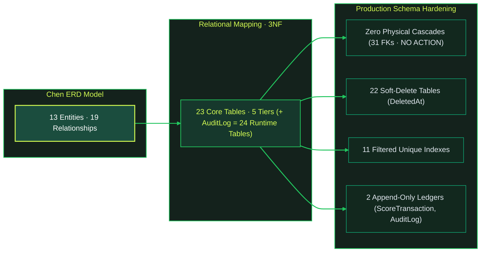

<div align="center">
  <br />
  
  <br />

  # TeamUp — Student Collaboration &amp; Gamification Platform
  **Clean Architecture .NET 10 Web API &amp; React 19 SPA · Cross-Faculty Team Formation, Student Organizations &amp; Gamification Engine**

  <br />

  [](https://dotnet.microsoft.com/)
  [](https://learn.microsoft.com/en-us/dotnet/csharp/)
  [](https://asp.net/)
  [](https://learn.microsoft.com/en-us/ef/core/)
  [](https://react.dev/)
  [](https://www.microsoft.com/en-us/sql-server/)
  [](https://jwt.io/)
  [](https://www.docker.com/)
  [](https://github.com/AhmedTyson/TeamUp)
  
  

</div>

<br />

---

<br />

> ### *"LET'S FIND YOUR NEXT TEAM"*
> **Build your skills, find your team, join student activities, and grow together from your first year at university.**

Welcome to the **TeamUp** repository! **TeamUp** is an enterprise-grade academic collaboration and gamification platform engineered with **.NET 10 / C# 14** and a decoupled **React 19 / TypeScript / Tailwind CSS v4** SPA. It bridges higher-education academic programs and real-world project execution by connecting students across universities and faculties into cross-functional teams, facilitating student organization recruitment, scheduling campus workshops, verifying attendance via rotating 60-second HMAC-SHA256 QR/PIN check-ins, and rewarding active student engagement through an immutable scoring ledger, progressive levels, and verifiable achievement badges.

---

##  Repository Structure

```text
TeamUp/
├── .github/
│   └── workflows/                     # GitHub Actions CI (backend, frontend, Playwright E2E) & MonsterASP.NET CD
├── backend/                           # ⚙️ .NET 10 Clean Architecture Backend & Pure JSON REST API (Zero MVC Views)
│   ├── TeamUp.sln                     # Visual Studio / Rider .NET 10 solution file
│   ├── Directory.Build.props          # Shared .NET build settings (Nullable, TreatWarningsAsErrors)
│   ├── src/
│   │   ├── TeamUp.Domain/             # Enterprise Entities, Invariants, Enums, Base Contracts (0 dependencies)
│   │   ├── TeamUp.Application/        # Application Services, DTOs, FluentValidators, Domain Event Handlers
│   │   ├── TeamUp.Infrastructure/     # EF Core 10 AppDbContext, 9 Migrations, Interceptors, Seeders, QuestPDF
│   │   │   └── Templates/             # Embedded HTML templates (Emails/ & Reports/) and Brand Assets (no MVC views)
│   │   └── TeamUp.Api/                # ASP.NET Core 10 Pure REST API (/api/v1/* + /health), Thin Controllers, OpenAPI
│   └── tests/
│       ├── TeamUp.UnitTests/          # 117 Unit tests (Gamification math, FluentValidators, Interceptors, Security)
│       └── TeamUp.IntegrationTests/   # 75 End-to-end integration tests (WebApplicationFactory, Auth, OpenAPI export)
├── frontend/                          # 🎨 React 19 + Vite 8 + TypeScript + Tailwind CSS v4 SPA (create-vrtw stack)
│   ├── src/
│   │   ├── api/                       # Typed Axios HTTP client, JWT interceptors & /api/v1/* endpoint modules
│   │   ├── app/                       # React Router v7 modular route fragments & TanStack Query providers
│   │   ├── components/                # Shared layout shell, hero components & reusable UI kit
│   │   ├── features/                  # Vertical feature slices (auth, admin, projects, skills, gamification, profile, notifications)
│   │   ├── hooks/                     # Custom React hooks (useApiHealth, useInViewOnce)
│   │   ├── lib/                       # Env config, JWT decoding, Zod CSP helpers & token storage
│   │   ├── pages/                     # Top-level routed pages (Home, Projects, Activities, Events, Privacy Policy)
│   │   └── test/                      # 71 Vitest + Testing Library unit/component tests
│   ├── e2e/                           # Playwright Chromium E2E smoke suite (m1-auth.smoke.spec.ts)
│   ├── vite.config.ts                 # Vite + Tailwind v4 + /api, /health, /openapi & portrait dev proxy to :5186
│   └── package.json                   # Frontend dependencies & scripts
├── docs/
│   ├── api/                           # OpenAPI v3 spec (openapi.json), Postman collection/env, API reports
│   ├── architecture/                  # Clean Architecture, N-Tier SOLID design specs & query reviews
│   ├── database/                      # Idempotent SQL Server schema script (teamup-sqlserver-idempotent.sql)
│   ├── prototypes/                    # Archived static HTML landing prototype (landing-static.html)
│   ├── research/                      # Adaptable AI engine research pillars (future roadmap)
│   ├── security/                      # Remediated Microsoft STRIDE Threat Model (16 findings addressed)
│   └── DEPLOYMENT_FREE.md             # Zero-credit-card deployment guide (MonsterASP.NET + Pages/Netlify/Vercel)
├── assets/                            # 🖼️ Vector brand assets & official logo marks (SVG/PNG)
├── wiki/                              # 📚 Comprehensive project documentation home (guides, references & audits)
├── ERD/                               # Peter Chen ERD (13 entities, 19 relationships), SVG/PNG/Draw.io diagrams
├── Mapping/                           # Core relational schema mapping (23 core tables across 5 tiers), 3NF checks
├── tasks/                             # 20-Phase backend & frontend implementation roadmap and checklists
├── scripts/                           # PowerShell API verification (test_live_api.ps1) & publish-monsterasp.ps1
├── CONTRIBUTING.md                    # Team ownership split, branching rules & DB/EF Core engineering standards
├── netlify.toml                       # Netlify SPA build, redirects & Content-Security-Policy configuration
└── dotnet-tools.json                  # Local dotnet-ef 10.0.14 tool manifest (usable from repo root or backend/)
```

---

##  Key Features & Platform Highlights

| Domain / Layer | Technology | Key Capabilities & Highlights |
|---|---|---|
| **Frontend Web App** | React 19, Vite 8, TypeScript, Tailwind CSS v4 | Decoupled SPA (`frontend/`) with React Router v7, TanStack Query v5, Axios JWT refresh interceptors, Zod v4 + React Hook Form validation, Privacy & Policy opt-in controls, Vitest (71 tests), and Playwright E2E smoke tests. |
| **Identity & Governance** | .NET 10, PBKDF2, JWT Bearer, STRIDE | Student registration with faculty affiliation, HMAC-SHA256 JWT with `SecurityStamp` validation, SHA-256 hashed refresh token rotation (10s reuse grace & replay revocation), escalating login lockout, 15-min password resets (redacted from HTTP payloads), privacy-filtered directory, immutable `AuditLog`, and QuestPDF governance reports. |
| **Academic Catalog** | In-Memory Caching (`IMemoryCache`) | Multi-tenant university & faculty hierarchy, 1-hour cached anonymous lookup (`/api/v1/universities/catalog`) for sub-5ms registration UX, administrative CRUD with automatic cache invalidation. |
| **Projects & Sprint Tasks** | Clean DDD, ISP Services | Cross-functional project creation (`+100 pts / delivered project`, `+50 pts / completed task`), required skills matrix, vacancy recruitment, applicant vetting workflow, skill-based recommendations, and Kanban task boards (`Todo` ➔ `InProgress` ➔ `InReview` ➔ `Done`). |
| **Organizations & Events** | Relational Schemas, Concurrency Tokens | Campus student clubs directory (IEEE, GDG, Enactus), scoped `OrgAdmin` board governance, multi-session event timetables, seat capacity limits with optimistic `RowVersion` & automatic waitlist promotion, rotating 60s HMAC-SHA256 QR/PIN self check-ins (`+25 pts / session`), and printable HTML attendance reports. |
| **Gamification Engine** | Domain Events, Append-Only Ledger | Idempotent `ScoreLedger` backed by immutable `ScoreTransaction` (`IAppendOnly`), deterministic level progression formula $\lfloor 1 + \sqrt{\text{pts}/100} \rfloor$, campus leaderboard, automated badge evaluator (*First Steps*, *Rising Star*, *Champion*, *Workshop Marathoner*, *Task Master*), notifications inbox, and opt-in email digests. |
| **Database Integrity** | SQL Server 2022, EF Core 10 (SQLite Dev Fallback) | **24 runtime tables** (23 core domain tables + `AuditLog`), **31 foreign keys** with **100% Zero Cascades** (`ON DELETE NO ACTION`), 22 soft-delete tables (`DeletedAt`) + 2 `IAppendOnly` ledgers, **11 filtered unique indexes**, and **20 CHECK constraints**. |

---

##  Quick Start Guide

### 1. Database Provisioning (Docker SQL Server 2022 or Local SQLite Fallback)

Launch Microsoft SQL Server 2022 mapped to port `14333`:

```bash
docker run -e "ACCEPT_EULA=Y" -e "MSSQL_SA_PASSWORD=YourStrong@Passw0rd!" \
   -p 14333:1433 --name teamup-sql --hostname teamup-sql \
   -d mcr.microsoft.com/mssql/server:2022-latest
```

> **Offline Development Option:** In `Development`, [`appsettings.Development.json`](backend/src/TeamUp.Api/appsettings.Development.json) enables `UseSqliteFallbackIfOffline: true`. If SQL Server is not reachable on startup, the API automatically falls back to a local SQLite database (`TeamUp.dev.db`) and initializes the schema & seed data.

### 2. Restore Local Tools & Configure User Secrets

From the repository root, restore the local `dotnet-ef` tool and set local secrets using the .NET Secret Manager:

```bash
dotnet tool restore
cd backend/src/TeamUp.Api

# Set SQL Server connection string
dotnet user-secrets set "ConnectionStrings:TeamUpDb" "Server=localhost,14333;Database=TeamUpDB;User Id=sa;Password=YourStrong@Passw0rd!;TrustServerCertificate=True;MultipleActiveResultSets=True;"

# Set JWT secret key & parameters (min 32 UTF-8 bytes)
dotnet user-secrets set "Jwt:Key" "SuperSecretDevelopmentKeyForTeamUpAppAtLeast32BytesLong2026!"
dotnet user-secrets set "Jwt:Issuer" "TeamUp"
dotnet user-secrets set "Jwt:Audience" "TeamUp.Clients"

# Enable development seeder with admin password (min 12 characters)
dotnet user-secrets set "Seed:Enabled" "true"
dotnet user-secrets set "Seed:AdminPassword" "<choose-a-unique-12+-char-password>"
```

### 3. Run Migrations & Start the Web API

```bash
# From backend/src/TeamUp.Api — apply EF Core migrations (when using SQL Server)
dotnet ef database update --project ../TeamUp.Infrastructure --startup-project .

# Launch API host
dotnet run
```

- **Base HTTP URL:** `http://localhost:5186`
- **Base HTTPS URL:** `https://localhost:7173`
- **Health Check Endpoint:** `GET http://localhost:5186/health` (Returns `{"status": "Healthy", "database": "Connected"}`)
- **OpenAPI Document (Development):** `http://localhost:5186/openapi/v1.json`

### 4. Start the React Frontend (Vite + Tailwind CSS v4)

```bash
cd frontend
npm install
npm run dev
```

- **Frontend Dev Server:** `http://localhost:5173` (automatically proxies `/api`, `/health`, `/openapi`, and `/images/people/student-*` to `http://localhost:5186`)

### 5. Seeded Accounts

When `Seed:Enabled = true`, [`DbSeeder.cs`](backend/src/TeamUp.Infrastructure/Seed/DbSeeder.cs) provisions reference data (12 Egyptian universities, 25 faculties, 30 skills, 5 badges) and a bootstrap `PlatformAdmin` (`admin@teamup.local`).
The password is whatever you set in `Seed:AdminPassword`; no production password is published in this repository (in `Development` only, if `Seed:AdminPassword` is omitted, `Program.cs` falls back to a local dev-only seed password).

- **Development:** the seeder also creates a demo `OrgAdmin` (`nour@cu.edu.eg`) and 6 showcase student profiles (`salma@cu.edu.eg`, `omar@capu.edu.eg`, `youssef@asu.edu.eg`, `hana@alexu.edu.eg`, `karim@guc.edu.eg`, `mariam@mans.edu.eg`) sharing your `Seed:AdminPassword`.
- **Any other environment:** keep `Seed:Enabled=false` after the first bootstrap. If enabled, the app refuses to start when the admin password is shorter than 12 characters or matches a previously documented sample value. Existing account passwords are never overwritten, the demo `OrgAdmin` is not created, and showcase profiles get an unusable random password.

---

##  Testing & Verification

Execute the complete automated test suite (**117 Unit + 75 Integration + 71 Frontend = 263 Automated Tests** + Playwright E2E smoke suite):

```bash
# Run all backend automated tests (117 Unit + 75 Integration)
dotnet test backend/TeamUp.sln

# Run unit tests only
dotnet test backend/tests/TeamUp.UnitTests

# Run integration tests only (in-memory SQLite WebApplicationFactory)
dotnet test backend/tests/TeamUp.IntegrationTests

# Run frontend tests & production build check (71 Vitest tests)
cd frontend && npm run test && npm run build

# Run Playwright E2E smoke suite
cd frontend && npm run test:e2e

# Run PowerShell live API runner against running host
pwsh scripts/test_live_api.ps1
```

```text
Passed!  - Failed:     0, Passed:   117, Skipped:     0, Total:   117 (TeamUp.UnitTests.dll)
Passed!  - Failed:     0, Passed:    75, Skipped:     0, Total:    75 (TeamUp.IntegrationTests.dll)
Test Files  9 passed (9) | Tests  71 passed (71) (Vitest frontend suite)
Total: 263 / 263 Passing Automated Tests (100% Pass Rate)
```

---

##  Documentation Home

All technical documentation, architectural decision records, and operational guides live in **[`wiki/`](wiki/Home.md)** and **`docs/`**:

| Section | Guides & Specifications |
|---|---|
| **Start Here** | [System Overview](wiki/System%20Overview.md) · [Getting Started Guide](wiki/Getting%20Started%20Guide.md) · [Development Guidelines](wiki/Development%20Guidelines.md) · [Contributing Guidelines](CONTRIBUTING.md) |
| **Architecture** | [Architecture Overview](wiki/Architecture.md) · [Technology Stack & Architecture](wiki/Technology%20Stack%20%26%20Architecture.md) · [Backend Services](wiki/Backend%20Services.md) · [Database Design & Mapping](wiki/Database%20Design%20%26%20Relational%20Mapping.md) |
| **Operations** | [Infrastructure](wiki/Infrastructure.md) · [Deployment Guide](wiki/DEPLOYMENT.md) · [Free Demo Deployment](docs/DEPLOYMENT_FREE.md) · [Environment Configuration](wiki/ENVIRONMENT.md) · [Release Sign-off](wiki/RELEASE_SIGN_OFF.md) |
| **API Reference** | [API Reference](wiki/API%20Reference.md) · [API Endpoints Reference](wiki/API%20Endpoints%20Reference.md) · [Routes Appendix (116 Routes)](wiki/ROUTES-APPENDIX.md) · [OpenAPI v3 JSON](docs/api/openapi.json) |
| **Security, Audits & AI** | [STRIDE Threat Model](docs/security/STRIDE-THREAT-MODEL.md) · [Clean Code & Architecture Audit](wiki/Clean%20Code%20%26%20Architecture%20Audit.md) · [Adaptable AI Engine Research](wiki/Adaptable%20AI%20Engine%20Research.md) |

➡️ **Full navigation index:** [`wiki/Home.md`](wiki/Home.md)

---

##  Database Design & Relational Mapping

| Visual Deliverable | Specification | Path |
|---|---|---|
| **Peter Chen ERD** | 13 Conceptual Entities, 19 Relationships, Weak Entities, Identifying Relationships | [ERD/TeamUp-Chen-ERD.png](ERD/TeamUp-Chen-ERD.png) · [ERD/description.md](ERD/description.md) |
| **Relational Schema** | 23 Core Tables across 5 Tiers (+ `AuditLog` = 24 Runtime Tables), 31 FKs, 11 Filtered UQ Indexes | [Mapping/TeamUp-Relational-Mapping.png](Mapping/TeamUp-Relational-Mapping.png) · [Mapping/description.md](Mapping/description.md) |



---

##  Engineering Team

- **Ahmed Elsayed (@AhmedTyson)** — *Tech Lead & M1 Lead (Auth, Core Identity, Catalog, Platform Governance)* · [github.com/AhmedTyson](https://github.com/AhmedTyson)
- **Ossama** — *Module 2 Lead (Skills Master Catalog, Projects, Member Roles, Sprint Tasks)*
- **Ibrahim (@hemataher2026-dotcom)** — *Module 3 Lead (Student Organizations, Activities, Multi-Session Events, Attendance)*
- **Youssef (@yousef2792006-cpu)** — *Module 4 Lead (Gamification Ledger, Badges Engine, Notifications, OpenAPI)*

---

##  License

Licensed under the [MIT License](LICENSE) — TeamUp Academic Collaboration Platform Deliverable.
