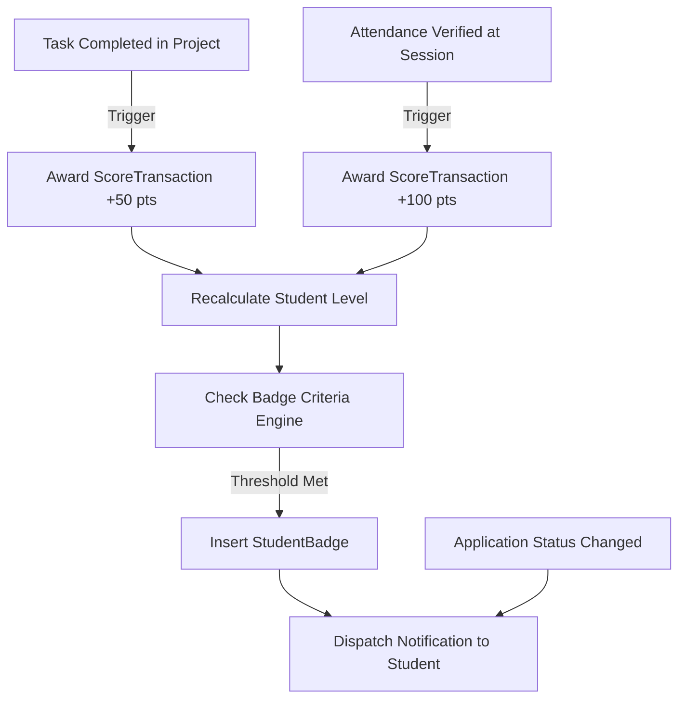

# TeamUp — RESTful API Proposal (v1)

## 1. Architectural Standards & Conventions

- **Base Route:** `/api/v1`
- **Resource Nouns:** Plural lowercase kebab-case (e.g., `/api/v1/projects`, `/api/v1/score-transactions`).
- **HTTP Methods:**
  - `GET`: Safe & idempotent retrieval.
  - `POST`: Create resource (`201 Created` with `Location` header) or trigger business action.
  - `PUT`: Full replacement of resource or idempotent state assignment.
  - `PATCH`: Partial update (e.g., status transition).
  - `DELETE`: **Soft delete** (`204 No Content`). Marks `IsDeleted = 1`, `DeletedAt = UtcNow`.
- **Error Format:** RFC 7807 Problem Details (`application/problem+json`).
- **Authentication:** `Authorization: Bearer <JWT>` containing `sub` (StudentID) and `role` (`Student`, `OrgAdmin`, `PlatformAdmin`).
- **Pagination:** Query parameters `?page=1&pageSize=20`. Response wrapped in `PagedResult<T>`:
  ```json
  {
    "items": [ ... ],
    "page": 1,
    "pageSize": 20,
    "totalCount": 142,
    "totalPages": 8
  }
  ```

---

## 2. API Endpoint Catalogue (Organized by Team Ownership)

### Member 1: Identity, Universities & Profiles

| Method | Endpoint | Description | Role / Auth |
|---|---|---|---|
| `POST` | `/api/v1/auth/register` | Register new student account | Public |
| `POST` | `/api/v1/auth/login` | Authenticate with email & password, returns JWT | Public |
| `POST` | `/api/v1/auth/refresh` | Rotate expired access token using refresh token | Public |
| `POST` | `/api/v1/auth/logout` | Invalidate active refresh token | Authenticated |
| `GET` | `/api/v1/universities` | List all universities (paged) | Authenticated |
| `POST` | `/api/v1/universities` | Create an accredited university | `PlatformAdmin` |
| `GET` | `/api/v1/universities/{id}` | Get university details + faculties | Authenticated |
| `PUT` | `/api/v1/universities/{id}` | Update university information | `PlatformAdmin` |
| `DELETE` | `/api/v1/universities/{id}` | Soft-delete a university | `PlatformAdmin` |
| `GET` | `/api/v1/universities/{id}/faculties` | List faculties in a university | Authenticated |
| `POST` | `/api/v1/universities/{id}/faculties` | Add faculty to a university | `PlatformAdmin` |
| `PUT` | `/api/v1/faculties/{id}` | Update faculty details | `PlatformAdmin` |
| `DELETE` | `/api/v1/faculties/{id}` | Soft-delete a faculty | `PlatformAdmin` |
| `GET` | `/api/v1/students` | Search / filter students by skill/faculty | Authenticated |
| `GET` | `/api/v1/students/{id}` | Public student profile & badges | Authenticated |
| `GET` | `/api/v1/students/me` | Current authenticated student full profile | Authenticated |
| `PATCH` | `/api/v1/students/me` | Update academic year / account info | Self |
| `DELETE` | `/api/v1/students/me` | Soft-delete student account | Self / `PlatformAdmin` |
| `GET` | `/api/v1/students/{id}/profile` | Get student extended portfolio/bio | Authenticated |
| `PUT` | `/api/v1/students/me/profile` | Upsert bio, photo, GitHub, LinkedIn | Self |
| `GET` | `/api/v1/students/{id}/interests` | Get student interests list | Authenticated |
| `POST` | `/api/v1/students/me/interests` | Add an interest tag | Self |
| `DELETE` | `/api/v1/students/me/interests/{tag}` | Remove an interest tag | Self |

---

### Member 2: Skills, Projects, Teams & Tasks

| Method | Endpoint | Description | Role / Auth |
|---|---|---|---|
| `GET` | `/api/v1/skills` | List standard skills catalog | Authenticated |
| `POST` | `/api/v1/skills` | Add new skill to master catalog | `PlatformAdmin` |
| `PUT` | `/api/v1/skills/{id}` | Update skill metadata | `PlatformAdmin` |
| `DELETE` | `/api/v1/skills/{id}` | Soft-delete skill | `PlatformAdmin` |
| `GET` | `/api/v1/students/{id}/skills` | Get skills endorsed/claimed by student | Authenticated |
| `PUT` | `/api/v1/students/me/skills/{skillId}` | Add/update skill proficiency & experience | Self |
| `DELETE` | `/api/v1/students/me/skills/{skillId}` | Remove skill from student profile | Self |
| `GET` | `/api/v1/projects` | Search projects (by skill, status, keyword) | Authenticated |
| `POST` | `/api/v1/projects` | Create a new project (creator becomes lead) | Student |
| `GET` | `/api/v1/projects/{id}` | Project details + team + required skills | Authenticated |
| `PATCH` | `/api/v1/projects/{id}` | Update title, status, description | Project Creator |
| `DELETE` | `/api/v1/projects/{id}` | Soft-delete project & cascade to tasks | Project Creator |
| `GET` | `/api/v1/projects/{id}/required-skills` | Get required skills for project | Authenticated |
| `PUT` | `/api/v1/projects/{id}/required-skills/{skillId}` | Add/update required skill on project | Project Creator |
| `DELETE` | `/api/v1/projects/{id}/required-skills/{skillId}` | Remove required skill from project | Project Creator |
| `GET` | `/api/v1/projects/{id}/members` | List confirmed project members & roles | Authenticated |
| `PATCH` | `/api/v1/projects/{id}/members/{studentId}` | Update member role | Project Creator |
| `DELETE` | `/api/v1/projects/{id}/members/{studentId}` | Remove member from project (unassigns tasks) | Project Creator / Self |
| `GET` | `/api/v1/projects/{id}/applications` | List applications to join project | Project Creator |
| `POST` | `/api/v1/projects/{id}/applications` | Submit application to join project | Student |
| `PATCH` | `/api/v1/projects/{id}/applications/{appId}` | Accept or Reject application | Project Creator |
| `DELETE` | `/api/v1/projects/{id}/applications/{appId}` | Withdraw pending application | Applicant |
| `GET` | `/api/v1/projects/{id}/tasks` | List tasks in project board | Project Members |
| `POST` | `/api/v1/projects/{id}/tasks` | Create task in project | Project Members |
| `GET` | `/api/v1/tasks/{id}` | Get task details | Project Members |
| `PATCH` | `/api/v1/tasks/{id}` | Update task status, priority, due date | Project Members |
| `PUT` | `/api/v1/tasks/{id}/assignee` | Assign task to a project member | Project Creator / Lead |
| `DELETE` | `/api/v1/tasks/{id}/assignee` | Unassign student from task | Project Creator / Lead |
| `DELETE` | `/api/v1/tasks/{id}` | Soft-delete task | Project Creator / Lead |

---

### Member 3: Student Activities, Events, Sessions & Attendance

| Method | Endpoint | Description | Role / Auth |
|---|---|---|---|
| `GET` | `/api/v1/organizations` | List student organizations/clubs | Authenticated |
| `POST` | `/api/v1/organizations` | Register new student organization | `PlatformAdmin` / Verified |
| `GET` | `/api/v1/organizations/{id}` | Organization profile & events | Authenticated |
| `PATCH` | `/api/v1/organizations/{id}` | Update description, logo, category | Org Admin |
| `DELETE` | `/api/v1/organizations/{id}` | Soft-delete organization | `PlatformAdmin` |
| `GET` | `/api/v1/organizations/{id}/members` | List organization board & members | Authenticated |
| `PATCH` | `/api/v1/organizations/{id}/members/{studentId}` | Update member role (e.g., Head of PR) | Org Admin |
| `DELETE` | `/api/v1/organizations/{id}/members/{studentId}` | Remove member from organization | Org Admin / Self |
| `GET` | `/api/v1/organizations/{id}/applications` | List recruitment applications | Org Admin |
| `POST` | `/api/v1/organizations/{id}/applications` | Submit application to join club | Student |
| `PATCH` | `/api/v1/organizations/{id}/applications/{appId}` | Accept or Reject application | Org Admin |
| `DELETE` | `/api/v1/organizations/{id}/applications/{appId}` | Withdraw application | Applicant |
| `GET` | `/api/v1/events` | Browse upcoming workshops & hackathons | Authenticated |
| `POST` | `/api/v1/events` | Create new event for an organization | Org Admin |
| `GET` | `/api/v1/events/{id}` | Event details, agenda & registration status | Authenticated |
| `PATCH` | `/api/v1/events/{id}` | Update event venue, dates, capacity | Org Admin |
| `DELETE` | `/api/v1/events/{id}` | Soft-delete event & cascade to sessions | Org Admin |
| `GET` | `/api/v1/events/{id}/sessions` | Get timetable / sessions of event | Authenticated |
| `POST` | `/api/v1/events/{id}/sessions` | Add session track/block to event | Org Admin |
| `PUT` | `/api/v1/sessions/{id}` | Update session time & room | Org Admin |
| `DELETE` | `/api/v1/sessions/{id}` | Soft-delete session | Org Admin |
| `GET` | `/api/v1/events/{id}/registrations` | View attendee list & capacity count | Org Admin |
| `POST` | `/api/v1/events/{id}/registrations` | Register student for event (checks capacity) | Student |
| `DELETE` | `/api/v1/events/{id}/registrations` | Cancel event registration | Student |
| `GET` | `/api/v1/sessions/{id}/attendance` | View verified check-in list for session | Org Admin |
| `POST` | `/api/v1/sessions/{id}/attendance` | Verify attendance (QRCode / RFID / Manual) | Org Admin |
| `DELETE` | `/api/v1/sessions/{id}/attendance/{studentId}` | Revoke attendance check-in | Org Admin |

---

### Member 4: Gamification, Badges & Notifications

| Method | Endpoint | Description | Role / Auth |
|---|---|---|---|
| `GET` | `/api/v1/students/{id}/score` | Get total points, current level, breakdown | Authenticated |
| `GET` | `/api/v1/students/{id}/score-transactions` | View student audit ledger of points | Self / Admin |
| `POST` | `/api/v1/score-transactions` | Manual adjustment / bonus award | `PlatformAdmin` |
| `GET` | `/api/v1/badges` | View all available badges & criteria | Authenticated |
| `POST` | `/api/v1/badges` | Create new badge definition | `PlatformAdmin` |
| `PUT` | `/api/v1/badges/{id}` | Update badge criteria & icon | `PlatformAdmin` |
| `DELETE` | `/api/v1/badges/{id}` | Soft-delete badge | `PlatformAdmin` |
| `GET` | `/api/v1/students/{id}/badges` | View badges earned by a student | Authenticated |
| `POST` | `/api/v1/students/{id}/badges/{badgeId}` | Manually award badge | `PlatformAdmin` |
| `GET` | `/api/v1/notifications` | Current student in-app notifications | Authenticated |
| `PATCH` | `/api/v1/notifications/{id}` | Mark single notification as read | Authenticated |
| `PATCH` | `/api/v1/notifications/mark-all-read` | Mark all unread notifications as read | Authenticated |
| `DELETE` | `/api/v1/notifications/{id}` | Soft-delete notification from inbox | Authenticated |

---

## 3. Business Rule Automation Hooks


