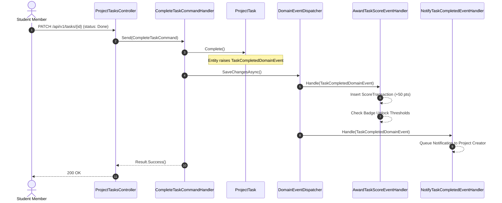

# TeamUp — N-Tier SOLID Architecture & Design Patterns Specification

## 1. Architectural Philosophy & Objectives

The goal of this architectural blueprint is to structure **TeamUp** as a **Clean, Modular N-Tier Monolith** that is:
- **Highly Maintainable:** Sliced cleanly across 4 team members with zero conflicting responsibilities.
- **Strictly SOLID:** Thin controllers adhering strictly to the Single Responsibility Principle (SRP), fine-grained interfaces, and decoupled domain logic.
- **Pattern-Driven:** Leveraging **CQRS**, **Domain Events (Pub-Sub)**, **Specification Pattern**, and **Result Pattern** to directly serve TeamUp's student collaboration, team-formation, and gamification mechanics.

---

## 2. N-Tier System Blueprint

```
┌──────────────────────────────────────────────────────────────────────────────────┐
│                             PRESENTATION TIER                                    │
│  TeamUp.Api                                                                      │
│  - Ultra-thin, Single-Responsibility Controllers (Resource-focused)              │
│  - Action Filters (ValidationFilter, PerformanceFilter)                          │
│  - Global Exception Handler (RFC 7807 ProblemDetails)                            │
│  - OpenAPI / Swagger with JWT Bearer Authentication                              │
└────────────────────────────────────────┬─────────────────────────────────────────┘
                                         │ depends on
                                         ▼
┌──────────────────────────────────────────────────────────────────────────────────┐
│                             APPLICATION TIER                                     │
│  TeamUp.Application                                                              │
│  - CQRS Use Cases: Commands (Writes) & Queries (Reads)                           │
│  - Vertical Feature Slices (Auth, Students, Projects, Events, Gamification)      │
│  - Input Validators (FluentValidation)                                           │
│  - Domain Event Handlers (Cross-module reactive triggers)                        │
│  - Functional Result Envelopes (Result<T>, ErrorDetail)                          │
│  - Common Contracts (IJwtTokenService, ICurrentUser, IDateTimeProvider)           │
└──────────────────┬───────────────────────────────────────────────┬───────────────┘
                   │ depends on                                    │ depends on
                   ▼                                               ▼
┌──────────────────────────────────────────────┐  ┌────────────────────────────────┐
│                 DOMAIN TIER                  │  │     DATA ACCESS & INFRA TIER   │
│  TeamUp.Domain                               │  │  TeamUp.Infrastructure         │
│  - Rich Aggregate Roots & Entities           │  │  - EF Core AppDbContext        │
│  - Invariant Guards & Domain Encapsulation   │  │  - Modular Fluent Configs      │
│  - Domain Events (IDomainEvent)              │  │  - SoftDeleteInterceptor       │
│  - Core Interfaces (ISoftDelete, IAppendOnly)│  │  - Domain Event Dispatcher     │
│  - Business Value Objects & Enums            │  │  - SQL Server Migrations       │
│  - Zero external NuGet / library dependencies│  │  - Cryptographic / External Svc│
└──────────────────────────────────────────────┘  └────────────────────────────────┘
```

---

## 3. SOLID Principles Enforcement Matrix

### A. Single Responsibility Principle (SRP)
- **Monolithic Controllers Prohibited:** Instead of a single 1,000-line controller, controllers are decomposed by sub-resource:
  - `AuthController`: Registration, Login, Logout.
  - `TokensController`: Refresh token rotation.
  - `StudentsController`: Account-level identity (`/me`).
  - `StudentProfilesController`: Extended bio and portfolio links (`/profile`).
  - `StudentInterestsController`: Interest tags lifecycle (`/interests`).
  - `ProjectsController`: Project CRUD and status transitions.
  - `ProjectMembersController`: Team roster and role assignments.
  - `ProjectApplicationsController`: Candidate applications and recruitment decisions.
  - `ProjectTasksController`: Sprint backlog and deliverable assignments.
- **Controller Purity:** Controllers execute only 3 steps:
  1. Extract authenticated context (`User.GetStudentId()`).
  2. Dispatch Command or Query to Application handler.
  3. Map result to HTTP status code (`200 OK`, `201 CreatedAtAction`, `204 NoContent`). Zero business rules or EF queries live in controllers.

### B. Open/Closed Principle (OCP)
- **Domain Event Handlers:** Adding new business reactions (e.g., awarding points when a project is completed or dispatching email on application acceptance) requires **creating a new event handler class**. The publishing entity and controller remain completely untouched.

### C. Liskov Substitution Principle (LSP)
- **Domain Abstractions:** Core persistence contracts (`IReadRepository<T>`, `IWriteRepository<T>`) behave identically regardless of whether the backing store is SQL Server, SQLite in-memory test runner, or a read replica.

### D. Interface Segregation Principle (ISP)
- Fine-grained, role-tailored interfaces:
  - `ICurrentUser` (only student context).
  - `IJwtTokenService` (only token cryptography).
  - `IEventRegistrationService` (isolated from event session management).

### E. Dependency Inversion Principle (DIP)
- Application and Domain tiers never import `Microsoft.EntityFrameworkCore.SqlServer` or ASP.NET Core presentation assemblies. All dependencies point inward toward business models.

---

## 4. Tailored Design Patterns for TeamUp

### Pattern 1: Domain Events & Observer Pattern (Pub-Sub)
**Objective:** Decouple Projects, Tasks, and Events from Gamification and Notifications.



### Pattern 2: CQRS with Feature Slices
**Objective:** Separate read-intensive browsing (Student directory, Event agendas, Project matching) from transactional mutations (Applications, Check-ins, Task assignments).
- **Queries (Reads):**
  - Use `.AsNoTracking()`.
  - Use `.Select()` projection directly to response DTOs (avoids loading entire entities into memory).
- **Commands (Writes):**
  - Validated by FluentValidation.
  - Enforce aggregate invariants.
  - Persist changes atomically.

### Pattern 3: Specification Pattern (Dynamic Query Composition)
**Objective:** Reusable, clean filtering for candidate teammate discovery and project browsing.
```csharp
public class ProjectFilterSpecification : Specification<Project>
{
    public ProjectFilterSpecification(string? search, int? skillId, ProjectStatus? status)
    {
        Query.Where(p => p.DeletedAt == null);

        if (!string.IsNullOrWhiteSpace(search))
            Query.Where(p => p.Title.Contains(search) || p.Description.Contains(search));

        if (status.HasValue)
            Query.Where(p => p.Status == status.Value);

        if (skillId.HasValue)
            Query.Where(p => p.RequiredSkills.Any(s => s.SkillId == skillId.Value));

        Query.OrderByDescending(p => p.CreatedAt);
    }
}
```

### Pattern 4: Functional Result Pattern (`Result<T>`)
**Objective:** Explicit, type-safe business outcomes without expensive exception-based control flow for expected scenarios.
```csharp
public readonly struct Result<T>
{
    public bool IsSuccess { get; }
    public T Value { get; }
    public Error Error { get; }

    public static Result<T> Success(T value) => new(value);
    public static Result<T> Failure(Error error) => new(error);
}
```

---

## 5. Directory & File Organization Roadmap

```
src/
├── TeamUp.Domain/
│   ├── Common/              # BaseEntity, ISoftDelete, IAppendOnly, IDomainEvent
│   ├── Entities/            # Rich Domain Entities (methods guard state transitions)
│   ├── Enums/               # Domain enumerations (UserRole, ProjectStatus, etc.)
│   └── Events/              # TaskCompletedEvent, BadgeUnlockedEvent, AttendanceVerifiedEvent
│
├── TeamUp.Application/
│   ├── Common/
│   │   ├── Behaviors/       # ValidationBehavior, LoggingBehavior
│   │   ├── Exceptions/      # NotFoundException, ConflictException, ForbiddenException
│   │   ├── Interfaces/      # IJwtTokenService, ICurrentUser, IDateTimeProvider
│   │   └── Models/          # Result<T>, PagedResult<T>, ApiResponse<T>, ErrorResponse
│   │
│   ├── Modules/             # Vertical Feature Slices (CQRS)
│   │   ├── Identity/        # Universities, Faculties, Students (Tyson)
│   │   ├── Auth/            # Register, Login, Refresh, Logout (Tyson)
│   │   ├── Profiles/        # Extended Bio, Portfolio, Interests (Tyson)
│   │   ├── Skills/          # Master Skills, Student claimed skills (Ossama)
│   │   ├── Projects/        # Projects, Teams, Required Skills (Ossama)
│   │   ├── ProjectTasks/    # Sprint Tasks, Backlog, Assignee (Ossama)
│   │   ├── Organizations/   # Clubs, Boards, Members, Recruitment (Ibrahim)
│   │   ├── Events/          # Events, Sessions, Agenda (Ibrahim)
│   │   ├── Attendance/      # Registrations, Check-in verification (Ibrahim/Youssef)
│   │   ├── Gamification/    # Scoring Ledger, Badge rules engine (Youssef)
│   │   └── Notifications/   # In-app inbox, alert dispatches (Youssef)
│
├── TeamUp.Infrastructure/
│   ├── Persistence/
│   │   ├── AppDbContext.cs
│   │   ├── Configurations/  # Modular EntityTypeConfigurations
│   │   ├── Interceptors/    # SoftDeleteInterceptor, AuditableInterceptor
│   │   └── Migrations/
│   ├── Services/            # JwtTokenService, PasswordHasher, DateTimeProvider
│   └── EventDispatching/    # MediatR / Custom In-Memory Domain Event Publisher
│
└── TeamUp.Api/
    ├── Controllers/         # Thin SRP Controllers (1 resource per controller)
    │   ├── AuthController.cs
    │   ├── StudentsController.cs
    │   ├── StudentProfilesController.cs
    │   ├── StudentInterestsController.cs
    │   ├── UniversitiesController.cs
    │   ├── FacultiesController.cs
    │   ├── SkillsController.cs
    │   ├── ProjectsController.cs
    │   ├── ProjectMembersController.cs
    │   ├── ProjectApplicationsController.cs
    │   ├── ProjectTasksController.cs
    │   ├── OrganizationsController.cs
    │   ├── EventsController.cs
    │   ├── EventSessionsController.cs
    │   ├── RegistrationsController.cs
    │   ├── AttendanceController.cs
    │   ├── ScoresController.cs
    │   ├── BadgesController.cs
    │   └── NotificationsController.cs
    ├── Filters/             # ValidationFilter
    └── Middleware/          # GlobalExceptionHandler
```

---

## 6. Migration & Refactoring Phases

1. **Step 1: Domain Events Infrastructure (Core):**
   - Add `IDomainEvent` to `TeamUp.Domain.Common`.
   - Update `BaseEntity` to maintain a collection of domain events (`AddDomainEvent`, `ClearDomainEvents`).
   - Hook event dispatching into `AppDbContext.SaveChangesAsync()`.
2. **Step 2: Split Existing Monolithic Controllers into SRP Controllers:**
   - Decompose `StudentsController` into:
     - `StudentsController` (account information).
     - `StudentProfilesController` (extended portfolio bio & links).
     - `StudentInterestsController` (interest tags management).
3. **Step 3: Vertical Feature Modules Scaffolding:**
   - Organize Application logic into feature folders per module owner (Tyson, Ossama, Ibrahim, Youssef).
4. **Step 4: Implementation of Upcoming Vertical Slices (Modules 2 – 15):**
   - Each module implements its focused controllers, command/query handlers, specifications, and event listeners.
