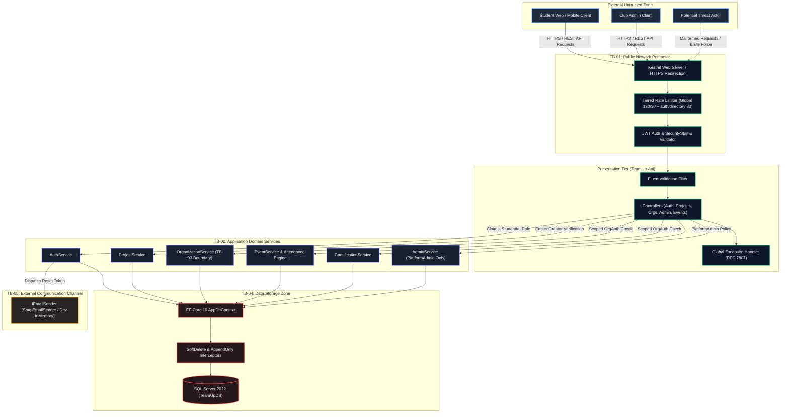

# TeamUp — STRIDE Threat Model & Security Architecture Review

> **Document Status:** Remediated & Verified (All 16 STRIDE Findings Addressed)  
> **Target System:** `backend/TeamUp.sln` (.NET 10 / ASP.NET Core Web API / EF Core 10 / SQL Server 2022)  
> **Evaluation Framework:** Microsoft STRIDE Threat Modeling Taxonomy  
> **Date:** November 2026  

---

## 1. System Overview & Scope

**TeamUp** is an academic collaboration, project recruitment, and gamification platform designed for higher education institutions. The system facilitates student discovery, project team matching, student organization management, campus event registrations with QR/PIN attendance validation, and points-based gamification using an append-only scoring ledger.

### Audited Architecture Components:
- **Presentation Layer (`TeamUp.Api`):** ASP.NET Core 10 Web API controllers, JWT authentication handlers, IP-partitioned rate limiting, validation filters, and global exception handling.
- **Application Layer (`TeamUp.Application`):** CQRS command/query services, FluentValidation rule sets, domain event handlers, and security contracts.
- **Domain Layer (`TeamUp.Domain`):** Bounded contexts (`Identity`, `Projects`, `Organizations`, `Gamification`), aggregate roots, soft-delete contracts (`ISoftDelete`), and append-only constraints (`IAppendOnly`).
- **Infrastructure Layer (`TeamUp.Infrastructure`):** EF Core 10 `AppDbContext`, SQL Server 2022 configurations, PBKDF2/SHA-256 cryptographic services, and database interceptors.
- **Frontend Layer (`frontend/`):** Decoupled React + Vite + TypeScript SPA consuming the pure JSON REST API (`/api/v1/*`); non-UI HTML templates are isolated under `TeamUp.Infrastructure/Templates/{Emails,Reports}`.

---

## 2. Assets & Data Classification

| Asset Category | Target Assets | Impact of Compromise | Criticality |
|---|---|---|---|
| **Identity & Authentication Credentials** | Student password hashes (PBKDF2), Active Refresh Tokens (SHA-256), Password Reset Tokens (SHA-256), JWT Symmetric Signing Key (`Jwt:Key`). | Complete account takeover, administrative session forgery. | **Critical** |
| **Personal Identifiable Information (PII)** | Student full names, academic email addresses, university/faculty affiliations, academic years, biographies, portfolio/social URLs. | Academic spear-phishing, privacy violation, student identity harvesting. | **High** |
| **Gamification & Reputation Ledger** | `ScoreTransaction` records, Student XP, level progression formulas, awarded `StudentBadge` records, leaderboard ranks. | Academic credibility corruption, fraudulent reward acquisition. | **High** |
| **Organizational & Event Operations** | Student organizations, executive committee rosters, event schedules, room locations, confirmed registrations, attendance validation logs. | Unauthorized organization modification, event disruption, attendance spoofing. | **Medium** |
| **Project & Collaborative Data** | Project vacancies, team rosters, student join applications, Kanban task boards (`ProjectTask`), skill matrices. | Unauthorized membership modification, intellectual property tampering. | **Medium** |
| **System Availability & Audit Trails** | Database connection pool, API throughput, soft-deleted records (`DeletedAt`), concurrency tokens (`RowVersion`). | Denial of service during peak event registration, unrecorded malicious administrative actions. | **High** |

---

## 3. Trust Boundaries & Architecture Flow

The system operates across five primary trust boundaries:
1. **TB-01: Public Internet / External User Boundary:** Untrusted clients communicating with the API host over HTTPS.
2. **TB-02: Presentation / Application Boundary:** The transition between HTTP controllers, middleware, and domain application services.
3. **TB-03: Multi-Tenant / Organization Authorization Boundary:** Lateral boundaries separating regular students from organization administrators (`OrgAdmin`) and platform administrators (`PlatformAdmin`).
4. **TB-04: Application / Persistence Boundary:** The interface between EF Core and the SQL Server 2022 database instance.
5. **TB-05: Out-of-Band Service Boundary:** Asynchronous notification and password reset communication channel.



---

## 4. STRIDE Threat Analysis Matrix

> **Note:** Sections 4 and 5 preserve the pre-remediation threat analysis and implementation roadmap; all 16 findings are verified mitigated in [Section 7](#7-remediation-status-matrix-implemented-november-2026).

| Category | Threat ID | Threat Description | Likelihood | Impact | Risk Level | Mitigation Strategy |
|---|---|---|---|---|---|---|
| **Spoofing** | **THR-S-01** | **Hardcoded Fallback JWT Key:** `appsettings.json` contains a fallback JWT symmetric key (`DevelopmentFallbackSecretKey...`). If deployed without an external environment variable override, an adversary can forge tokens with arbitrary claims (e.g., `role: PlatformAdmin`). | Medium | Critical | **High** | Fail startup immediately if running in `Production` and `Jwt:Key` is absent or matches known development defaults. Use Azure Key Vault, AWS Secrets Manager, or Kubernetes secrets. |
| **Spoofing** | **THR-S-02** | **Client IP Header Spoofing for Rate Limit Evasion:** The rate limiter reads `X-Forwarded-For` without registering `ForwardedHeadersOptions` or validating trusted reverse proxy CIDR ranges. Attackers can cycle headers to bypass brute-force limits. | High | Medium | **High** | Configure ASP.NET Core `UseForwardedHeaders` specifying `KnownProxies` / `KnownNetworks`, and obtain client IP solely from `RemoteIpAddress` after middleware sanitization. |
| **Spoofing** | **THR-S-03** | **Reset Token Extraction from In-Memory Store:** `InMemoryEmailSender` logs and retains password reset tokens indefinitely in an in-memory dictionary. If deployed to shared or unmanaged environments, memory dumps or log aggregation platforms expose active tokens. | Medium | High | **High** | Implement a production `IEmailSender` using SMTP or SendGrid. Eliminate in-memory token dictionaries; rely strictly on database hashes with short expiration windows (15 minutes). |
| **Tampering** | **THR-T-01** | **Broken Object-Level Authorization (BOLA) in Organizations:** `OrganizationsController.UpdateOrganization` and `UpdateMemberRole` enforce `[Authorize(Roles = "OrgAdmin,PlatformAdmin")]` but never verify that the authenticated caller is actually an admin of the specified `organizationId`. An admin from Club A can modify Club B. | High | High | **High** | Implement resource-based authorization. Query `OrganizationMembers` to verify `StudentId == CurrentStudentId` and `Role == OrganizationRole.Admin` for the target `organizationId`. |
| **Tampering** | **THR-T-02** | **Fraudulent Attendance Injection & XP Ledger Manipulation:** `SessionAttendanceController.CheckIn` checks only `OrgAdmin,PlatformAdmin` role. Any `OrgAdmin` can register attendance for any student in any session, fraudulently awarding XP via the append-only `ScoreTransaction` ledger. | Medium | High | **High** | Enforce tenant scoping: verify the session belongs to an event owned by the caller's organization. For QR/PIN methods, enforce dynamic rotating check-in tokens with short expiry (e.g., 60 seconds). |
| **Tampering** | **THR-T-03** | **Unvalidated External URI Schemes (XSS / SSRF):** `Organization.LogoUrl` and related endpoints lack strict URI scheme validation in certain DTOs, potentially allowing `javascript:` or internal network URIs (`http://169.254.169.254/`). | Low | Medium | **Medium** | Apply strict URI validation rules across all URL properties requiring `Uri.UriSchemeHttp` or `Uri.UriSchemeHttps` and ban private IP ranges. |
| **Repudiation** | **THR-R-01** | **Absence of Immutable Audit Logging for Administrative Actions:** Role promotions (`PATCH /api/v1/admin/students/{id}/role`), soft-deletions, and entity restorations write no persistent audit log entries. Compromised administrators can execute modifications without a non-repudiable trail. | Medium | High | **Medium** | Introduce a dedicated `AuditLog` table with user identity, client IP, action timestamp, old values, and new values, guarded by `IAppendOnly`. |
| **Repudiation** | **THR-R-02** | **Attendance Verification Origin Deficit:** `SessionAttendance` records `CheckInTime` and `VerificationMethod` but omits `CheckedInByAdminId`. In contested gamification disputes, the system cannot prove which administrator authorized the attendance. | Medium | Low | **Low** | Add `RecordedByStudentId` column to `SessionAttendance` linking to the executive account that scanned or approved the record. |
| **Information Disclosure** | **THR-I-01** | **Student Directory Data Harvesting:** `GET /api/v1/students` allows any authenticated student to page through the entire student registry (names, emails, faculty, academic year). Scripted scraping can dump university-wide rosters. | High | Medium | **Medium** | Enforce aggressive pagination limits (max page size 20), apply authenticated rate limiting on directory lookups, and restrict student email visibility based on user privacy preferences. |
| **Information Disclosure** | **THR-I-02** | **Missing CORS Policy Specification:** `Program.cs` does not declare or enforce a CORS policy. While API clients can consume endpoints, improper proxy routing or browser integrations can leave endpoints vulnerable to unintended cross-origin interactions. | Medium | Medium | **Medium** | Configure explicit `builder.Services.AddCors()` specifying exact allowed origins, methods, and headers for known frontend clients. |
| **Information Disclosure** | **THR-I-03** | **Unencrypted Database Transit (TrustServerCertificate):** Documentation and setup guides recommend `TrustServerCertificate=True`. In containerized or cloud deployments without private networks, traffic between the API and SQL Server is vulnerable to sniffing. | Low | High | **Medium** | Enforce valid TLS certificates for SQL Server connections in staging and production environments (`Encrypt=True;TrustServerCertificate=False`). |
| **Denial of Service** | **THR-D-01** | **Unprotected Query & Search Endpoints:** Rate limiting (`auth-policy`) is bound exclusively to `AuthController`. Expensive operations (e.g., `GET /api/v1/projects?keyword=...`, `GET /api/v1/organizations`) can be flooded to exhaust CPU and database worker threads. | High | High | **High** | Apply global rate limiting across all API endpoints with tiered limits (e.g., 120 req/min for authenticated users, 30 req/min for anonymous search queries). |
| **Denial of Service** | **THR-D-02** | **Concurrency Race Conditions on Event Waitlists:** `EventService.UnregisterAsync` promotes waitlisted students using a read-then-update pattern without pessimistic locking (`UPDLOCK`), risking deadlocks or race conditions during high-volume cancellations. | Medium | Medium | **Medium** | Use serializable transactions or explicit SQL row-locking hints (`UPDLOCK`, `ROWLOCK`) when querying and updating waitlisted registrations. |
| **Elevation of Privilege** | **THR-E-01** | **Global Role Claim vs. Scoped Multi-Tenant Role:** `OrgAdmin` is stored as a global user role claim (`ClaimTypes.Role = "OrgAdmin"`). An administrator of a chess club automatically inherits administrative privileges across engineering, robotics, and medical societies. | High | Critical | **High** | Remove global `OrgAdmin` system role. Scope organization permissions exclusively to `OrganizationMember.Role` within the database or enrich JWT with tenant-scoped claims (`org_admin:14`). |
| **Elevation of Privilege** | **THR-E-02** | **Stale JWT Role Claims on Administrative Demotion:** Access tokens have a 60-minute lifetime (`AccessTokenMinutes = 60`). If a `PlatformAdmin` demotes an account via `AdminService.UpdateStudentRoleAsync`, the user retains elevated privileges until token expiration. | High | High | **High** | Implement a lightweight `SecurityStamp` validation middleware or reduce access token lifetime to 15 minutes while rotating refresh tokens. Invalidate user tokens immediately upon role modification. |
| **Elevation of Privilege** | **THR-E-03** | **Unrestricted Administrative Role Escalation:** `AdminService.UpdateStudentRoleAsync` allows any `PlatformAdmin` to elevate any student to `PlatformAdmin` without secondary approval or audit safeguards, risking irreversible loss of control if one admin account is compromised. | Low | Critical | **Medium** | Enforce multi-party confirmation or protect `PlatformAdmin` assignments via root configuration / database seeders rather than interactive runtime endpoints. |

---

## 5. Top Fixes to Implement First

```text
Priority Implementation Order:
[1] Scope OrgAdmin Privileges (BOLA Fix)
       └───> [2] Enforce Startup Secrets Validation
               └───> [3] Global Rate Limiting & Proxy Hardening
                       └───> [4] Token Invalidation & Security Stamp
                               └───> [5] Production Email Service & Memory Clean-up
```

### 1. Fix Broken Object-Level Authorization (BOLA) for Organizations & Events
* **Root Cause:** Controllers rely on coarse-grained `[Authorize(Roles = "OrgAdmin,PlatformAdmin")]` without validating organization ownership against the database.
* **Remediation Action:** Create an `IOrganizationAuthorizationService` that evaluates whether `CurrentStudentId` has an `Admin` or `Executive` role for the specific `organizationId`:
  ```csharp
  // TeamUp.Application/Common/Security/IOrgAuthService.cs
  public async Task EnsureOrgAdminAsync(int organizationId, int studentId, CancellationToken ct)
  {
      var isMemberAdmin = await db.OrganizationMembers.AnyAsync(
          m => m.OrganizationId == organizationId 
            && m.StudentId == studentId 
            && m.Role == OrganizationRole.Admin, ct);

      if (!isMemberAdmin)
          throw new ForbiddenException("You do not have administrative authority over this organization.");
  }
  ```

### 2. Guard JWT Signing Keys & Disallow Insecure Defaults
* **Root Cause:** Hardcoded fallback key in `appsettings.json`.
* **Remediation Action:** Add validation in `Program.cs` during application bootstrap:
  ```csharp
  var jwtKey = builder.Configuration["Jwt:Key"];
  if (builder.Environment.IsProduction())
  {
      if (string.IsNullOrWhiteSpace(jwtKey) || jwtKey.Contains("DevelopmentFallbackSecretKey"))
      {
          throw new InvalidOperationException("CRITICAL: A secure, unique Jwt:Key must be configured in production.");
      }
  }
  ```

### 3. Deploy Global Rate Limiting & Sanitize Forwarded Headers
* **Root Cause:** Rate limiting is only bound to `AuthController` and trusts raw `X-Forwarded-For` headers.
* **Remediation Action:**
  1. Add `builder.Services.Configure<ForwardedHeadersOptions>` specifying trusted networks.
  2. Implement an application-wide fallback rate limiter in `Program.cs`:
  ```csharp
  builder.Services.AddRateLimiter(options =>
  {
      options.RejectionStatusCode = StatusCodes.Status429TooManyRequests;
      options.GlobalLimiter = PartitionedRateLimiter.Create<HttpContext, string>(context =>
          RateLimitPartition.GetFixedWindowLimiter(
              partitionKey: context.User.Identity?.IsAuthenticated == true
                  ? context.User.GetStudentId().ToString()
                  : context.Connection.RemoteIpAddress?.ToString() ?? "anon",
              factory: _ => new FixedWindowRateLimiterOptions
              {
                  PermitLimit = 120,
                  Window = TimeSpan.FromMinutes(1)
              }));
  });
  ```

### 4. Implement Token Revocation & Security Stamp Check
* **Root Cause:** 60-minute access token lifespan without real-time revocation when roles change.
* **Remediation Action:**
  1. Add a `Guid SecurityStamp` column to the `Student` entity.
  2. Embed `SecurityStamp` in JWT claims.
  3. Update `SecurityStamp` whenever a student's password, role, or active status changes.
  4. Reduce `AccessTokenMinutes` default from 60 to 15 minutes.

### 5. Replace `InMemoryEmailSender` & Flush In-Memory Dictionaries
* **Root Cause:** `InMemoryEmailSender` indefinitely retains reset tokens in memory with potential data disclosure risk.
* **Remediation Action:**
  Implement a production mail sender integrating with SMTP/SendGrid, ensuring password reset tokens are exclusively transmitted through authenticated email protocols and never retained in memory collections.

---

## 6. Verification & Security Testing Guidance

To verify these remediations:
- **BOLA Tests:** Add integration tests in `TeamUp.IntegrationTests` verifying that an `OrgAdmin` of Organization 1 receives `403 Forbidden` when issuing updates to Organization 2.
- **Key Validation Tests:** Add unit tests validating that missing or default JWT keys trigger application termination in non-development environments.
- **Rate Limit Verification:** Execute load tests via `scripts/test_live_api.ps1` ensuring `429 Too Many Requests` is returned when exceeding `30 requests/minute` (anonymous, `auth-policy`, `directory-policy`) or `120 requests/minute` (authenticated).

---

## 7. Remediation Status Matrix (Implemented November 2026)

| Threat ID | Status | Implemented Controls | Verification |
|---|---|---|---|
| **THR-S-01** | ✅ Mitigated | Removed fallback key from `appsettings.json` (moved dev key to `appsettings.Development.json`); `SecurityStartupValidator` fails fast on empty, short (<32B), or default JWT keys outside Development. | `StrideSecurityUnitTests`, `ProductionStartup_WithMissingOrFallbackJwtKey_FailsFast` |
| **THR-S-02** | ✅ Mitigated | Cleared default `KnownProxies`; `ForwardedHeaders` activates only when `KnownProxies`/`KnownNetworks` are configured; rate limiter uses sanitized `RemoteIpAddress` exclusively (zero raw `X-Forwarded-For` reads). | `RateLimiting_GlobalAndSpoofedForwardedForCannotBypass_AndSecurityHeadersPresent` |
| **THR-S-03** | ✅ Mitigated | Added `SmtpEmailSender` + `Templates/Emails/PasswordReset.html` as production default; `InMemoryEmailSender` forbidden in Production (`SecurityStartupValidator`) and bounded to 15-min TTL in Dev/Test; reset token expiry shortened to 15 minutes. | `StrideSecurityUnitTests`, `AuthAndProfileTests` |
| **THR-T-01** | ✅ Mitigated | Implemented `IOrganizationAuthorizationService` enforcing per-organization `OrganizationMember` admin checks across organizations, events, sessions, registrations, and attendance; creator automatically becomes scoped `Admin`; closed score ledger BOLA. | `BolaProtection_OrgAdminOfClubA_CannotModifyClubBOrItsEventsAndAttendance` |
| **THR-T-02** | ✅ Mitigated | Enforced organization-scoped session authorization on attendance endpoints and added HMAC-SHA256 60-second rotating check-in tokens (`IAttendanceCodeService`, `check-in-code`, `self-check-in`). | `AttendanceCodeService_*`, `RotatingQrCheckIn_RecordsOrigin_AwardsXp_AndRendersHtmlReport` |
| **THR-T-03** | ✅ Mitigated | Implemented `SafeUrlValidator` banning non-HTTP(S) schemes, userinfo, localhost, and private/loopback/link-local/metadata IP ranges across all organization, profile, university, and badge validators. | `SafeUrlValidator_*`, `SsrfAndXssUrlPayloads_AreRejectedByApiValidation` |
| **THR-R-01** | ✅ Mitigated | Added `IAppendOnly` `AuditLog` entity, EF migration (`AddStrideSecurityHardening`), `IAuditLogService`, `HttpRequestContext`, and `GET /api/v1/admin/audit-logs` recording role changes, soft-deletes, restorations, and manual gamification adjustments. | `AuditLog_IsAppendOnly_BlocksUpdateAndDelete`, `AdminGovernance_BlocksPlatformAdminEscalation_AndRecordsImmutableAuditLogs` |
| **THR-R-02** | ✅ Mitigated | Added `SessionAttendance.RecordedByStudentId` FK (`DeleteBehavior.Restrict`), populated on check-in and exposed in `SessionAttendanceDto` and HTML attendance reports. | `RotatingQrCheckIn_RecordsOrigin_AwardsXp_AndRendersHtmlReport` |
| **THR-I-01** | ✅ Mitigated | Clamped `StudentDirectoryQuery` max page size to 20, applied dedicated `directory-policy` rate limit, added `Student.ShowEmailInDirectory` opt-in preference (default `false`), and blocked email-enumeration searches. | `StudentDirectoryQuery_ClampsPageSizeToMaximum20`, `StudentDirectory_EnforcesPageSizeCap20AndEmailPrivacyPreferences` |
| **THR-I-02** | ✅ Mitigated | Hardened `FrontendPolicy` CORS in `Program.cs` with explicit origins, explicit HTTP methods, explicit headers, and baseline security response headers (`X-Content-Type-Options`, `X-Frame-Options`, `Referrer-Policy`, `CSP`, `HSTS`). | `HealthTests.CorsPreflight_*`, `RateLimiting_GlobalAndSpoofedForwardedForCannotBypass_AndSecurityHeadersPresent` |
| **THR-I-03** | ✅ Mitigated | `SecurityStartupValidator` rejects `TrustServerCertificate=True` and `Encrypt=False` on Production SQL Server connections; updated `wiki/ENVIRONMENT.md` and `wiki/DEPLOYMENT.md`. | `SecurityStartupValidator_Production_InMemoryEmailOrTrustServerCert_Throws` |
| **THR-D-01** | ✅ Mitigated | Deployed global partitioned rate limiter (`120/min` authenticated, `30/min` anonymous, `/health` exempt) alongside `auth-policy` and `directory-policy` with uniform `429` JSON envelope and `Retry-After`. | `RateLimiting_GlobalAndSpoofedForwardedForCannotBypass_AndSecurityHeadersPresent` |
| **THR-D-02** | ✅ Mitigated | Upgraded `EventService.CancelRegistrationAsync` and `RegisterAsync` to `IsolationLevel.Serializable` with SQL Server `UPDLOCK, ROWLOCK` row locks; mapped `DbUpdateConcurrencyException` to `409 Conflict`. | `EventsAndAttendanceTests`, `CachingAndConcurrencyTests` |
| **THR-E-01** | ✅ Mitigated | Removed coarse global `OrgAdmin` controller guards on org-scoped endpoints; scoped permissions to `OrganizationMember` admin roles in DB and enriched JWTs with `org_admin` claims. | `BolaProtection_OrgAdminOfClubA_CannotModifyClubBOrItsEventsAndAttendance`, `JwtOptions_DefaultsAndClaims_*` |
| **THR-E-02** | ✅ Mitigated | Added `Student.SecurityStamp` column + JWT `security_stamp` claim validated in `JwtBearerEvents.OnTokenValidated`; rotated stamp on role change, logout, password reset, and soft-delete; shortened default `AccessTokenMinutes` to 15. | `SecurityStamp_ImmediateRevocationOnRoleChangeLogoutAndPasswordReset` |
| **THR-E-03** | ✅ Mitigated | Disabled runtime elevation to `PlatformAdmin` by default (`Admin:AllowRuntimePlatformAdminPromotion=false`), blocked self-demotion and last-admin demotion, and audited all role changes. | `AdminGovernance_BlocksPlatformAdminEscalation_AndRecordsImmutableAuditLogs` |
