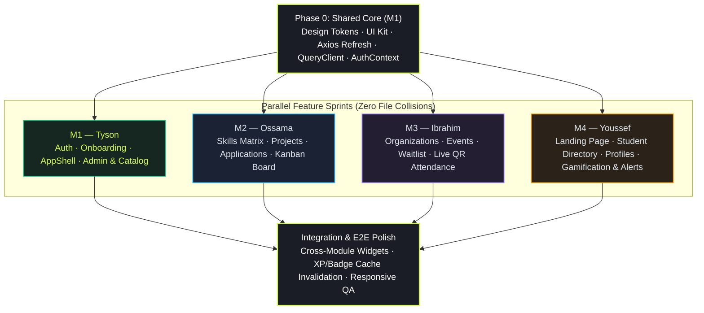

# TeamUp Frontend — Full-Stack Architecture, Design System & 4-Developer Execution Plan

> **Date:** 2026-11-21  
> **Status:** Architecture & Task Breakdown Blueprint (Ready for Approval & Execution)  
> **Frontend Stack:** React 19 + Vite 8 + TypeScript 7 (strict) + Tailwind CSS v4 (`create-vrtw` scaffold in `frontend/`)  
> **Backend API:** ASP.NET Core 10 Pure REST API (`/api/v1/*` — 67 paths, 108 operations, verified in `docs/api/openapi.json`)  
> **Landing Reference:** [`docs/prototypes/landing-static.html`](../docs/prototypes/landing-static.html)  
> **Design System Inspiration:** [Handshake (`joinhandshake.com`)](https://joinhandshake.com/)  
> **Team Split (4 Developers):** **M1 — Ahmed Elsayed / Tyson** · **M2 — Ossama** · **M3 — Ibrahim** · **M4 — Youssef**

---

## 1. Current Baseline & Phase 0 Gap Audit

The `frontend/` SPA is already scaffolded on the `create-vrtw` stack with passing `tsc`, `vitest` (5/5), `vite build`, and live Vite-to-API proxying (`:5173` → `:5186`). Before parallel feature sprints begin, **Phase 0** resolves three concrete sync gaps introduced during Task 2 (STRIDE hardening) and installs minimal production utilities:

### 1.1 Existing Installed Packages (`frontend/package.json`)
- **Core:** `react@^19.3.1`, `react-dom@^19.3.1`, `react-router-dom@^7.18.6`, `axios@^1.21.1`, `lucide-react@^1.77.0`
- **Build & Test:** `vite@^8.3.6`, `@tailwindcss/vite@^4.3.5`, `tailwindcss@^4.3.5`, `typescript@~7.0.2`, `vitest@^5.1.1`, `@testing-library/react@^16.3.3`, `@testing-library/jest-dom@^8.0.0`, `happy-dom@^21.0.4`

### 1.2 Recommended Phase 0 Package Additions (Lean, Zero Bloat)

| Package | Purpose | Used By |
|---|---|---|
| `@tanstack/react-query` | Server-state caching, pagination, optimistic mutations, cross-module cache invalidation (`score`, `notifications`, `projects`) | All (M1–M4) |
| `react-hook-form`, `zod`, `@hookform/resolvers` | Declarative form state + client-side schema validation mirroring backend FluentValidation rules | All (M1–M4) |
| `sonner` | Accessible, non-blocking toast notifications for XP awards, `409 Conflict` notices, and `429` rate-limit alerts | All (M1–M4) |
| `qrcode.react` | Client-side SVG QR rendering for OrgAdmin 60-second rotating session check-in codes | M3 |

### 1.3 Verified Sync Gaps Between `frontend/src/api/` and `docs/api/openapi.json`
1. **Missing endpoints in `frontend/src/api/endpoints.ts` (added in Task 2):**
   - `GET /api/v1/admin/audit-logs`
   - `GET /api/v1/gamification/leaderboard`
   - `POST /api/v1/sessions/{id}/attendance/check-in-code`
   - `POST /api/v1/sessions/{id}/attendance/self-check-in`
   - `GET /api/v1/sessions/{id}/attendance/report` (returns `text/html`)
   - `POST /api/v1/students/{id}/badges/{badgeId}` (PlatformAdmin manual badge award)
2. **Incomplete `AuthResult` DTO in `frontend/src/api/auth.api.ts`:**
   - Backend `AuthResponse` returns `{ accessToken, refreshToken, expiresAt, student }` where `StudentSummaryDto` includes `academicYear`, `facultyId`, `facultyName`, and `universityName`.
   - `authApi` also needs `forgotPassword(email)` and `resetPassword({ email, token, newPassword })`.
3. **Missing Silent Token Refresh Mutex in `frontend/src/api/client.ts`:**
   - STRIDE THR-E-02 shortened JWT access token TTL to **15 minutes** and added `SecurityStamp` immediate revocation.
   - `client.ts` must intercept `401 Unauthorized`, coalesce concurrent failing requests behind a single `POST /api/v1/auth/refresh` promise (preventing refresh-token replay collisions), retry with the rotated token, or clear session + redirect to `/auth/login` if refresh fails.

---

## 2. Design System Specification (Handshake `joinhandshake.com` + `landing-static.html`)

TeamUp adopts a **Handshake-inspired, high-contrast academic-tech visual system**: an energetic electric lime-chartreuse brand anchor (`#D3FB52`) balanced against deep charcoal dark surfaces (`#14151C`), emerald/forest depth accents (`#15733F`, `#539886`), bold condensed display typography, and crisp white elevated data/preview cards.

### 2.1 Color Token Architecture (`@theme` in `frontend/src/index.css`)

| Token | Value | Role & Usage |
|---|---|---|
| `--color-canvas` | `#14151c` | Root page background, app shell canvas |
| `--color-surface` | `#1b1d26` | Primary cards, sidebars, panels, table containers |
| `--color-surface-elevated` | `#222532` | Modals, dropdowns, popovers, active row hover |
| `--color-surface-tile` | `#1c1e26` | Marquee tiles, metric chips, subtle inset boxes |
| `--color-accent` | `#d3fb52` | **Handshake Electric Lime** — primary CTAs, active nav pill, brand wordmark, focus rings |
| `--color-accent-hover` | `#deff6e` | Primary CTA hover state |
| `--color-on-accent` | `#14151c` | Text/icon ink on lime surfaces (contrast ratio **15.8:1** — WCAG AAA) |
| `--color-emerald` | `#10b981` | Secondary positive highlights, online API badge, active indicators |
| `--color-forest` | `#15733f` | Deep campus green for showcase gradients and high-contrast badges on light cards |
| `--color-teal-glow` | `#539886` | Mesh hero gradient & card spotlight secondary glow |
| `--color-light-surface` | `#ffffff` | High-contrast inset surfaces (hero search bar, showcase cards, QR projector card, morphing scrolled navbar) |
| `--color-light-subtle` | `#f8faf9` | Secondary tint inside white cards |
| `--color-ink-dark` | `#111827` | Primary text on light surfaces |
| `--color-ink-muted` | `#9ca3af` | Secondary copy on dark surfaces (WCAG AA compliant on `#14151c` and `#1b1d26`) |
| `--color-border-subtle` | `rgba(255, 255, 255, 0.085)` | Hairline structural borders on dark cards |
| `--color-border-accent` | `rgba(211, 251, 82, 0.38)` | Hover/focus border glow |
| `--color-status-success` | `#16a34a` / `#10b981` | Confirmed registration, Done task, Verified attendance, XP earned |
| `--color-status-warning` | `#f59e0b` | Waitlisted registration, Pending application, InReview task |
| `--color-status-danger` | `#ef4444` | Rejected application, Urgent priority, Soft-delete / destructive actions |
| `--color-status-info` | `#38bdf8` | InProgress status, Event reminders, Informational callouts |

### 2.2 Typography Scale (Google Fonts already loaded in `frontend/index.html`)

| Role | Font Family | Weights | Sizing & Tracking | Usage |
|---|---|---|---|---|
| **Brand Wordmark** | `Barlow Condensed` | 900 Italic | `32px–42px` (header), `clamp(3.1rem, 18.2vw, 18.2rem)` (footer) | `TeamUp` wordmark & scrolled `T` square badge |
| **Hero Display** | `Antonio`, `Barlow Condensed` | 700 Uppercase | `clamp(2.9rem, 11.2vw, 9.5rem)`, `leading-[0.9]`, `-0.025em` | Landing hero & high-impact campaign banners |
| **Page / Section Headings** | `Plus Jakarta Sans` | 500–700 | `H1: 32–46px`, `H2: 24–32px`, `H3: 18–22px`, `-0.02em` | Dashboard titles, feature headers, modal titles |
| **Body & UI Controls** | `DM Sans` | 400–700 | `14px–16px` body, `13px` labels, `12px` captions | Forms, descriptions, tables, navigation |
| **Numeric / Code / Ledger** | `ui-monospace` (`tabular-nums`) | 500–600 | `12px–14px` | XP points (`+250 pts`), level formula, 60s QR countdown, audit IDs |

### 2.3 Signature Handshake + Prototype UI Patterns

1. **Dual-Surface Contrast:** Dark `#14151c` workspace shell with `#1b1d26` cards for everyday focus; crisp `#ffffff` inset surfaces strictly for high-prominence search bars, scrolled floating header, QR code projection (required for reliable camera scanning), and landing feature previews.
2. **Morphing Liquid-Pill Navbar (Landing):** Transparent top bar (`max-w-[1440px]`) with translucent lime gliding pill → smoothly morphs past `scrollY > 90px` into a centered floating white pill (`max-w-[1120px] bg-white rounded-[20px]`) with solid `#d3fb52` active indicator and compact `T` badge.
3. **Spotlight Hover Cards (`.service-card`):** Mouse-tracked radial gradient (`--mouse-x`, `--mouse-y`) casting a subtle lime/teal sheen on hover, `-translate-y-1.5` lift, `#d3fb52/38` border highlight, and circular `ArrowUpRight` badge transitioning to lime.
4. **Vivid Gradient Showcase Frames (`.showcase-gradient-1..4`):** Layered chartreuse/mint/forest gradient frames housing overlapping frosted glass and crisp white cards.
5. **Accessibility & Motion Guardrails:**
   - Every interactive element must provide `focus-visible:outline-none focus-visible:ring-2 focus-visible:ring-[#d3fb52] focus-visible:ring-offset-2 focus-visible:ring-offset-[#14151c]`.
   - Wrap all continuous/entrance animations (typewriter, marquee, letter burst, reveal transforms) with `@media (prefers-reduced-motion: reduce)` fallbacks.
   - All modals/dropdowns must support `Escape` to close, outside-click dismissal, and ARIA roles (`dialog`, `menu`, `tablist`).

### 2.4 Shared UI Primitive Kit (`frontend/src/components/ui/`)
Built once in **Phase 0** by M1 and consumed identically across all 4 tracks:
`Button` (`primary` lime, `secondary` ghost, `outline`, `danger`), `Input`, `Textarea`, `Select`, `Card`, `SpotlightCard`, `Badge` / `StatusPill`, `Avatar`, `Modal`, `ConfirmDialog`, `Tabs`, `DataTable`, `Pagination`, `EmptyState`, `Skeleton`, `ErrorBanner`, `SearchInput`.

---

## 3. Landing Page Architecture (Ref: `docs/prototypes/landing-static.html`)

Ported by **M4 (Youssef)** into modular React components under `frontend/src/features/landing/`, preserving 100% of the visual polish from `landing-static.html` while replacing dead anchors with live SPA navigation and real backend hooks:

| Prototype Section (`landing-static.html`) | React Component | Live SPA Upgrade |
|---|---|---|
| Sticky Morphing Header + 5 Module Dropdowns (`L517–565`, `L1345–1702`) | `LandingHeader.tsx` | Right zone houses **Sign In / Get Started** (guest) or **Dashboard + NotificationBell + UserMenu** (authenticated). Dropdown items route directly to `/projects`, `/students`, `/organizations`, `/events`, `/gamification`, `/leaderboard`. |
| Section 1: Mesh Gradient Hero + Giant `LET'S FIND YOUR NEXT TEAM` + Typewriter Pill Search + Quick Filter Chips (`L570–690`) | `HeroSection.tsx` | Submitting a search routes directly with query params (`/projects?keyword=...`, `/organizations?search=...`, `/events?search=...`, `/students?search=...`) based on active chip! |
| Section 2a: 3×2 Core Platform Services Spotlight Grid (`L695–724`, `L1870–1899`) | `ServicesGridSection.tsx` | Uses shared `<SpotlightCard>` + `useInViewOnce` hook; each card links to its live feature route. |
| Section 2b: Seamless RTL Infinite Campus Guilds Marquee (`L725–729`, `L1901–1961`) | `CampusMarquee.tsx` | Pause-on-hover, keyboard-safe, reduced-motion static grid fallback; clicking a guild card navigates to `/organizations?search=<guild>`. |
| Section 3: 4 Alternating Gradient Showcase Rows (`L734–1208`) | `FeatureShowcaseSection.tsx` | Reuses `.showcase-gradient-1..4` CSS classes; CTAs route to `/projects`, `/organizations`, `/events`, `/leaderboard` (or `/auth/register` if guest). |
| Section 4: Footer Sitemap + One-Shot Giant Burst `TeamUp` Wordmark (`L1213–1337`) | `LandingFooter.tsx` | All 3 footer columns become working React Router `<Link>` items; burst animation fires once on viewport entry (disabled under `prefers-reduced-motion`). |

---

## 4. General API Integration & Security Reference

### 4.1 Response Envelope, Pagination & Error Semantics

All JSON endpoints under `/api/v1/*` return `ApiResponse<T>` (`frontend/src/api/types.ts`):
```ts
interface ApiResponse<T = undefined> {
  success: boolean;
  message: string;
  statusCode: number;
  data?: T;
  errors?: Array<{ field: string; message: string }> | null;
  timestamp: string;
}
```
Paginated collections wrap items in `PagedResult<T>`: `{ items, page, pageSize, totalCount, totalPages }`.

| HTTP Status | Backend Cause | Mandatory Frontend Handling |
|---|---|---|
| `200` / `201` | Success / Resource created | Unwrap `data`, update/invalidate TanStack Query cache, show success toast on mutations. |
| `204` | Soft-delete, logout, mark-read, unassign | Treat empty body as success; do **not** call `unwrapApiResponse` on `204` endpoints! |
| `400` | FluentValidation error (`errors[]`) | Map `errors` by lowercase field name directly into `react-hook-form` `setError()`. |
| `401` | Expired JWT (15m) or revoked `SecurityStamp` | Axios interceptor attempts **one** single-flight `POST /api/v1/auth/refresh`; on failure, clear tokens & redirect to `/auth/login?reason=session_expired`. |
| `403` | Role mismatch, BOLA org/project ownership, or `THR-E-03` admin guard | Render inline `<ForbiddenBanner>` or toast with backend `message`; never crash page. |
| `404` | Missing or soft-deleted entity | Render graceful `<EmptyState>` with back-navigation CTA. |
| `409` | Duplicate email/application/check-in or EF `RowVersion` concurrency race (`THR-D-02`) | Show warning toast with backend `message` and automatically refetch latest entity state. |
| `429` | Global (120/min auth, 30/min anon), `auth-policy`, or `directory-policy` rate limit | Show cooldown toast displaying `Retry-After` seconds; disable submit button briefly. |

### 4.2 STRIDE-Aligned Frontend Security Rules
- **JWT Claims (`sub`, `role`, `org_admin[]`):** Parse payload strictly to toggle UI controls (`isPlatformAdmin`, `isOrgAdminOf(orgId)`). Never rely on client checks for security; always handle `403` gracefully.
- **Refresh Token Single-Flight Queue:** Backend rotates SHA-256 hashed refresh tokens on every refresh; replaying an old refresh token returns `401`. Only one refresh request may run in flight at any time.
- **Directory Privacy (`THR-I-01`):** `GET /api/v1/students` hard-caps `PageSize <= 20` and omits other students' emails unless `showEmailInDirectory === true`. UI pagination selector on `/students` must offer `[10, 20]` only and gracefully render `"Email private"` when empty.
- **Safe URL Validation (`THR-T-03`):** All URL form fields (`website`, `logoUrl`, `photoUrl`, `gitHubUrl`, `linkedInUrl`, `iconUrl`) must validate `^https?://` client-side (rejecting `javascript:`, `data:`, localhost) and render anchors with `target="_blank" rel="noopener noreferrer"`.
- **Sandboxed HTML Attendance Report (`THR-R-02`):** `GET /api/v1/sessions/{id}/attendance/report` returns `text/html`. Fetch via `apiClient.get(url, { responseType: "text", headers: { Accept: "text/html" } })` and render in `<iframe srcDoc={html} sandbox="allow-same-origin" />` with a dedicated Print button.
- **Append-Only Score Ledger:** Score transactions can never be edited or deleted; UI presents the ledger as read-only (with PlatformAdmin compensating adjustments via `POST /api/v1/score-transactions`).

### 4.3 Domain Enums Contract (`frontend/src/api/enums.ts`)

| Enum | Exact String Values (Matched to `TeamUp.Domain.Enums`) |
|---|---|
| `UserRole` | `"Student" \| "OrgAdmin" \| "PlatformAdmin"` |
| `OrganizationRoles` | `"Admin" \| "OrgAdmin" \| "President" \| "Vice President" \| "Executive" \| "Member"` (Admin scope = all except `"Member"`) |
| `ProficiencyLevel` | `"Beginner" \| "Intermediate" \| "Advanced"` |
| `ProjectStatus` | `"Recruiting" \| "InProgress" \| "Completed" \| "Archived"` |
| `ApplicationStatus` | `"Pending" \| "Accepted" \| "Rejected" \| "Withdrawn"` |
| `ProjectTaskStatus` | `"Todo" \| "InProgress" \| "InReview" \| "Done"` |
| `TaskPriority` | `"Low" \| "Medium" \| "High" \| "Urgent"` |
| `EventType` | `"Workshop" \| "Hackathon" \| "Session" \| "Competition"` |
| `RegistrationStatus` | `"Confirmed" \| "Waitlisted" \| "Cancelled"` |
| `VerificationMethod` | `"QRCode" \| "RFID" \| "ManualByOrganizer"` |
| `ScoreSourceType` | `"EventAttendance" \| "TaskCompleted" \| "ProjectDelivered" \| "Manual"` |
| `BadgeCriteriaType` | `"PointsThreshold" \| "EventCount" \| "TaskCount"` |
| `NotificationType` | `"ApplicationStatus" \| "TaskAssigned" \| "BadgeEarned" \| "EventReminder"` |
| `RestorableEntityType` | `"student" \| "university" \| "faculty" \| "skill" \| "project" \| "organization" \| "event" \| "badge"` |

### 4.4 Master API Endpoint Coverage Map (67 Paths · 108 Operations · 100% Assigned)

| Domain Group | Ops | Endpoints Summary | Auth / Role Tier | Owner |
|---|---|---|---|---|
| **Auth** | 6 | `POST /auth/{register,login,refresh,logout,forgot-password,reset-password}` | Public (rate-limited) · `logout` Auth | **M1 (Tyson)** |
| **Universities** | 6 | `GET /universities`, `GET /universities/catalog`, `GET /universities/{id}`, `POST/PUT/DELETE` | Reads Public · Writes `PlatformAdmin` | **M1 (Tyson)** |
| **Faculties** | 5 | `GET /universities/{universityId}/faculties`, `GET /faculties/{id}`, `POST/PUT/DELETE` | Reads Public · Writes `PlatformAdmin` | **M1 (Tyson)** |
| **Admin Governance** | 5 | `GET /admin/dashboard`, `PATCH /admin/students/{id}/role`, `GET /admin/soft-deleted`, `POST /admin/restore/{entityType}/{id}`, `GET /admin/audit-logs` | `PlatformAdmin` | **M1 (Tyson)** |
| **Skills Catalog** | 5 | `GET /skills`, `GET /skills/{id}`, `POST/PUT/DELETE /skills` | Reads Auth · Writes `PlatformAdmin` | **M2 (Ossama)** |
| **Student Skills** | 3 | `GET /students/{id}/skills`, `PUT/DELETE /students/me/skills/{skillId}` | Auth / Self | **M2 (Ossama)** |
| **Projects, Skills, Members, Apps** | 17 | `GET/POST /projects`, `GET/PATCH/DELETE /projects/{id}`, `required-skills` (3), `members` (3), `applications` (4), `GET/POST /projects/{id}/tasks` (2) | Auth · Mutations scoped to Creator/Lead/Applicant | **M2 (Ossama)** |
| **Sprint Tasks** | 5 | `GET/PATCH/DELETE /tasks/{id}`, `PUT/DELETE /tasks/{id}/assignee` | Auth · Team Members/Lead (`Done` awards `+50 XP`) | **M2 (Ossama)** |
| **Organizations** | 12 | `GET/POST /organizations`, `GET/PATCH/DELETE /organizations/{id}`, `members` (3), `applications` (4) | Auth · Create `OrgAdmin\|PlatformAdmin` · Manage scoped OrgAdmin · Delete `PlatformAdmin` | **M3 (Ibrahim)** |
| **Events & Sessions** | 9 | `GET/POST /events`, `GET/PATCH/DELETE /events/{id}`, `GET/POST /events/{id}/sessions`, `PUT/DELETE /sessions/{id}` | Auth · Writes scoped OrgAdmin of owning org | **M3 (Ibrahim)** |
| **Event Registrations** | 3 | `GET/POST/DELETE /events/{id}/registrations` (optional `?studentId=`) | Auth · Self or OrgAdmin · Concurrency-safe Waitlist | **M3 (Ibrahim)** |
| **Session Attendance** | 6 | `GET/POST /sessions/{id}/attendance`, `POST .../check-in-code` (60s QR), `POST .../self-check-in`, `DELETE .../{studentId}`, `GET .../report` (`text/html`) | Auth · Code/Manual/Revoke/Report scoped OrgAdmin · Self-check-in Student (`+25/+100 XP`) | **M3 (Ibrahim)** |
| **Students, Profile & Interests** | 11 | `GET /students` (`directory-policy`, max 20), `GET /students/{id}`, `GET/PATCH/DELETE /students/me`, `DELETE /students/{id}` (Admin), `GET/PUT .../profile`, `GET/POST/DELETE .../interests` | Auth · Self mutations · Admin delete | **M4 (Youssef)** |
| **Gamification & Score Ledger** | 4 | `GET /gamification/leaderboard`, `GET /students/{id}/score`, `GET /students/{id}/score-transactions` (Self/Admin), `POST /score-transactions` (Admin) | Auth · Ledger Self/Admin · Manual Admin | **M4 (Youssef)** |
| **Badges** | 6 | `GET /badges`, `POST/PUT/DELETE /badges` (Admin), `GET /students/{id}/badges`, `POST /students/{id}/badges/{badgeId}` (Admin) | Auth · Catalog/Award `PlatformAdmin` | **M4 (Youssef)** |
| **Notifications & Health** | 5 | `GET /notifications` (`?unreadOnly=`), `PATCH /notifications/{id}`, `PATCH /notifications/mark-all-read`, `DELETE /notifications/{id}`, `GET /health` | Auth (Self inbox) · `/health` Public | **M4 (Youssef)** |

**Total: 22 (M1) + 30 (M2) + 30 (M3) + 26 (M4) = 108 / 108 API operations covered.**

---

## 5. Team Division & Zero-Conflict Folder Ownership

Each developer owns dedicated feature directories, typed API modules, and route definitions so all four teammates can open parallel PRs without stepping on each other's files.

### 5.1 Four-Developer Ownership Matrix

| Member | Track & Primary Mission | Owned Directories (`frontend/src/`) | Owned Routes | Ops | Detailed Brief |
|---|---|---|---|---|---|
| **M1 — Ahmed Elsayed (Tyson)** | **Tech Lead:** Phase 0 Design System & UI Kit, Auth & Onboarding, AppShell, Platform Admin Governance & Academic Catalog | `components/ui/`, `components/layout/`, `lib/`, `api/{client,endpoints,enums,auth,universities,admin}.ts`, `features/auth/`, `features/admin/` | `/auth/login`, `/auth/register`, `/auth/forgot-password`, `/auth/reset-password`, `/admin/*` | **22** | [`01-tyson-core-auth-admin.md`](./frontend-modules/01-tyson-core-auth-admin.md) |
| **M2 — Ossama** | **Projects & Skills:** Master Skill Catalog, Student Skill Claims, Project Discovery, Team Roster, Applications & Sprint Kanban Board | `api/{skills,projects,tasks}.api.ts`, `features/skills/`, `features/projects/` | `/skills`, `/projects`, `/projects/new`, `/projects/:id` (tabs: Overview, Skills, Team, Applications, Board) | **30** | [`02-ossama-skills-projects-tasks.md`](./frontend-modules/02-ossama-skills-projects-tasks.md) |
| **M3 — Ibrahim** | **Activities & Events:** Student Organizations, Recruitment, Multi-Session Events, Waitlist Registration & Live 60s QR Attendance + HTML Reports | `api/{organizations,events,sessions,attendance}.api.ts`, `features/organizations/`, `features/events/` | `/organizations`, `/organizations/:id`, `/events`, `/events/:id`, `/events/:id/sessions/:sessionId/attendance`, `/check-in` | **30** | [`03-ibrahim-orgs-events-attendance.md`](./frontend-modules/03-ibrahim-orgs-events-attendance.md) |
| **M4 — Youssef** | **Landing, Community & Gamification:** Flagship Landing Page (`landing-static.html`), Student Directory & Portfolio Profiles, Leaderboard, XP Ledger, Badges & Notifications | `api/{students,gamification,badges,notifications}.api.ts`, `features/landing/`, `features/profile/`, `features/gamification/` | `/`, `/students`, `/students/:id`, `/profile/me`, `/leaderboard`, `/gamification`, `/notifications` | **26** | [`04-youssef-landing-profiles-gamification.md`](./frontend-modules/04-youssef-landing-profiles-gamification.md) |

### 5.2 Modular Route & Cross-Feature Composition Architecture



### 5.3 Cross-Module Public Contracts (Shared Widgets & Query Keys)

To eliminate ad-hoc coupling, each developer exports a tiny, typed integration surface:

1. **Standardized TanStack Query Keys (`frontend/src/lib/queryKeys.ts` — defined in Phase 0):**
   - `queryKeys.auth.me`, `queryKeys.universities.catalog`
   - `queryKeys.students.directory(params)`, `queryKeys.students.detail(id)`, `queryKeys.students.skills(id)`
   - `queryKeys.projects.list(params)`, `queryKeys.projects.detail(id)`, `queryKeys.projects.tasks(id)`
   - `queryKeys.organizations.list(params)`, `queryKeys.organizations.detail(id)`
   - `queryKeys.events.list(params)`, `queryKeys.events.detail(id)`, `queryKeys.sessions.attendance(sessionId)`
   - `queryKeys.gamification.score(studentId)`, `queryKeys.gamification.ledger(studentId)`, `queryKeys.gamification.leaderboard(params)`, `queryKeys.badges.catalog`, `queryKeys.badges.student(studentId)`, `queryKeys.notifications.inbox(unreadOnly)`
2. **Embedded Cross-Track Widgets:**
   - **M1 exports:** `useAuth()` (`user`, `isAuthenticated`, `isPlatformAdmin`, `isOrgAdminOf(orgId)`, `logout`), `<ProtectedRoute>`, `<RoleGuard>`.
   - **M2 exports:** `<StudentSkillsPanel studentId={id} editable={isMe} />` → mounted inside M4's `/students/:id` and `/profile/me`.
   - **M4 exports:** `<NotificationBell />` and `<XpLevelChip />` → mounted inside M1's `Navbar` / `AppShell` header; `<StudentGamificationSummary studentId={id} />` → mounted on `/students/:id`.
   - **Gamification Cache Helper (`invalidateGamification(queryClient, studentId)`):** Called by **M2** when a task transitions to `Done` (`+50 XP`) and by **M3** when a session check-in succeeds (`+25/+100 XP`) so the navbar XP level pill, badges, and notification bell update live without page reload!
3. **Zero-Conflict Routing (`frontend/src/app/router.tsx`):**
   - Each developer owns a route fragment file (`authRoutes.tsx`, `projectRoutes.tsx`, `orgEventRoutes.tsx`, `communityRoutes.tsx`) lazy-loaded via `React.lazy()`. `router.tsx` simply spreads the 4 route arrays once in Phase 0.

---

## 6. Phased Execution Roadmap

| Phase | Target Window | Lead / Owners | Core Deliverables | Exit Gate |
|---|---|---|---|---|
| **Phase 0: Foundation & Core Kit** | Days 1–2 | **M1 (lead)** + all review | Install `@tanstack/react-query`, `react-hook-form`, `zod`, `sonner`, `qrcode.react`; sync all 67 paths in `endpoints.ts` + `enums.ts`; Axios 401 refresh mutex; `AuthContext` + JWT claim helper; `components/ui/*` Handshake kit; `queryKeys.ts`; route fragment wiring. | `npm run typecheck && npm run test && npm run build` green; Storybook/preview route or unit tests for UI kit & refresh interceptor pass. |
| **Phase 1: Public & Read-Heavy Surfaces** | Days 3–6 | **M1, M2, M3, M4** in parallel | **M1:** Login, Register (with university→faculty catalog cascade), Forgot/Reset Password, AppShell.<br>**M2:** Skills catalog + Projects discovery + Project Detail overview.<br>**M3:** Organizations directory + Org Detail + Events discovery + Event Detail.<br>**M4:** Full `landing-static.html` React port (`/`) + Student Directory (`/students`) + Campus Leaderboard (`/leaderboard`). | All read flows render against live local API (`:5186`) with loading skeletons, empty states, and pagination. |
| **Phase 2: Full Mutations & Domain Workflows** | Days 7–11 | **M1, M2, M3, M4** in parallel | **M1:** Admin Dashboard, Role Management, 8-entity Soft-Delete Recycle Bin & Restore, Audit Logs, Universities & Faculties CRUD.<br>**M2:** Create/Edit Project, Required Skills Matrix, Team Roster/Roles, Applications workflow, Sprint Kanban Task Board & Assignee flow, My Claimed Skills.<br>**M3:** Org Create/Manage, Membership Applications, Event & Multi-Session CRUD, Waitlist Register/Cancel (`409` handling), Live 60s Rotating QR Projector, Self Check-In & HTML Attendance Report viewer.<br>**M4:** Public Portfolio Page, `/profile/me` Editor + Interests + Privacy Toggle + Account Delete, XP Ledger, Badge Catalog/Awarding, Notifications Inbox & Navbar Bell. | 100% of 108 API endpoints exercised with Zod validation, optimistic/invalidated cache updates, and role guards. |
| **Phase 3: Cross-Module Wiring, Tests & QA** | Days 12–14 | **All 4** | Mount M2 `<StudentSkillsPanel>` in M4 profiles; mount M4 `<NotificationBell>` + `<XpLevelChip>` in M1 `AppShell`; wire XP cache invalidation from M2/M3 mutations; full Vitest + Testing Library coverage; mobile/tablet/desktop QA (`375px`, `768px`, `1440px`); Lighthouse accessibility pass. | Full E2E flow (`Register → Join Project → Complete Task → Join Org → Register Event → Self Check-In → Verify XP/Badge/Notification`) passes cleanly against live backend. |

---

## 7. Frontend Coding Standards & Definition of Done (DoD)

- **Branch Naming:** `feat/fe-m<1|2|3|4>-<short-slug>` (e.g., `feat/fe-m2-kanban-board`, `feat/fe-m4-landing-hero`).
- **Modular Functional Components Only:** No class components; no monolithic page files (> 250 lines → split into sub-components/hooks).
- **File Header Convention:** Every new `.ts`/`.tsx` file starts with a JSDoc `@date` and `@purpose` header matching existing `frontend/src/` files.
- **API Boundary Rule:** Components **never** import `axios` directly; all HTTP calls live in `frontend/src/api/*.api.ts` and are consumed via TanStack Query hooks in `features/<domain>/hooks/`.
- **TypeScript Strictness:** Zero `any`, zero `@ts-ignore`, respect `erasableSyntaxOnly: true` (use `as const` objects + union types instead of TS `enum` keyword!).
- **TDD & Quality Gate (Required on every PR):**
  1. Write Vitest + Testing Library tests covering happy path, validation/error states, and role gating.
  2. `cd frontend && npm run typecheck && npm run test && npm run build` exits `0` with **zero warnings**.
  3. Responsive check verified at `375px` (mobile), `768px` (tablet), and `1440px` (desktop).
  4. Verified against live `.NET 10` backend via Vite proxy (`http://localhost:5173`).

---

## 8. Per-Developer Task Briefs

- **M1 (Ahmed Elsayed / Tyson):** [`tasks/frontend-modules/01-tyson-core-auth-admin.md`](./frontend-modules/01-tyson-core-auth-admin.md)
- **M2 (Ossama):** [`tasks/frontend-modules/02-ossama-skills-projects-tasks.md`](./frontend-modules/02-ossama-skills-projects-tasks.md)
- **M3 (Ibrahim):** [`tasks/frontend-modules/03-ibrahim-orgs-events-attendance.md`](./frontend-modules/03-ibrahim-orgs-events-attendance.md)
- **M4 (Youssef):** [`tasks/frontend-modules/04-youssef-landing-profiles-gamification.md`](./frontend-modules/04-youssef-landing-profiles-gamification.md)
