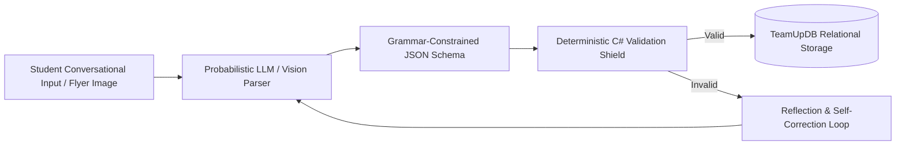

# TeamUp — Adaptable AI Engine Research

> **Autonomous Adaptable AI Systems & Generative UI Architecture** · Master research blueprint outlining the 6-pillar, 30-phase architecture for autonomous student onboarding, flyer-to-event synthesis, project decomposition, and adversarial defense.

> **Sources:**
> - [docs/research/adaptable-ai-engine/SUMMARY.md](../docs/research/adaptable-ai-engine/SUMMARY.md)
> - [docs/research/adaptable-ai-engine/00-EXECUTIVE-FEASIBILITY-REPORT.md](../docs/research/adaptable-ai-engine/00-EXECUTIVE-FEASIBILITY-REPORT.md)
> - [docs/research/adaptable-ai-engine/PILLAR-1-CONVERSATIONAL-ONBOARDING](../docs/research/adaptable-ai-engine/PILLAR-1-CONVERSATIONAL-ONBOARDING)
> - [docs/research/adaptable-ai-engine/PILLAR-2-MULTIMODAL-VISION-AVATARS](../docs/research/adaptable-ai-engine/PILLAR-2-MULTIMODAL-VISION-AVATARS)
> - [docs/research/adaptable-ai-engine/PILLAR-3-AUTONOMOUS-ENTITY-SYNTHESIS](../docs/research/adaptable-ai-engine/PILLAR-3-AUTONOMOUS-ENTITY-SYNTHESIS)
> - [docs/research/adaptable-ai-engine/PILLAR-4-ZERO-MISTAKE-RELIABILITY](../docs/research/adaptable-ai-engine/PILLAR-4-ZERO-MISTAKE-RELIABILITY)
> - [docs/research/adaptable-ai-engine/PILLAR-5-SECURITY-ADVERSARIAL-DEFENSE](../docs/research/adaptable-ai-engine/PILLAR-5-SECURITY-ADVERSARIAL-DEFENSE)
> - [docs/research/adaptable-ai-engine/PILLAR-6-PRODUCTION-OBSERVABILITY](../docs/research/adaptable-ai-engine/PILLAR-6-PRODUCTION-OBSERVABILITY)

---

## Table of Contents

1. [Executive Feasibility & Scientific Blueprint](#executive-feasibility--scientific-blueprint)
2. [Pillar I: Conversational Onboarding & Intent Capture (Phases 01–05)](#pillar-i-conversational-onboarding--intent-capture-phases-0105)
3. [Pillar II: Multimodal Perception, Vision & Avatar Pipeline (Phases 06–10)](#pillar-ii-multimodal-perception-vision--avatar-pipeline-phases-0610)
4. [Pillar III: Autonomous Entity Synthesis & Execution (Phases 11–15)](#pillar-iii-autonomous-entity-synthesis--execution-phases-1115)
5. [Pillar IV: Zero-Mistake Reliability & Validation Shields (Phases 16–20)](#pillar-iv-zero-mistake-reliability--validation-shields-phases-1620)
6. [Pillar V: Security & Adversarial Defense (Phases 21–25)](#pillar-v-security--adversarial-defense-phases-2125)
7. [Pillar VI: Production Observability & Systems Engineering (Phases 26–30)](#pillar-vi-production-observability--systems-engineering-phases-2630)

---

## Executive Feasibility & Scientific Blueprint

The Adaptable AI Engine represents the next-generation evolution of TeamUp: transitioning from a standard CRUD platform into an **Autonomous, Intent-Driven Collaboration Operating System**.

### Core Tenet: Probabilistic AI with Deterministic Software Guards
Probabilistic Large Language Models (LLMs) excel at natural language parsing, fuzzy entity disambiguation, and creative synthesis, but are prone to hallucinations and non-determinism. TeamUp enforces a **Dual-Shield Architecture**:
- AI processes conversational student intent and extracts candidate parameters.
- Deterministic C# software guards (FluentValidation, database check constraints, filtered unique indexes) validate all invariants before persistence.

---

## Pillar I: Conversational Onboarding & Intent Capture (Phases 01–05)

- **Phase 01: Landing Page Zero-Latency Intent Gateway:** Sub-200ms hero intent routing classifying student goals (e.g., "Find a graduation project team" vs. "Host a GDG hackathon").
- **Phase 02: Non-Linear Finite State Slot-Filling Engine:** Multi-slot simultaneous entity extraction allowing fluid dialogue without rigid robotic question sequences.
- **Phase 03: Generative UI Dynamic Form Hydration:** Dual-Coding combining conversational chat with live direct-manipulation preview cards.
- **Phase 04: Public Catalog Entity Disambiguation:** Hybrid trigram and vector similarity mapping informal mentions (e.g., "FCAI") to verified primary keys (`FacultyID = 1`).
- **Phase 05: Session State Recovery & Ephemeral Migration:** Staging anonymous student onboarding drafts in distributed cache until account verification.

---

## Pillar II: Multimodal Perception, Vision & Avatar Pipeline (Phases 06–10)

- **Phase 06: Binary Streamer & Magic-Byte Sniffing:** Client-side drag-and-drop pipeline with client canvas downsampling, magic-byte format validation, and WebP compression.
- **Phase 07: Semantic Image Classification:** Zero-shot Vision Transformer categorizing uploads into Illustrated Characters, Headshots, or Event Flyers.
- **Phase 08: Autonomous Bounding Box Centering:** Automated facial landmark detection framing golden-ratio 1:1 circular avatars without requiring manual user cropping.
- **Phase 09: Flyer, Syllabus & Document OCR:** Vision-Language model parsing unstructured campus flyers, extracting dates, venues, organizers, and agenda items.
- **Phase 10: Secure Storage & Content-Addressed Assets:** SHA-256 asset deduplication, private object storage buckets, and CDN caching.

---

## Pillar III: Autonomous Entity Synthesis & Execution (Phases 11–15)

- **Phase 11: Document-to-Event Synthesis:** End-to-end pipeline transforming parsed flyer OCR into relational `Event` and `EventSession` rows.
- **Phase 12: Project & Team Auto-Drafting:** Synthesizing informal student pitches into structured projects with vacancies and required skill tags.
- **Phase 13: Task Decomposition & Dependency Graphing (DAG):** Breaking large project objectives into acyclic dependency graphs of actionable sprint tasks.
- **Phase 14: Automated Matchmaking:** Cosine similarity matching student skill profiles against project vacancy matrices.
- **Phase 15: Transactional Orchestration:** Committing multi-entity AI creations within atomic database transactions with rollback protection.

---

## Pillar IV: Zero-Mistake Reliability & Validation Shields (Phases 16–20)

- **Phase 16: Grammar-Constrained JSON Generation:** Enforcing strict schema decoding at the token level, preventing syntax errors and missing JSON keys.
- **Phase 17: Multi-Layer Validation Shield:** Piping generated models through FluentValidation before reaching Application services.
- **Phase 18: Reflection & Self-Correction Loops:** Catching validation failures and feeding error logs back to the LLM for automatic schema self-healing.
- **Phase 19: Database Constraint Synchronization:** Dynamic schema reflections keeping AI prompt schemas synchronized with SQL Server migrations.
- **Phase 20: Human-in-the-Loop (HITL) Preview UX:** Mandatory visual review modal allowing students to review, edit, and confirm AI-drafted entities before database insertion.

---

## Pillar V: Security & Adversarial Defense (Phases 21–25)

- **Phase 21: Indirect Prompt Injection Defense:** Sanitizing third-party text, PDF attachments, and flyer OCR against adversarial instruction override attacks.
- **Phase 22: Confused Deputy & Least Privilege:** Enforcing student authorization policies on all tool calls initiated by autonomous AI agents.
- **Phase 23: PII Masking & Data Privacy:** Scrubbing personal phone numbers and private emails prior to external LLM processing.
- **Phase 24: Guardrails & Toxicity Filtering:** Moderating project descriptions and chat messages against harassment, spam, and academic dishonesty.
- **Phase 25: Denial-of-Wallet (DoW) Protection:** Per-student AI quota counters, sliding-window rate limiters, and token budget ceilings.

---

## Pillar VI: Production Observability & Systems Engineering (Phases 26–30)

- **Phase 26: Async Job Queues & SignalR Real-Time Telemetry:** Offloading heavy multimodal vision and LLM parsing to background workers with real-time browser progress streaming.
- **Phase 27: OpenTelemetry & Token Cost Audit:** Detailed tracing of model latencies, token consumption, and operational cost accounting.
- **Phase 28: Continuous Evaluation Benchmarks:** Regression test suite testing prompt accuracy against 100+ standardized student input fixtures.
- **Phase 29: Gateway Fallback & Resilient Routing:** Automated fallback routing between primary and secondary LLM providers during cloud outages.
- **Phase 30: System Master Runbook:** Troubleshooting, recovery procedures, and emergency kill-switches for production operations.
