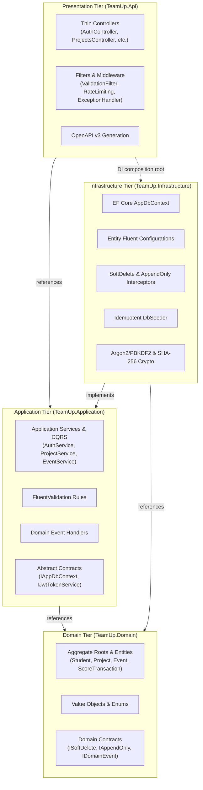
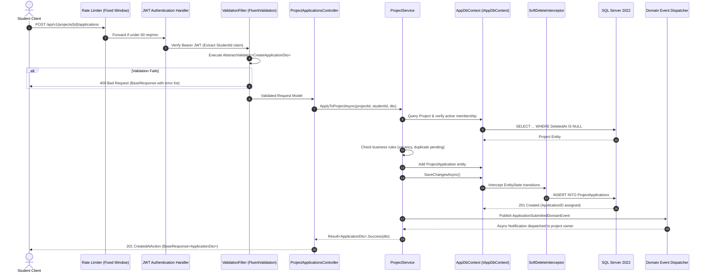

# TeamUp — Architecture Overview

> **Clean Architecture Blueprint & Design Patterns Specification** · Comprehensive guide to domain boundaries, layered request flows, CQRS service segregation, domain events pub-sub, and data integrity guards.

> **Sources:**
> - [docs/architecture/N-TIER-SOLID-ARCHITECTURE-PLAN.md](../docs/architecture/N-TIER-SOLID-ARCHITECTURE-PLAN.md)
> - [docs/architecture/CLEAN-CODE-AUDIT.md](../docs/architecture/CLEAN-CODE-AUDIT.md)
> - [src/TeamUp.Domain/Common](../src/TeamUp.Domain/Common)
> - [src/TeamUp.Infrastructure/Persistence/AppDbContext.cs](../src/TeamUp.Infrastructure/Persistence/AppDbContext.cs)

---

## Table of Contents

1. [Architectural Philosophy](#architectural-philosophy)
2. [N-Tier Clean Architecture Layers](#n-tier-clean-architecture-layers)
3. [End-to-End Request Flow](#end-to-end-request-flow)
4. [Domain Bounded Contexts](#domain-bounded-contexts)
5. [Cross-Cutting Patterns & Domain Events](#cross-cutting-patterns--domain-events)
6. [Data Integrity & Persistence Guards](#data-integrity--persistence-guards)
7. [Security & Claims Architecture](#security--claims-architecture)

---

## Architectural Philosophy

TeamUp is architected as an **N-Tier Clean Architecture Modular Monolith**. It balances the velocity of a unified deployment unit with the strict decoupling of microservices.

### Core Objectives:
- **Clean Boundaries:** Code is segregated into four distinct tiers: Presentation (`Api`), Use Cases (`Application`), Core Business Logic (`Domain`), and Data Access (`Infrastructure`).
- **Strict SOLID Adherence:** Thin controllers adhering to Single Responsibility Principle (SRP), fine-grained service contracts adhering to Interface Segregation Principle (ISP), and dependency inversion targeting pure abstractions (`IAppDbContext`).
- **Resilient Data Foundations:** Physical cascades are completely replaced by transactional soft-deletions, preventing catastrophic relational data loss.

---

## N-Tier Clean Architecture Layers



---

## End-to-End Request Flow

The following sequence traces an authenticated write request (e.g., student applying to join a project):



---

## Domain Bounded Contexts

Entities are partitioned into four discrete bounded contexts under `TeamUp.Domain.Entities`:

| Bounded Context | Aggregate Roots & Entities | Invariants & Business Logic |
|---|---|---|
| **Identity & Catalog** | `University`, `Faculty`, `Student`, `StudentProfile`, `StudentInterest` | Unique academic email addresses, portfolio links, academic year constraints (1–7), interest tags. |
| **Projects & Skills** | `Skill`, `StudentSkill`, `Project`, `ProjectRequiredSkill`, `ProjectMember`, `ProjectApplication`, `ProjectTask` | Minimum/maximum team sizes, student application limits, task state transitions (`Todo` ➔ `InProgress` ➔ `Completed`). |
| **Organizations & Events** | `Organization`, `OrganizationMember`, `MembershipApplication`, `Event`, `EventSession`, `EventRegistration`, `SessionAttendance` | Event capacity limits, multi-session timetables, unique attendance check-ins, registration waitlists. |
| **Gamification & Alerts** | `ScoreTransaction`, `Badge`, `StudentBadge`, `Notification` | Append-only points ledger, algorithmic level calculation, automated badge awards, in-app notification tracking. |

---

## Cross-Cutting Patterns & Domain Events

### 1. Uniform Response Envelope (`BaseResponse<T>`)
Every API endpoint responds with a standardized structure to ensure client predictability:
```json
{
  "success": true,
  "message": "Operation completed successfully.",
  "statusCode": 200,
  "data": { ... },
  "errors": null,
  "timestamp": "2026-11-06T00:30:00Z"
}
```

### 2. Result Pattern
Application services return functional result envelopes rather than throwing exceptions for expected business failures:
```csharp
public record ServiceResult<T>(bool Succeeded, T? Data, string? ErrorMessage, int StatusCode);
```

### 3. Domain Events Pub-Sub
When state changes in one module (e.g., student attends workshop), a domain event is raised:
- `SessionAttendanceRecordedEvent` ➔ `GamificationEventHandler` (awards 50 XP).
- `GamificationEventHandler` ➔ Inserts `ScoreTransaction` ➔ Checks badge milestones ➔ Dispatches in-app `Notification`.

---

## Data Integrity & Persistence Guards

1. **Single-Column Soft-Delete:**
   All 22 mutable domain entities implement `ISoftDelete`. Hard-deletes are intercepted and converted to `DeletedAt = DateTime.UtcNow`. EF Core applies global query filters:
   ```csharp
   modelBuilder.Entity<Project>().HasQueryFilter(e => e.DeletedAt == null);
   ```
2. **The Zero Cascades Rule:**
   All 29 foreign keys specify `DeleteBehavior.Restrict`. Dependent child cascades are managed explicitly in application code within a database transaction.
3. **Immutable Audit Ledger:**
   `ScoreTransaction` implements `IAppendOnly`. Any attempt to update or delete rows throws an `InvalidOperationException`.
4. **Optimistic Concurrency:**
   High-concurrency entities (e.g., `Event` registration capacity) utilize `RowVersion` byte arrays to prevent overselling seats.

---

## Security & Claims Architecture

- **Token Structure:** JWT Access Tokens signed via HMAC-SHA256, carrying `sub` (StudentID), `email`, and `role` (`Student`, `OrgAdmin`, `PlatformAdmin`).
- **Token Rotation:** Refresh tokens are 64 cryptographically secure random bytes hashed with SHA-256 before database storage.
- **Rate Limiting:** Public endpoints are protected via an IP-partitioned rate limiter (60 requests per minute per IP address).
