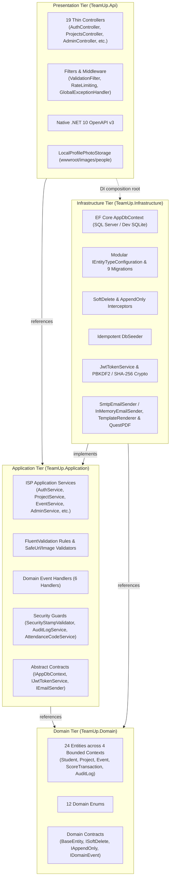
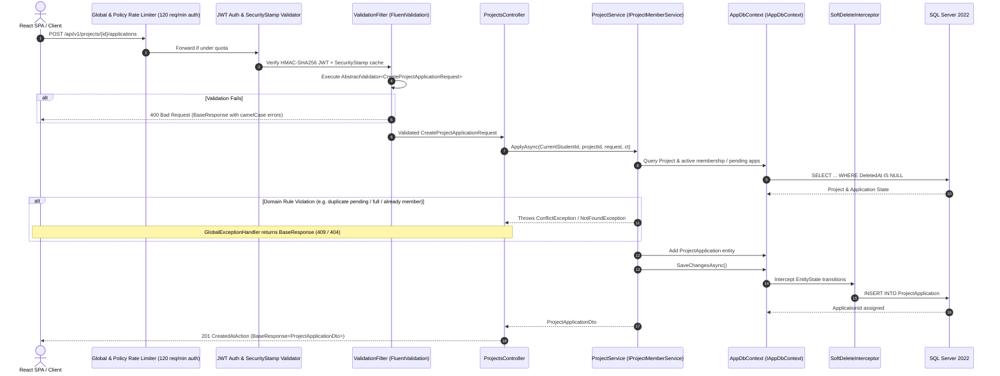

# TeamUp — Architecture Overview

> **Clean Architecture Blueprint & Design Patterns Specification** · Comprehensive guide to domain boundaries, layered request flows, ISP service segregation, domain events pub-sub, STRIDE security controls, and data integrity guards.

> **Sources:**
> - [docs/architecture/N-TIER-SOLID-ARCHITECTURE-PLAN.md](../docs/architecture/N-TIER-SOLID-ARCHITECTURE-PLAN.md)
> - [docs/architecture/CLEAN-CODE-AUDIT.md](../docs/architecture/CLEAN-CODE-AUDIT.md)
> - [docs/security/STRIDE-THREAT-MODEL.md](../docs/security/STRIDE-THREAT-MODEL.md)
> - [backend/src/TeamUp.Domain/Common](../backend/src/TeamUp.Domain/Common)
> - [backend/src/TeamUp.Infrastructure/Persistence/AppDbContext.cs](../backend/src/TeamUp.Infrastructure/Persistence/AppDbContext.cs)

---

## Table of Contents

1. [Architectural Philosophy](#architectural-philosophy)
2. [N-Tier Clean Architecture Layers](#n-tier-clean-architecture-layers)
3. [End-to-End Request Flow](#end-to-end-request-flow)
4. [Domain Bounded Contexts](#domain-bounded-contexts)
5. [Cross-Cutting Patterns & Domain Events](#cross-cutting-patterns--domain-events)
6. [Data Integrity & Persistence Guards](#data-integrity--persistence-guards)
7. [Security & Claims Architecture](#security--claims-architecture)

---

## Architectural Philosophy

TeamUp is architected as an **N-Tier Clean Architecture Modular Monolith** paired with a decoupled React 19 SPA. It balances the velocity of a unified deployment unit with strict layer decoupling and SOLID interface segregation.

### Core Objectives:
- **Clean Boundaries:** Code is segregated into four distinct tiers: Presentation (`TeamUp.Api`), Application Use Cases (`TeamUp.Application`), Core Business Logic (`TeamUp.Domain`), and Data Access & Outbound Integrations (`TeamUp.Infrastructure`).
- **Strict SOLID Adherence:** Thin controllers adhering to Single Responsibility Principle (SRP), fine-grained service contracts adhering to Interface Segregation Principle (ISP), and dependency inversion targeting pure abstractions (`IAppDbContext`, `IJwtTokenService`, `IEmailSender`).
- **Resilient Data Foundations:** Physical cascades are completely replaced by `DeleteBehavior.Restrict` (`NO ACTION`) and transactional soft-deletions (`DeletedAt`), preventing catastrophic relational data loss.

---

## N-Tier Clean Architecture Layers



---

## End-to-End Request Flow

The following sequence traces an authenticated write request (e.g., a student applying to join a project):



*(When the project creator later reviews the application via `PATCH /api/v1/projects/{id}/applications/{appId}`, `ProjectService` raises `ApplicationReviewedDomainEvent`, which `DomainEventDispatcher` dispatches post-commit to notify the applicant.)*

---

## Domain Bounded Contexts

Entities are partitioned across four bounded contexts under `TeamUp.Domain.Entities`:

| Bounded Context | Entities (24 Runtime Tables) | Invariants & Business Logic |
|---|---|---|
| **Identity & Governance** | `University`, `Faculty`, `Student`, `StudentProfile`, `StudentInterest`, `AuditLog` | Unique academic emails (`WHERE [DeletedAt] IS NULL`), academic year (`1–7`), roles (`Student`, `OrgAdmin`, `PlatformAdmin`), `SecurityStamp`, lockout tracking, email preferences, and immutable `AuditLog`. |
| **Projects & Skills** | `Skill`, `StudentSkill`, `Project`, `ProjectRequiredSkill`, `ProjectMember`, `ProjectApplication`, `ProjectTask` | `MaxTeamSize >= 1`, `RowVersion` concurrency on `Project`, proficiency levels (`Beginner`, `Intermediate`, `Advanced`), project statuses (`Recruiting`, `InProgress`, `Completed`, `Archived`), task states (`Todo`, `InProgress`, `InReview`, `Done`), and one pending application per `(ProjectId, StudentId)`. |
| **Organizations & Events** | `Organization`, `OrganizationMember`, `MembershipApplication`, `Event`, `EventSession`, `EventRegistration`, `SessionAttendance` | Scoped `OrgAdmin` permissions, `RowVersion` capacity checks with `Waitlisted` auto-promotion, multi-session timetables, and rotating 60s HMAC-SHA256 QR/PIN check-in with `RecordedByStudentId` provenance. |
| **Gamification & Alerts** | `ScoreTransaction`, `Badge`, `StudentBadge`, `Notification` | Idempotent `ScoreLedger` on append-only `ScoreTransaction`, deterministic level math, automated badge evaluation (`PointsThreshold`, `EventCount`, `TaskCount`), and in-app notifications inbox. |

---

## Cross-Cutting Patterns & Domain Events

### 1. Uniform Response Envelope (`ApiResponse<T>` / `BaseResponse<T>`)
Every JSON endpoint responds with a standardized envelope (`BaseResponse<T>` aliases `ApiResponse<T>`):
```json
{
  "success": true,
  "message": "Operation completed successfully.",
  "statusCode": 200,
  "data": { },
  "errors": null,
  "timestamp": "2026-11-24T12:00:00Z"
}
```

### 2. Exception-Driven Domain Error Flow
Application services return typed DTOs or `PagedResult<T>` on success and throw typed domain exceptions from [`AppExceptions.cs`](../backend/src/TeamUp.Application/Common/Exceptions/AppExceptions.cs) when invariants fail. [`GlobalExceptionHandler`](../backend/src/TeamUp.Api/Middleware/GlobalExceptionHandler.cs) translates them into `BaseResponse` HTTP responses:
- `ValidationException` / `BadRequestException` / `ArgumentException` ➔ `400 Bad Request`
- `UnauthorizedException` ➔ `401 Unauthorized`
- `ForbiddenException` ➔ `403 Forbidden`
- `NotFoundException` ➔ `404 Not Found`
- `ConflictException` / `DbUpdateConcurrencyException` / unique-constraint `DbUpdateException` ➔ `409 Conflict`

### 3. Domain Events Pub-Sub (6 Events & Handlers)
`AppDbContext.SaveChangesAsync` collects `IDomainEvent` entries from tracked `IHasDomainEvents` entities and dispatches them post-commit via `IDomainEventDispatcher`:

| Domain Event | Trigger Source | Reactive Handler | Side Effect |
|---|---|---|---|
| `TaskCompletedDomainEvent` | `ProjectService.UpdateTaskAsync` (status ➔ `Done`) | `TaskCompletedDomainEventHandler` | Awards `+50 XP` once per task via `ScoreLedger`; evaluates badges. |
| `SessionAttendedDomainEvent` | `EventService.CheckInAsync` / `SelfCheckInAsync` | `SessionAttendedDomainEventHandler` | Awards `+25 XP` once per `(StudentId, SessionId)` via `ScoreLedger`; evaluates badges. |
| `ProjectCompletedDomainEvent` | `ProjectService.UpdateProjectAsync` (status ➔ `Completed`) | `ProjectCompletedDomainEventHandler` | Awards `+100 XP` per distinct team member once per project; evaluates badges. |
| `TaskAssignedDomainEvent` | `ProjectService.AssignTaskAsync` | `TaskAssignedDomainEventHandler` | Inserts `NotificationType.TaskAssigned` alert for assignee. |
| `ApplicationReviewedDomainEvent` | `ProjectService` / `OrganizationService` `ReviewApplicationAsync` | `ApplicationReviewedDomainEventHandler` | Inserts `NotificationType.ApplicationStatus` alert for applicant. |
| `WaitlistPromotedDomainEvent` | `EventService.CancelRegistrationAsync` | `WaitlistPromotedDomainEventHandler` | Inserts `NotificationType.EventReminder` alert for promoted student. |

---

## Data Integrity & Persistence Guards

1. **Single-Column Soft-Delete:**
   22 mutable entities implement `ISoftDelete` (`DeletedAt DATETIME2 NULL`). Hard-deletes are intercepted by `SoftDeleteInterceptor` and converted to `DeletedAt = DateTime.UtcNow`. EF Core applies global query filters `e.DeletedAt == null`.
2. **The Zero Cascades Rule:**
   All **31 foreign keys** enforce `DeleteBehavior.Restrict` (`ON DELETE NO ACTION ON UPDATE NO ACTION`). Dependent soft-deletes (e.g., university faculties or event sessions) are orchestrated explicitly in application services.
3. **Immutable Audit Ledgers:**
   `ScoreTransaction` and `AuditLog` implement `IAppendOnly`. Any attempt to update or delete rows throws `InvalidOperationException` in `SoftDeleteInterceptor`.
4. **Optimistic Concurrency & Idempotency:**
   `Project` and `Event` enforce `RowVersion` (`IsRowVersion()`), while `ScoreTransaction` enforces a filtered unique index on `(StudentId, SourceType, SourceReferenceId) WHERE [SourceReferenceId] IS NOT NULL`.

---

## Security & Claims Architecture

- **Token Structure:** HMAC-SHA256 JWT access tokens (15 min default) carrying `sub`, `nameidentifier`, `email`, `name`, `role` (`Student`, `OrgAdmin`, `PlatformAdmin`), `jti`, `security_stamp`, and scoped `org_admin` claims for each organization administered.
- **Immediate Revocation (`SecurityStamp`):** `JwtBearerEvents.OnTokenValidated` verifies the token's `security_stamp` and `role` against `ISecurityStampValidator` (30s `IMemoryCache` TTL, invalidated on logout, password reset, role change, and account deletion).
- **Refresh Token Rotation & Replay Detection:** 64-byte crypto random tokens stored as SHA-256 hashes; rotating within `RefreshReuseGrace = 10s` returns a benign error while replay outside the grace window revokes the entire session and rotates `SecurityStamp`.
- **Login Abuse Protection:** Escalating temporary lockout (`FailedLoginCount` / `LockoutEndUtc`, capped at 15 minutes).
- **Rate Limiting & Proxy Trust:** Partitioned fixed-window limiters (`120/min` authenticated, `30/min` anonymous, `30/min` `auth-policy`, `30/min` `directory-policy`; `/health` exempt) using sanitized `RemoteIpAddress` only (`ForwardedHeaders` cleared by default unless `KnownProxies`/`KnownNetworks` are configured).
- **HTTP Security Headers:** `X-Content-Type-Options: nosniff`, `X-Frame-Options: DENY`, `Referrer-Policy: no-referrer`, `X-Permitted-Cross-Domain-Policies: none`, and strict `Content-Security-Policy` headers on every API response.
