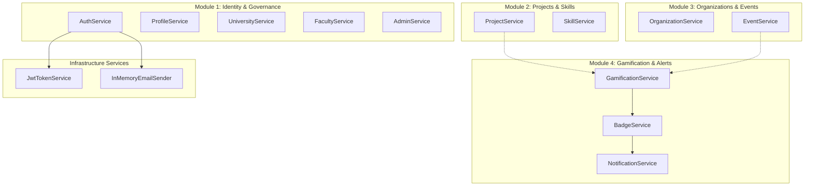

# TeamUp — Backend Services

> **Service Catalogue & Core Business Logic Guide** · In-depth documentation of Application Services, interface contracts, domain validation logic, and reactive event-driven side effects across all 4 modules.

> **Sources:**
> - [src/TeamUp.Application/Services](../src/TeamUp.Application/Services)
> - [src/TeamUp.Infrastructure/Services](../src/TeamUp.Infrastructure/Services)
> - [docs/architecture/N-TIER-SOLID-ARCHITECTURE-PLAN.md](../docs/architecture/N-TIER-SOLID-ARCHITECTURE-PLAN.md)

---

## Table of Contents

1. [Service Catalogue Overview](#service-catalogue-overview)
2. [Module 1: Auth, Identity & Platform Governance Services](#module-1-auth-identity--platform-governance-services)
3. [Module 2: Skills, Projects & Task Services](#module-2-skills-projects--task-services)
4. [Module 3: Organizations, Events & Attendance Services](#module-3-organizations-events--attendance-services)
5. [Module 4: Gamification, Badges & Notification Services](#module-4-gamification-badges--notification-services)
6. [Cross-Module Reactive Domain Event Handlers](#cross-module-reactive-domain-event-handlers)
7. [Infrastructure Services](#infrastructure-services)

---

## Service Catalogue Overview

---

## Module 1: Auth, Identity & Platform Governance Services

### 1. `AuthService` (`IAuthService`)
- **Responsibilities:** Student registration, credential authentication, refresh token rotation, session revocation, and password reset flows.
- **Security Logic:**
  - Hashes passwords using ASP.NET Core Identity's PBKDF2 implementation (`IPasswordHasher<Student>`).
  - Issues 64-byte cryptographically secure random refresh tokens, storing only their SHA-256 hash.
  - Generates secure password reset tokens with a strict 15-minute expiry window.
  - Enforces faculty affiliation validation before creating student accounts.

### 2. `ProfileService` (`IProfileService`)
- **Responsibilities:** Student discovery directory, public portfolio cards, bio updates, and interest tag management.
- **Optimizations:** Read-only methods (`GetMyProfileAsync`, `GetStudentCardAsync`) execute with `.AsNoTracking()`.

### 3. `UniversityService` & `FacultyService`
- **Responsibilities:** Hierarchical academic catalog management. Public lookup queries are cached via `IMemoryCache` (30-minute sliding window) and invalidated on admin mutations.

### 4. `AdminService` (`IAdminService`)
- **Responsibilities:** Executive platform dashboard telemetry, system-wide entity listing, account locking, and universal soft-delete restoration (`.IgnoreQueryFilters()`).

---

## Module 2: Skills, Projects & Task Services

### 1. `SkillService` (`ISkillService`)
- **Responsibilities:** Master skills catalog categorization and student skill claims with proficiency ratings (1 = Beginner to 5 = Expert).
- **Invariants:** Enforces filtered unique index on `(StudentID, SkillID)` to prevent duplicate endorsement claims.

### 2. `ProjectService` (`IProjectService`)
- **Responsibilities:**
  - Project creation, status lifecycle transitions (`Draft`, `Recruiting`, `InProgress`, `Completed`, `Cancelled`).
  - Required skills specification for vacancies.
  - Team membership assignments (`ProjectRole: Owner, Member`).
  - Candidate application reviews (`ApplyToProject`, `AcceptApplication`, `RejectApplication`).
  - Kanban sprint task boards (`Todo`, `InProgress`, `Completed`).
- **Integrity Rule:** Deleting a project soft-deletes associated tasks and applications within an explicit database transaction.

---

## Module 3: Organizations, Events & Attendance Services

### 1. `OrganizationService` (`IOrganizationService`)
- **Responsibilities:** Student organization directory, executive board appointments, and membership recruitment campaigns.
- **Authorization Guard:** Mutations require `OrgAdmin` role or creator ownership.

### 2. `EventService` (`IEventService`)
- **Responsibilities:**
  - Campus workshops and multi-session timetable schedules.
  - Seat capacity reservations with waitlist transitions.
  - QR Code and PIN code attendance check-in verification.
- **Duplicate Prevention:** Prevents double check-ins via filtered unique index on `(SessionID, StudentID)`.

---

## Module 4: Gamification, Badges & Notification Services

### 1. `GamificationService` (`IGamificationService`)
- **Responsibilities:** Appending score transactions, calculating real-time point balances, and computing level progressions.
- **Level Formula:**
  $$\text{Level} = \left\lfloor 1 + \sqrt{\frac{\text{TotalPoints}}{100}} \right\rfloor$$
- **Immutability:** Transactions are saved to the `ScoreTransaction` ledger. Modifying or deleting ledger rows is blocked by `SoftDeleteInterceptor`.

### 2. `BadgeService` (`IBadgeService`)
- **Responsibilities:** Achievement catalog management and automated criteria rule evaluation.
- **Criteria Evaluator:** Evaluates student score thresholds, completed project counts, and verified workshop attendances.

### 3. `NotificationService` (`INotificationService`)
- **Responsibilities:** In-app inbox notifications, unread counters, and bulk mark-as-read updates.

---

## Cross-Module Reactive Domain Event Handlers

TeamUp utilizes in-process domain event dispatching to avoid tight coupling between modules:

| Event Published | Trigger Source | Reactive Handler | Side Effect |
|---|---|---|---|
| `AttendanceCheckedInDomainEvent` | `EventService.CheckInAsync` | `GamificationAttendanceHandler` | Appends +50 XP score transaction; checks workshop badge milestones. |
| `TaskCompletedDomainEvent` | `ProjectService.UpdateTaskStatusAsync` | `GamificationTaskHandler` | Appends +25 XP to student; notifies project owner. |
| `ApplicationAcceptedDomainEvent` | `ProjectService.AcceptApplicationAsync` | `NotificationEventHandler` | Sends congratulatory in-app notification to candidate. |
| `ScoreAwardedDomainEvent` | `GamificationService.AwardPointsAsync` | `BadgeEvaluationHandler` | Evaluates level thresholds and unlocks eligible badges. |

---

## Infrastructure Services

- **`JwtTokenService` (`IJwtTokenService`):** Assembles claims (`sub`, `email`, `role`, `facultyId`), signs HMAC-SHA256 access tokens, and configures expiration.
- **`InMemoryEmailSender` (`IEmailSender`):** Development email simulator logging verification links and password reset tokens to the console without third-party SMTP dependencies.
