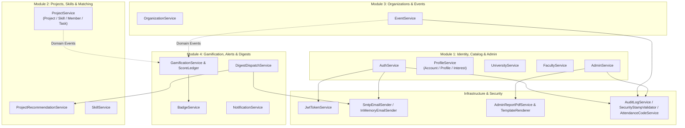

# TeamUp — Backend Services

> **Service Catalogue & Core Business Logic Guide** · Complete reference for all Application Services, ISP contracts, Security & Governance guards, Domain Event handlers, and Infrastructure/API services.

> **Sources:**
> - [backend/src/TeamUp.Application/DependencyInjection.cs](../backend/src/TeamUp.Application/DependencyInjection.cs)
> - [backend/src/TeamUp.Application/Services](../backend/src/TeamUp.Application/Services)
> - [backend/src/TeamUp.Application/Gamification/EventHandlers/GamificationDomainEventHandlers.cs](../backend/src/TeamUp.Application/Gamification/EventHandlers/GamificationDomainEventHandlers.cs)
> - [backend/src/TeamUp.Infrastructure/DependencyInjection.cs](../backend/src/TeamUp.Infrastructure/DependencyInjection.cs)
> - [backend/src/TeamUp.Infrastructure/Services](../backend/src/TeamUp.Infrastructure/Services)

---

## Table of Contents

1. [Service Catalogue Overview](#service-catalogue-overview)
2. [Module 1: Auth, Identity, Catalog & Admin Services](#module-1-auth-identity-catalog--admin-services)
3. [Module 2: Skills, Projects, Recommendations & Task Services](#module-2-skills-projects-recommendations--task-services)
4. [Module 3: Organizations, Events & Attendance Services](#module-3-organizations-events--attendance-services)
5. [Module 4: Gamification, Badges, Notifications & Digest Services](#module-4-gamification-badges-notifications--digest-services)
6. [Cross-Module Security & Governance Services](#cross-cutting-security--governance-services)
7. [Cross-Module Reactive Domain Event Handlers](#cross-module-reactive-domain-event-handlers)
8. [Infrastructure & Presentation Services](#infrastructure--presentation-services)

---

## Service Catalogue Overview

---

## Module 1: Auth, Identity, Catalog & Admin Services

### 1. `AuthService` (`IAuthService`)
- **Responsibilities:** Student registration (with opt-in email notification flags), credential login, refresh token rotation, logout revocation, and password recovery.
- **Security Logic:**
  - Hashes passwords with ASP.NET Core Identity PBKDF2 (`IPasswordHasher<Student>`).
  - Escalating temporary login lockout (`FailedLoginCount` / `LockoutEndUtc`, capped at `MaxLockout = 15 minutes`).
  - Issues 64-byte random refresh tokens stored as SHA-256 hashes, with `RefreshReuseGrace = 10 seconds` and full session revocation (`SecurityStamp` rotation) on replay outside the grace window.
  - Issues 15-minute SHA-256 hashed password reset tokens redacted from HTTP payloads (`ForgotPasswordResponse` returns a generic message).

### 2. `ProfileService` (`IStudentAccountService`, `IStudentProfileService`, `IStudentInterestService`)
- **Responsibilities:** Split via Interface Segregation Principle (ISP) into three focused interfaces:
  - `IStudentAccountService`: Public student showcase (`GetPublicShowcaseAsync`), privacy-filtered directory search (max `20` items/page, respects `ShowEmailInDirectory`), self account read/update/soft-delete.
  - `IStudentProfileService`: Extended biography, portfolio links (`SafeUrlValidator`), and profile photo URL updates.
  - `IStudentInterestService`: Student interest tags retrieval, addition, and removal.

### 3. `UniversityService` (`IUniversityService`) & `FacultyService` (`IFacultyService`)
- **Responsibilities:** Multi-tenant university and faculty CRUD, plus anonymous academic catalog lookup (`/api/v1/universities/catalog`) cached via `IMemoryCache` (`CatalogCacheKeys.AcademicCatalog`, 1-hour TTL) and invalidated on mutations.

### 4. `AdminService` (`IAdminService`)
- **Responsibilities:** Platform dashboard metrics, guarded role management (`Admin:AllowRuntimePlatformAdminPromotion` prevents runtime `PlatformAdmin` escalation by default), universal soft-delete listing & restoration (`.IgnoreQueryFilters()`), and paginated immutable `AuditLog` queries.

---

## Module 2: Skills, Projects, Recommendations & Task Services

### 1. `SkillService` (`ISkillService`)
- **Responsibilities:** Master skills catalog management (1-hour `IMemoryCache` for unfiltered catalog) and student skill claims using `ProficiencyLevel` (`Beginner`, `Intermediate`, `Advanced`) and `YearsOfExperience`.

### 2. `ProjectService` (`IProjectService`, `IProjectSkillService`, `IProjectMemberService`, `IProjectTaskService`)
- **Responsibilities:** Segregated across four ISP interfaces:
  - `IProjectService`: Project CRUD, `RowVersion` optimistic concurrency, lifecycle transitions (`Recruiting`, `InProgress`, `Completed`, `Archived`), transactional soft-delete of child tasks/applications/members/required-skills.
  - `IProjectSkillService`: Required skill matrix management (`RequiredLevel`, `IsMandatory`).
  - `IProjectMemberService`: Team roster management and candidate application workflow (`Pending`, `Accepted`, `Rejected`, `Withdrawn`).
  - `IProjectTaskService`: Kanban sprint task board (`Todo`, `InProgress`, `InReview`, `Done`), member assignment, and status transitions.

### 3. `ProjectRecommendationService` (`IProjectRecommendationService`)
- **Responsibilities:** Computes skill-overlap match percentages between a student's claimed skills and open `Recruiting` projects' required skills (used by `DigestDispatchService` for project-match email digests).

---

## Module 3: Organizations, Events & Attendance Services

### 1. `OrganizationService` (`IOrganizationService`)
- **Responsibilities:** Student club directory, leadership & member rosters, and membership recruitment applications (`Pending`, `Accepted`, `Rejected`, `Withdrawn`).
- **Authorization Guard:** Mutations verify organization-scoped board/admin permissions via `IOrganizationAuthorizationService`.

### 2. `EventService` (`IEventService`)
- **Responsibilities:**
  - Campus events (`Workshop`, `Hackathon`, `Session`, `Competition`) and multi-session timetables (`EventSession`).
  - Seat capacity registration with `RowVersion` concurrency and automatic waitlist promotion when a confirmed registration cancels.
  - Rotating 60-second HMAC-SHA256 check-in code generation (`GenerateCheckInCodeAsync`), student self-check-in (`SelfCheckInAsync` with `Attendance:MaxSelfCheckInsPerWindow` burst cap), organizer manual/QR/RFID check-in (`CheckInAsync` recording `RecordedByStudentId`), attendance revocation, and printable HTML report rendering (`RenderAttendanceReportHtmlAsync`).

---

## Module 4: Gamification, Badges, Notifications & Digest Services

### 1. `GamificationService` (`IGamificationService`) & `ScoreLedger`
- **Responsibilities:** Computes real-time point balances and level progression (`CalculateLevelMetrics`), serves paginated `ScoreTransaction` history, processes admin manual score adjustments (`AuditLog`-recorded), and computes the ranked campus leaderboard (`GetLeaderboardAsync`).
- **Level Formula:**
  $$\text{Level} = \left\lfloor 1 + \sqrt{\frac{\max(\text{TotalPoints}, 0)}{100}} \right\rfloor$$
- **Idempotency & Immutability:** Automated event rewards go through `ScoreLedger.TryAwardAsync` guarded by a unique filtered index on `(StudentId, SourceType, SourceReferenceId) WHERE [SourceReferenceId] IS NOT NULL`. Updates/deletes to `ScoreTransaction` are blocked by `SoftDeleteInterceptor`.

### 2. `BadgeService` (`IBadgeService`)
- **Responsibilities:** Badge catalog CRUD (1-hour `IMemoryCache`), manual admin badge awarding, and automated criteria evaluation (`PointsThreshold`, `EventCount`, `TaskCount`).

### 3. `NotificationService` (`INotificationService`)
- **Responsibilities:** In-app notification inbox retrieval (with `unreadOnly` filter), mark-single-read, mark-all-read, and soft-deletion.

### 4. `DigestDispatchService` (`IDigestDispatchService`)
- **Responsibilities:** Dispatches opt-in `LeaderboardDigest` and `ProjectMatchDigest` templated HTML emails (`ReceiveLeaderboardDigests`, `ReceiveProjectMatchEmails`, `EmailNotificationsEnabled`), supporting `TestToMe`, live broadcast, and `DryRun` modes.

---

## Cross-Cutting Security & Governance Services

- **`OrganizationAuthorizationService` (`IOrganizationAuthorizationService`):** Enforces tenant-scoped `OrgAdmin` / executive board membership checks on organizations, events, sessions, and attendance (mitigates BOLA).
- **`SecurityStampValidator` (`ISecurityStampValidator`):** Validates JWT `security_stamp` and `role` claims against `IMemoryCache` (30s TTL) + `AppDbContext` for immediate session revocation.
- **`AuditLogService` (`IAuditLogService`):** Appends immutable `AuditLog` entries capturing `ActorStudentId`, `ActorEmail`, `Action`, `EntityType`, `EntityId`, `OldValues`, `NewValues`, and sanitized `ClientIp`.
- **`AttendanceCodeService` (`IAttendanceCodeService`):** Generates and constant-time-verifies (`FixedTimeEquals`) 60-second rotating HMAC-SHA256 session check-in codes (`{step}.{16-hex-sig}`).
- **`SecurityStartupValidator`:** Fails fast at startup if JWT signing keys, SMTP transport (Production), SQL TLS (`Encrypt=True;TrustServerCertificate=False` in Production), or non-Dev seed passwords violate security policy.

---

## Cross-Module Reactive Domain Event Handlers

TeamUp dispatches **6 domain events** post-commit via `DomainEventDispatcher`:

| Event Published | Trigger Source | Reactive Handler | Side Effect |
|---|---|---|---|
| `TaskCompletedDomainEvent` | `ProjectService.UpdateTaskAsync` (status ➔ `Done`) | `TaskCompletedDomainEventHandler` | Awards **`+50 XP`** once per task via `ScoreLedger`; evaluates student badges. |
| `SessionAttendedDomainEvent` | `EventService.CheckInAsync` / `SelfCheckInAsync` | `SessionAttendedDomainEventHandler` | Awards **`+25 XP`** once per `(StudentId, SessionId)` via `ScoreLedger`; evaluates student badges. |
| `ProjectCompletedDomainEvent` | `ProjectService.UpdateProjectAsync` (status ➔ `Completed`) | `ProjectCompletedDomainEventHandler` | Awards **`+100 XP`** to each distinct project member once per project; evaluates badges. |
| `TaskAssignedDomainEvent` | `ProjectService.AssignTaskAsync` | `TaskAssignedDomainEventHandler` | Inserts `NotificationType.TaskAssigned` alert for the assigned student. |
| `ApplicationReviewedDomainEvent` | `ProjectService` & `OrganizationService` `ReviewApplicationAsync` | `ApplicationReviewedDomainEventHandler` | Inserts `NotificationType.ApplicationStatus` alert (`accepted` / `rejected`) for the applicant. |
| `WaitlistPromotedDomainEvent` | `EventService.CancelRegistrationAsync` | `WaitlistPromotedDomainEventHandler` | Inserts `NotificationType.EventReminder` alert when a waitlisted student is promoted to `Confirmed`. |

---

## Infrastructure & Presentation Services

- **`JwtTokenService` (`IJwtTokenService`):** Signs HMAC-SHA256 access tokens (`sub`, `nameidentifier`, `email`, `name`, `role`, `jti`, `security_stamp`, scoped `org_admin`), generates 64-byte crypto refresh tokens, and hashes tokens with SHA-256.
- **`SmtpEmailSender` & `InMemoryEmailSender` (`IEmailSender`):** Dispatches transactional password reset, digest, and admin report emails (SMTP mandatory in Production; `InMemoryEmailSender` for Development/Testing).
- **`TemplateRenderer` (`ITemplateRenderer`):** Renders embedded HTML templates under `TeamUp.Infrastructure/Templates/` (`Emails/` and `Reports/`) with embedded brand assets (`BrandAssets.cs`).
- **`AdminReportPdfService` (`IAdminReportService`):** Generates QuestPDF platform governance summary PDFs and emails them to administrators.
- **`LocalProfilePhotoStorage` (`IProfilePhotoStorage`):** Validates uploaded JPEG/PNG/WebP images via magic-byte sniffing (`ImageFileValidator`, max 3 MB) and persists portraits to `wwwroot/images/people/`.
