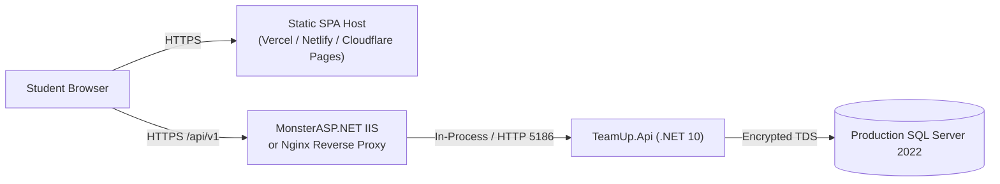

# TeamUp — Deployment Guide

> **Production Deployment Manual & Operational Runbook** · Covers both the active free-tier cloud deployment (MonsterASP.NET + Vercel/Netlify/Cloudflare Pages) and self-hosted Kestrel + Nginx + SQL Server deployment, EF Core migration procedures, and backup policies.

> **Sources:**
> - [docs/DEPLOYMENT_FREE.md](../docs/DEPLOYMENT_FREE.md)
> - [.github/workflows/deploy-monsterasp.yml](../.github/workflows/deploy-monsterasp.yml)
> - [scripts/publish-monsterasp.ps1](../scripts/publish-monsterasp.ps1)
> - [backend/src/TeamUp.Api/appsettings.Production.example.json](../backend/src/TeamUp.Api/appsettings.Production.example.json)
> - [backend/src/TeamUp.Api/Program.cs](../backend/src/TeamUp.Api/Program.cs)
> - [netlify.toml](../netlify.toml)

---

## Table of Contents

1. [Deployment Topologies](#deployment-topologies)
2. [Option A: Managed Free-Tier Deployment (MonsterASP.NET + Static SPA CDN)](#option-a-managed-free-tier-deployment-monsteraspnet--static-spa-cdn)
3. [Option B: Self-Hosted Nginx Reverse Proxy & Kestrel](#option-b-self-hosted-nginx-reverse-proxy--kestrel)
4. [Environment Configuration & Secrets Management](#environment-configuration--secrets-management)
5. [Database Migration Runbook](#database-migration-runbook)
6. [Disaster Recovery & Backup Policy](#disaster-recovery--backup-policy)
7. [Operational Monitoring & Log Rotation](#operational-monitoring--log-rotation)

---

## Deployment Topologies



---

## Option A: Managed Free-Tier Deployment (MonsterASP.NET + Static SPA CDN)

See the dedicated walkthrough in [`docs/DEPLOYMENT_FREE.md`](../docs/DEPLOYMENT_FREE.md). Key automated components:

- **Automated Backend CD ([`.github/workflows/deploy-monsterasp.yml`](../.github/workflows/deploy-monsterasp.yml)):**
  - Builds & publishes `backend/src/TeamUp.Api` in `Release` (`ServerGarbageCollection=false` for 256 MB RAM tier), prunes non-Windows runtimes and dev configs, normalizes `MONSTERASP_APPSETTINGS_JSON` (stripping any UTF-8 BOM, forcing `Seed.Enabled=false` and removing `Seed.AdminPassword` on ongoing deploys), and syncs via MSDeploy with `-enableRule:AppOffline` and `-enableRule:DoNotDeleteRule` (preserving uploaded user portraits in `wwwroot/images/people/student-*`).
- **Manual Publish Archive ([`scripts/publish-monsterasp.ps1`](../scripts/publish-monsterasp.ps1)):**
  - Emits `artifacts/teamup-api-monsterasp.zip` stripped of `appsettings.Development.json`.
- **Frontend SPA Hosting:**
  - **Netlify:** Root [`netlify.toml`](../netlify.toml) sets `base = "frontend"`, `command = "npm run build"`, `publish = "dist"`, `NODE_VERSION = "22"`, SPA redirects, and strict CSP/camera permissions headers.
  - **Vercel / Cloudflare Pages:** Root directory `frontend`, build command `npm run build`, output `dist`, configured with `VITE_API_BASE_URL=https://<your-api-domain>` and SPA routing via `frontend/vercel.json` / `frontend/public/_redirects`.

---

## Option B: Self-Hosted Nginx Reverse Proxy & Kestrel

Sample production Nginx configuration (`/etc/nginx/sites-available/teamup.conf`):

```nginx
server {
    listen 80;
    server_name api.teamup.edu;
    return 301 https://$host$request_uri;
}

server {
    listen 443 ssl http2;
    server_name api.teamup.edu;

    ssl_certificate /etc/letsencrypt/live/api.teamup.edu/fullchain.pem;
    ssl_certificate_key /etc/letsencrypt/live/api.teamup.edu/privkey.pem;

    client_max_body_size 10M;

    location / {
        proxy_pass http://127.0.0.1:5186;
        proxy_http_version 1.1;
        proxy_set_header Upgrade $http_upgrade;
        proxy_set_header Connection keep-alive;
        proxy_set_header Host $host;
        proxy_cache_bypass $http_upgrade;
        proxy_set_header X-Forwarded-For $proxy_add_x_forwarded_for;
        proxy_set_header X-Forwarded-Proto $scheme;
    }

    location /health {
        proxy_pass http://127.0.0.1:5186/health;
        access_log off;
    }
}
```

When running behind Nginx, configure `ForwardedHeaders__KnownProxies__0="127.0.0.1"` so `UseForwardedHeaders()` trusts `X-Forwarded-For` / `X-Forwarded-Proto` exclusively from Nginx.

---

## Environment Configuration & Secrets Management

Production settings must be supplied via OS environment variables, git-ignored `appsettings.Production.json` (modeled on [`appsettings.Production.example.json`](../backend/src/TeamUp.Api/appsettings.Production.example.json)), or secret vaults. Startup fails fast via `SecurityStartupValidator` if secrets or TLS settings are insecure.

### Required Production Environment Variables:

```bash
# ASP.NET Core Runtime
ASPNETCORE_ENVIRONMENT=Production
ASPNETCORE_URLS=http://+:5186
Hosting__EnableHttpsRedirection=true

# Database Connection String (Encrypt=True & TrustServerCertificate=False enforced in Production)
ConnectionStrings__TeamUpDb="Server=sql.internal.teamup.edu;Database=TeamUpDB_Prod;User Id=teamup_app;Password=<vault-managed-db-secret>;Encrypt=True;TrustServerCertificate=False;MultipleActiveResultSets=True;"
Database__AutoMigrate=false

# JWT Security Credentials (Min 32 random UTF-8 bytes; startup fails fast on fallback/short keys)
Jwt__Issuer="TeamUp"
Jwt__Audience="TeamUp.Clients"
Jwt__Key="<vault-managed-random-64-byte-secret>"
Jwt__AccessTokenMinutes=15
Jwt__RefreshTokenDays=7
Jwt__PasswordResetTokenMinutes=15

# Email Transport (SMTP mandatory in Production; InMemory rejected at startup)
Email__Provider="Smtp"
Email__SmtpHost="smtp.teamup.edu"
Email__SmtpPort=587
Email__UseSsl=true
Email__Username="no-reply@teamup.edu"
Email__Password="<vault-managed-smtp-secret>"
Email__FromAddress="no-reply@teamup.edu"
Email__FromName="TeamUp Platform"
Email__ResetPasswordUrlBase="https://teamup.edu/auth/reset-password"
Email__FrontendBaseUrl="https://teamup.edu"

# Reverse Proxy Trust & Explicit CORS Origins
ForwardedHeaders__ForwardLimit=1
ForwardedHeaders__KnownProxies__0="127.0.0.1"
Cors__AllowedOrigins__0="https://teamup.edu"

# Rate Limiting & Attendance Anti-Relay Cap
RateLimiting__WindowSeconds=60
RateLimiting__AuthenticatedPermitLimit=120
RateLimiting__AnonymousPermitLimit=30
RateLimiting__AuthPermitLimit=30
RateLimiting__DirectoryPermitLimit=30
Attendance__MaxSelfCheckInsPerWindow=120

# Governance & Seed Configuration (Disabled after initial bootstrap)
Admin__AllowRuntimePlatformAdminPromotion=false
Seed__Enabled=false
```

---

## Database Migration Runbook

Database migrations are applied via idempotent SQL scripts, EF Core migration bundles, or controlled `Database:AutoMigrate=true`.

### Step 1: Generate Idempotent SQL Script (or Bundle)
```bash
# Option A: Generate idempotent SQL script (also pre-exported in docs/database/teamup-sqlserver-idempotent.sql)
dotnet ef migrations script --idempotent --output deploy.sql \
  --project backend/src/TeamUp.Infrastructure --startup-project backend/src/TeamUp.Api

# Option B: Build standalone EF Core migration bundle executable
dotnet ef migrations bundle --output ./efbundle \
  --project backend/src/TeamUp.Infrastructure --startup-project backend/src/TeamUp.Api
```

### Step 2: Validate Schema Constraints
Verify against SQL Server's catalog that zero physical cascades exist:
```sql
SELECT fk.name AS ForeignKey, tp.name AS ParentTable, tr.name AS ReferencedTable, fk.delete_referential_action_desc
FROM sys.foreign_keys AS fk
INNER JOIN sys.tables AS tp ON fk.parent_object_id = tp.object_id
INNER JOIN sys.tables AS tr ON fk.referenced_object_id = tr.object_id
WHERE fk.delete_referential_action_desc <> 'NO_ACTION';
```
*(Query result must return 0 rows).*

### Step 3: Apply Migrations
Execute `deploy.sql` (or [`docs/database/teamup-sqlserver-idempotent.sql`](../docs/database/teamup-sqlserver-idempotent.sql)) in SSMS / `sqlcmd`, or run the compiled bundle:
```bash
./efbundle --connection "$ConnectionStrings__TeamUpDb"
```

---

## Disaster Recovery & Backup Policy

| Scope | Backup Mechanism | Frequency | Retention Schedule |
|---|---|---|---|
| **SQL Server Database** | Full Native Database Backup (`.bak`) | Daily at 02:00 UTC | 30 Days (Offsite Storage) |
| **Transaction Logs** | Differential / Log Backup | Every 15 Minutes | 7 Days |
| **Uploaded Profile Photos** | Persist `wwwroot/images/people/student-*` (preserved on deploy via `DoNotDeleteRule`) | Daily sync to offsite storage | Indefinite with Versioning |
| **System Secrets** | Secret Vault Snapshot | On Every Secret Rotation | Encrypted Archive |

### Automated Nightly SQL Backup Script:
```sql
BACKUP DATABASE [TeamUpDB_Prod]
TO DISK = N'/var/opt/mssql/backup/TeamUpDB_Prod_Daily.bak'
WITH FORMAT, INIT, COMPRESSION, STATS = 10;
```

---

## Operational Monitoring & Log Rotation

1. **Structured Logging:** TeamUp writes structured logs to `stdout` (`Default: Information`, `Microsoft.AspNetCore: Warning`).
2. **Health Check Heartbeat:** Monitoring systems poll `GET /health` every 30 seconds (`200 OK` `{"status":"Healthy","database":"Connected"}`). Three consecutive non-200 responses trigger alerts.
3. **Immutable Audit Trail:** Review security-sensitive mutations via `GET /api/v1/admin/audit-logs` or generate governance PDFs via `GET /api/v1/admin/reports/platform-summary.pdf`.
