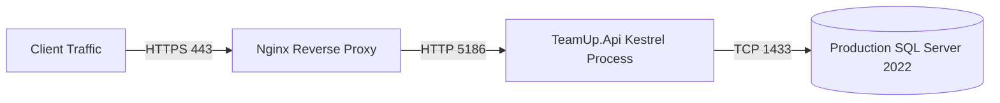

# TeamUp — Deployment Guide

> **Production Deployment Manual & Operational Runbook** · Production containerization, environment configuration, EF Core migration procedures, Nginx reverse proxy configuration, and disaster recovery policies.

> **Sources:**
> - [src/TeamUp.Api/appsettings.json](../src/TeamUp.Api/appsettings.json)
> - [src/TeamUp.Api/Program.cs](../src/TeamUp.Api/Program.cs)
> - [wiki/Infrastructure.md](./Infrastructure.md)

---

## Table of Contents

1. [Production Architecture](#production-architecture)
2. [Environment Configuration & Secrets Management](#environment-configuration--secrets-management)
3. [Database Migration Runbook](#database-migration-runbook)
4. [Nginx Reverse Proxy & TLS Termination](#nginx-reverse-proxy--tls-termination)
5. [Disaster Recovery & Backup Policy](#disaster-recovery--backup-policy)
6. [Operational Monitoring & Log Rotation](#operational-monitoring--log-rotation)

---

## Production Architecture

In production, TeamUp is deployed as a containerized service behind an Nginx reverse proxy with TLS termination:



---

## Environment Configuration & Secrets Management

Production settings must be supplied via OS environment variables or secure key vaults (e.g., Azure Key Vault, HashiCorp Vault, or Docker Secrets). Never commit `.env` or secrets to git.

### Required Production Environment Variables:

```bash
# ASP.NET Core Runtime
ASPNETCORE_ENVIRONMENT=Production
ASPNETCORE_URLS=http://+:5186

# Database Connection String
ConnectionStrings__DefaultConnection="Server=sql.internal.teamup.edu;Database=TeamUpDB_Prod;User Id=teamup_app;Password=Prod_Strong_Password_2026!;TrustServerCertificate=False;Encrypt=True;"

# JWT Security Credentials (Min 32 random bytes)
Jwt__Issuer="TeamUp"
Jwt__Audience="TeamUp.Clients"
Jwt__Key="ProductionSuperSecretSecureKey64CharactersLongForHMACSHA256Encryption2026!"
Jwt__AccessTokenMinutes=60
Jwt__RefreshTokenDays=7

# Seed Configuration (Disabled in Production)
Seed__Enabled=false
```

---

## Database Migration Runbook

Database migrations are managed via EF Core bundle executables or idempotent SQL scripts to ensure zero downtime.

### Step 1: Generate Migration Script
```bash
dotnet ef migrations script --idempotent --output deploy.sql \
  --project src/TeamUp.Infrastructure --startup-project src/TeamUp.Api
```

### Step 2: Validate Schema Constraints
Execute a pre-flight query against the database to guarantee no cascading triggers or physical cascades exist:
```sql
SELECT fk.name AS ForeignKey, tp.name AS ParentTable, tr.name AS ReferencedTable, fk.delete_referential_action_desc
FROM sys.foreign_keys AS fk
INNER JOIN sys.tables AS tp ON fk.parent_object_id = tp.object_id
INNER JOIN sys.tables AS tr ON fk.referenced_object_id = tr.object_id
WHERE fk.delete_referential_action_desc <> 'NO_ACTION';
```
*(Query result must return 0 rows).*

### Step 3: Apply Migrations
Apply the bundle to the target database:
```bash
./bundle --connection "$ConnectionStrings__DefaultConnection"
```

---

## Nginx Reverse Proxy & TLS Termination

Sample production Nginx configuration (`/etc/nginx/sites-available/teamup.conf`):

```nginx
server {
    listen 80;
    server_name api.teamup.edu;
    return 301 https://$host$request_uri;
}

server {
    listen 443 ssl http2;
    server_name api.teamup.edu;

    ssl_certificate /etc/letsencrypt/live/api.teamup.edu/fullchain.pem;
    ssl_certificate_key /etc/letsencrypt/live/api.teamup.edu/privkey.pem;

    client_max_body_size 10M;

    location / {
        proxy_pass http://127.0.0.1:5186;
        proxy_http_version 1.1;
        proxy_set_header Upgrade $http_upgrade;
        proxy_set_header Connection keep-alive;
        proxy_set_header Host $host;
        proxy_cache_bypass $http_upgrade;
        proxy_set_header X-Forwarded-For $proxy_add_x_forwarded_for;
        proxy_set_header X-Forwarded-Proto $scheme;
    }

    location /health {
        proxy_pass http://127.0.0.1:5186/health;
        access_log off;
    }
}
```

---

## Disaster Recovery & Backup Policy

| Scope | Backup Mechanism | Frequency | Retention Schedule |
|---|---|---|---|
| **SQL Server Database** | Full Native Database Backup (`.bak`) | Daily at 02:00 UTC | 30 Days (Offsite Blob Storage) |
| **Transaction Logs** | Differential Log Backup | Every 15 Minutes | 7 Days |
| **Uploaded Assets & Media** | Object Store Sync (S3/Azure Blob) | Continuous Replication | Indefinite with Versioning |
| **System Secrets** | Secret Vault Snapshot | On Every Secret Rotation | Encrypted Archive |

### Automated Nightly SQL Backup Script:
```sql
BACKUP DATABASE [TeamUpDB_Prod]
TO DISK = N'/var/opt/mssql/backup/TeamUpDB_Prod_Daily.bak'
WITH FORMAT, INIT, COMPRESSION, STATS = 10;
```

---

## Operational Monitoring & Log Rotation

1. **Structured Logging:** TeamUp writes structured JSON log entries to `stdout`, compatible with Datadog, Prometheus, or Grafana Loki.
2. **Log Levels:** Set to `Warning` for system components and `Information` for domain operations in production (`appsettings.json`).
3. **Health Check Heartbeat:** Monitoring systems poll `/health` every 30 seconds. Three consecutive non-200 responses trigger on-call alerts.
