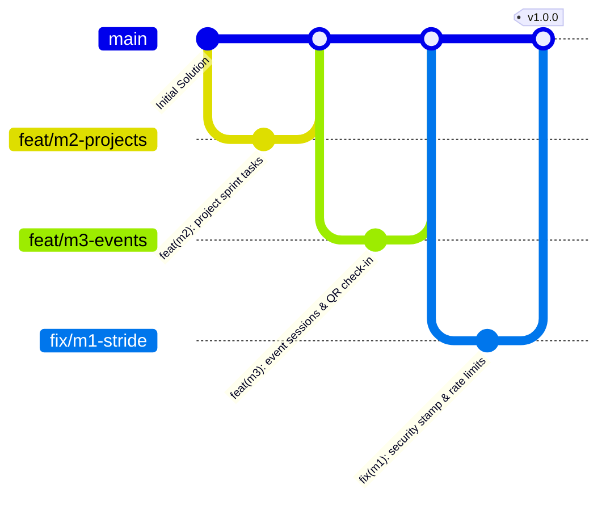

# TeamUp — Development Guidelines

> **Engineering Standards & Architectural Governance** · Coding conventions, Clean Architecture boundaries, database integrity rules, API response standards, security controls, and Definition of Done.

> **Sources:**
> - [docs/architecture/N-TIER-SOLID-ARCHITECTURE-PLAN.md](../docs/architecture/N-TIER-SOLID-ARCHITECTURE-PLAN.md)
> - [docs/architecture/CLEAN-CODE-AUDIT.md](../docs/architecture/CLEAN-CODE-AUDIT.md)
> - [docs/security/STRIDE-THREAT-MODEL.md](../docs/security/STRIDE-THREAT-MODEL.md)
> - [backend/Directory.Build.props](../backend/Directory.Build.props)
> - [CONTRIBUTING.md](../CONTRIBUTING.md)

---

## Table of Contents

1. [Architectural Ground Rules](#architectural-ground-rules)
2. [Controller & API Layer Conventions](#controller--api-layer-conventions)
3. [Database & Entity Conventions](#database--entity-conventions)
4. [Validation & Error Handling Standards](#validation--error-handling-standards)
5. [Security & Authentication Checklist](#security--authentication-checklist)
6. [Testing Standards](#testing-standards)
7. [Git Workflow & Conventional Commits](#git-workflow--conventional-commits)
8. [Definition of Done (DoD)](#definition-of-done-dod)

---

## Architectural Ground Rules

1. **Dependency Inversion is Absolute:**
   - `TeamUp.Domain` has **zero** dependencies on external libraries, frameworks, or NuGet packages.
   - `TeamUp.Application` depends **only** on `TeamUp.Domain` (plus EF Core abstractions, FluentValidation, and `Microsoft.Extensions.Identity.Core`). It must never reference `TeamUp.Infrastructure` or `TeamUp.Api`.
   - `TeamUp.Infrastructure` implements application contracts (`IAppDbContext`, `IJwtTokenService`, `IEmailSender`, `ITemplateRenderer`, `IAdminReportService`) and handles EF Core persistence, SMTP/InMemory email, and QuestPDF rendering.
   - `TeamUp.Api` serves solely as the HTTP presentation entry point (plus `LocalProfilePhotoStorage` for local `wwwroot` image uploads).
2. **No "Fat Controllers":**
   - Controllers must never perform direct database queries (`_context.Projects.Where(...)`).
   - Controllers only parse HTTP input, extract claims via `CurrentStudentId` / `CurrentUserRole`, invoke an Application Service, and return a standardized `BaseApiController` response.
3. **Domain Event Decoupling:**
   - Cross-module side effects (e.g., awarding points when a task or session completes or sending notifications when an application is reviewed or a waitlist spot opens) must be raised via `AddDomainEvent(...)` on `BaseEntity` and dispatched post-`SaveChangesAsync` by `IDomainEventDispatcher`.

---

## Controller & API Layer Conventions

- **Base Route:** `/api/v1/{resource}` using lowercase kebab-case plural nouns (e.g., `/api/v1/score-transactions`, `/api/v1/required-skills`).
- **Inheritance:** All 19 API controllers inherit from [`BaseApiController`](../backend/src/TeamUp.Api/Controllers/Common/BaseApiController.cs).
- **Response Envelopes:** Every JSON response is wrapped in `ApiResponse<T>` / `BaseResponse<T>`:
  ```json
  {
    "success": true,
    "message": "Operation completed successfully.",
    "statusCode": 200,
    "data": { },
    "errors": null,
    "timestamp": "2026-11-24T12:00:00Z"
  }
  ```
- **HTTP Methods:**
  - `GET`: Safe and idempotent data retrieval.
  - `POST`: Create resource (`201 Created`, often with `Location` header via `CreatedAtAction`) or trigger a state/command operation.
  - `PUT`: Full replacement or idempotent upsert (e.g., `PUT /api/v1/students/me/profile`, `PUT /api/v1/students/me/skills/{skillId}`).
  - `PATCH`: Partial update or status/role transition (e.g., `PATCH /api/v1/tasks/{id}`, `PATCH /api/v1/admin/students/{id}/role`).
  - `DELETE`: **Soft-delete** (`204 No Content`) or membership/registration withdrawal.

---

## Database & Entity Conventions

### 1. The Zero Cascades Rule
- All **31 foreign key relationships** across the 24 runtime tables must specify `DeleteBehavior.Restrict` (`ON DELETE NO ACTION ON UPDATE NO ACTION`, enforced globally in `AppDbContext.OnModelCreating`).
- Cascading soft-deletes across parent-child trees (such as soft-deleting a university's faculties or an event's sessions) must be orchestrated explicitly in application service code.

### 2. Single-Column Soft Delete (`DeletedAt`)
- Dual-column persisted indicators (`IsDeleted` bool + `DeletedAt` timestamp) are strictly forbidden.
- Mutable domain entities (22 tables) inherit `BaseEntity` / implement `ISoftDelete` with a single nullable timestamp: `DateTime? DeletedAt { get; set; }` (`IsDeleted => DeletedAt.HasValue` is an unmapped helper).
- Active rows: `DeletedAt IS NULL`. Soft-deleted rows: `DeletedAt IS NOT NULL`.
- `SoftDeleteInterceptor` intercepts `EntityState.Deleted` and converts it to `EntityState.Modified` setting only `DeletedAt = DateTime.UtcNow`.

### 3. Append-Only Ledgers
- Financial/gamification and governance audit tables (`ScoreTransaction`, `AuditLog`) implement `IAppendOnly`.
- Updating or deleting append-only entities is intercepted by `SoftDeleteInterceptor` and throws `InvalidOperationException`. Adjustments require inserting a compensating row.

### 4. Filtered Unique Indexes
- Unique business identifiers that can be reused after soft deletion must use a filtered unique index in SQL Server:
  ```csharp
  b.HasIndex(x => x.Email).IsUnique().HasFilter("[DeletedAt] IS NULL");
  ```
- Across the schema there are **11 filtered unique indexes** (10 soft-delete/pending-application indexes + 1 idempotency index on `ScoreTransaction(StudentId, SourceType, SourceReferenceId) WHERE [SourceReferenceId] IS NOT NULL`).

---

## Validation & Error Handling Standards

- **Boundary Validation:** Use `FluentValidation`. Incoming request DTOs have registered `AbstractValidator<T>` classes discovered via `AddValidatorsFromAssembly`.
- **Pipeline Interception:** [`ValidationFilter`](../backend/src/TeamUp.Api/Filters/ValidationFilter.cs) executes validators before the controller action. If invalid, it immediately short-circuits with `400 Bad Request` and camelCased field errors:
  ```json
  {
    "success": false,
    "message": "Validation failed: Please correct the highlighted fields and try again.",
    "statusCode": 400,
    "errors": [
      { "field": "email", "message": "A valid email address is required." }
    ],
    "timestamp": "2026-11-24T12:00:00Z"
  }
  ```
- **Domain Exception Translation (`GlobalExceptionHandler`):**
  - `ValidationException` / `BadRequestException` / `ArgumentException` ➔ `400 Bad Request`
  - `UnauthorizedException` ➔ `401 Unauthorized`
  - `ForbiddenException` ➔ `403 Forbidden`
  - `NotFoundException` ➔ `404 Not Found`
  - `ConflictException`, `DbUpdateConcurrencyException`, and unique-constraint `DbUpdateException` ➔ `409 Conflict`
  - Unhandled exceptions ➔ `500 Internal Server Error` with zero stack traces leaked.

---

## Security & Authentication Checklist

For every endpoint or feature added to TeamUp:

- [ ] **Authentication & Authorization:** Is it intentionally `[AllowAnonymous]`? Otherwise attach `[Authorize]` and enforce role policies (`PlatformAdmin`, `OrgAdmin,PlatformAdmin`) or scoped checks (`IOrganizationAuthorizationService` / resource ownership).
- [ ] **Session Revocation (`SecurityStamp`):** Password resets, logouts, role updates, and soft-deletes rotate `SecurityStamp` and invalidate `ISecurityStampValidator` cache.
- [ ] **Token & Secret Redaction:** Password reset tokens must **never** be returned in HTTP response bodies (`ForgotPasswordResponse` returns only a generic message); refresh and reset tokens are stored as `SHA-256` hashes.
- [ ] **Rate Limiting:** Public auth routes enforce `auth-policy` (`30 req/min` per `RemoteIpAddress`), student directory enforces `directory-policy` (`30 req/min`, max `20` rows/page), and all routes are guarded by the global partitioned limiter (`120 req/min` authenticated, `30 req/min` anonymous, `/health` exempt).
- [ ] **Input & Upload Safety:** Validate external URLs with `SafeUrlValidator` (blocking `javascript:`/`data:`/SSRF targets) and uploaded images with `ImageFileValidator` (magic-byte sniffing + size cap).
- [ ] **Governance Controls:** Keep `Admin:AllowRuntimePlatformAdminPromotion = false` unless explicitly opted in, and record sensitive mutations via `IAuditLogService`.

---

## Testing Standards

- **Backend Unit Tests (`TeamUp.UnitTests` — 117 tests):**
  - Verify mathematical domain logic (gamification level calculations, badge criteria evaluation).
  - Verify FluentValidators, `SafeUrlValidator`, `ImageFileValidator`, `AttendanceCodeService`, and `SecurityStartupValidator`.
  - Verify `SoftDeleteInterceptor`, `IAppendOnly` guards, and zero physical cascades.
- **Backend Integration Tests (`TeamUp.IntegrationTests` — 75 tests):**
  - Inherit from `TeamUpApiFactory` (using `WebApplicationFactory<Program>` + isolated in-memory SQLite).
  - Verify real HTTP status codes, JSON envelopes, JWT `SecurityStamp` revocation, rate limits, BOLA/IDOR guards, and OpenAPI v3 generation.
- **Frontend Tests (`frontend/src/test/` — 71 Vitest tests) & E2E (`frontend/e2e/`):**
  - Vitest + Testing Library (`happy-dom`) covering API client interceptors, auth/role guards, UI kit, and feature pages.
  - Playwright Chromium smoke suite (`npm run test:e2e`) running against the compiled `TeamUp.Api` host.

---

## Git Workflow & Conventional Commits



- **Target Branch:** `main` (via Pull Request).
- **Branch Naming:** `feat/m<1|2|3|4>-<short-description>`, `fix/m<1|2|3|4>-<short-description>`, `docs/<short-description>`.
- **Commit Format:** Conventional Commits:
  - `feat(m1): add refresh token reuse grace and lockout`
  - `fix(db): enforce DeleteBehavior.Restrict on all foreign keys`
  - `test(gamification): add unit tests for idempotent score ledger`
  - `docs(wiki): align documentation with current codebase`

---

## Definition of Done (DoD)

A task or pull request is only considered **Done** when:

1. Code adheres strictly to Clean Architecture layer boundaries (`Domain` ➔ `Application` ➔ `Infrastructure` / `Api`).
2. FluentValidator created and verified for any new incoming request DTO.
3. Entity configuration explicitly enforces `DeleteBehavior.Restrict` and filtered unique indexes (`[DeletedAt] IS NULL`) where applicable.
4. Backend unit/integration tests and frontend Vitest/build checks pass locally (`dotnet test backend/TeamUp.sln`, `npm run test && npm run build`).
5. GitHub Actions CI (`backend-build-and-test`, `frontend-build-and-test`, `e2e-playwright-smoke`) passes with 0 compiler warnings (`TreatWarningsAsErrors=true`) and zero physical cascades.
6. Endpoint contracts are reflected in `docs/api/openapi.json` and API docs.
