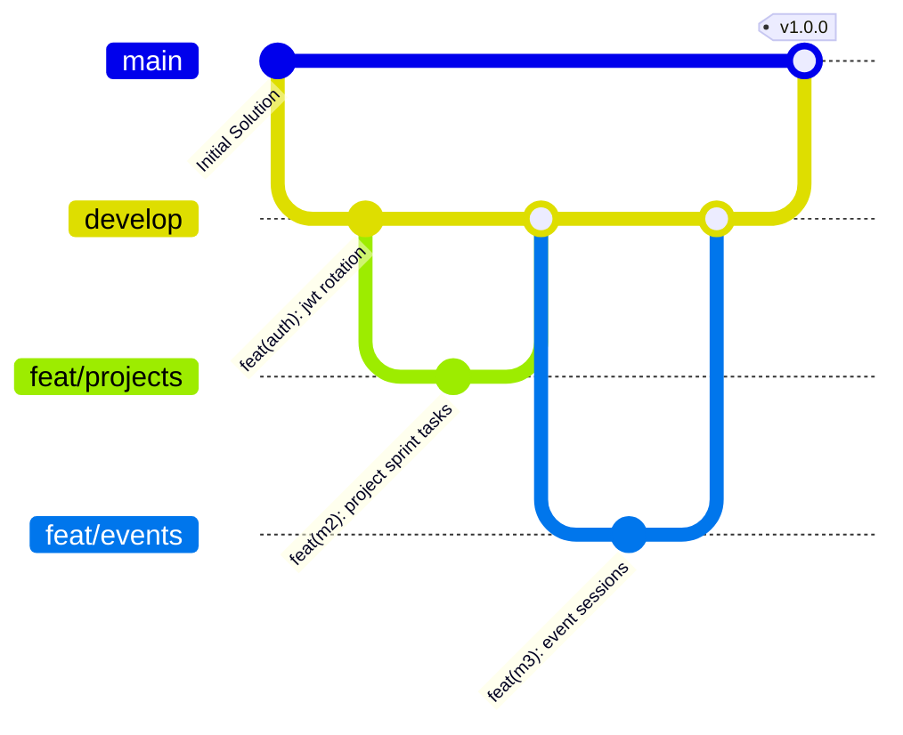

# TeamUp — Development Guidelines

> **Engineering Standards & Architectural Governance** · Coding conventions, Clean Architecture boundaries, database integrity rules, API response standards, and Definition of Done.

> **Sources:**
> - [docs/architecture/N-TIER-SOLID-ARCHITECTURE-PLAN.md](../docs/architecture/N-TIER-SOLID-ARCHITECTURE-PLAN.md)
> - [docs/architecture/CLEAN-CODE-AUDIT.md](../docs/architecture/CLEAN-CODE-AUDIT.md)
> - [Directory.Build.props](../Directory.Build.props)
> - [CONTRIBUTING.md](../CONTRIBUTING.md)

---

## Table of Contents

1. [Architectural Ground Rules](#architectural-ground-rules)
2. [Controller & API Layer Conventions](#controller--api-layer-conventions)
3. [Database & Entity Conventions](#database--entity-conventions)
4. [Validation & Error Handling Standards](#validation--error-handling-standards)
5. [Security & Authentication Checklist](#security--authentication-checklist)
6. [Testing Standards](#testing-standards)
7. [Git Workflow & Conventional Commits](#git-workflow--conventional-commits)
8. [Definition of Done (DoD)](#definition-of-done-dod)

---

## Architectural Ground Rules

1. **Dependency Inversion is Absolute:**
   - `TeamUp.Domain` has **zero** dependencies on external libraries, frameworks, or NuGet packages.
   - `TeamUp.Application` depends **only** on `TeamUp.Domain`. It must never reference `TeamUp.Infrastructure` or `TeamUp.Api`.
   - `TeamUp.Infrastructure` implements application interfaces (`IAppDbContext`, `IJwtTokenService`) and handles EF Core persistence.
   - `TeamUp.Api` serves solely as the presentation HTTP entry point.
2. **No "Fat Controllers":**
   - Controllers must never perform direct database queries (`_context.Projects.Where(...)`).
   - Controllers only parse HTTP input, extract claims via `User.GetStudentId()`, invoke an Application Service or CQRS handler, and return an HTTP status code.
3. **Domain Event Decoupling:**
   - Cross-module side effects (e.g., awarding points when a task completes or sending a notification when an application is accepted) must be published as `IDomainEvent` and processed by asynchronous in-process handlers.

---

## Controller & API Layer Conventions

- **Base Route:** `/api/v1/{resource}` using lowercase kebab-case nouns (e.g., `/api/v1/score-transactions`, `/api/v1/project-tasks`).
- **Inheritance:** All API controllers inherit from `BaseApiController`.
- **Response Envelopes:** Every response is wrapped in `BaseResponse<T>`:
  ```json
  {
    "success": true,
    "message": "Project retrieved successfully.",
    "statusCode": 200,
    "data": { ... },
    "errors": null,
    "timestamp": "2026-11-06T00:30:00Z"
  }
  ```
- **HTTP Methods:**
  - `GET`: Safe and idempotent data retrieval.
  - `POST`: Create resource (`201 Created` with `Location` header) or trigger business operation.
  - `PUT`: Full replacement or state assignment.
  - `PATCH`: Partial update (e.g., task status transition).
  - `DELETE`: **Soft-delete** (`204 No Content` or `200 OK`).

---

## Database & Entity Conventions

### 1. The Zero Cascades Rule
- All 29 foreign key relationships must specify `DeleteBehavior.Restrict` (`ON DELETE NO ACTION ON UPDATE NO ACTION`).
- Cascading operations across parent-child trees (such as soft-deleting an event's sessions) must be orchestrated transactionally in the application service layer.

### 2. Single-Column Soft Delete (`DeletedAt`)
- Dual-column indicators (`IsDeleted` bool + `DeletedAt` timestamp) are strictly forbidden.
- Entities implement `ISoftDelete` with a single nullable timestamp: `DateTime? DeletedAt { get; set; }`.
- Active rows: `DeletedAt IS NULL`. Soft-deleted rows: `DeletedAt IS NOT NULL`.
- `SoftDeleteInterceptor` intercepts `EntityState.Deleted` and transforms it into `DeletedAt = DateTime.UtcNow`.

### 3. Append-Only Ledgers
- Financial and gamification audit logs (`ScoreTransaction`) implement `IAppendOnly`.
- Updating or deleting append-only entities is intercepted by EF Core and throws `InvalidOperationException`. Adjustments require a compensating transaction row.

### 4. Filtered Unique Indexes
- Every unique business identifier (e.g., email address, skill name, active membership) must use a filtered unique index in SQL Server:
  ```sql
  CREATE UNIQUE INDEX [UX_Students_Email] ON [Students] ([Email]) WHERE [DeletedAt] IS NULL;
  ```
- This guarantees uniqueness among active rows while allowing soft-deleted records to retain historical data.

---

## Validation & Error Handling Standards

- **Boundary Validation:** Use `FluentValidation`. Every incoming request DTO must have a corresponding `AbstractValidator<T>`.
- **Pipeline Interception:** `ValidationFilter` executes validators before the controller action. If invalid, it immediately short-circuits with `400 Bad Request` and structured field errors:
  ```json
  {
    "success": false,
    "message": "Validation failed.",
    "statusCode": 400,
    "errors": [
      { "field": "Email", "message": "A valid university email address is required." }
    ]
  }
  ```
- **Domain Exception Translation:**
  - `NotFoundException` maps to `404 Not Found`.
  - `ConflictException` and unique constraint `DbUpdateException` map to `409 Conflict`.
  - `ForbiddenAccessException` maps to `403 Forbidden`.
  - Unhandled exceptions map to `500 Internal Server Error` via `GlobalExceptionHandler` with zero stack traces leaked in production.

---

## Security & Authentication Checklist

For every endpoint added to TeamUp:

- [ ] Is it public? If not, attach `[Authorize]` or specify required policies (`PlatformAdminOnly`, `OrgAdminOrPlatformAdmin`).
- [ ] Are sensitive tokens redacted? Password reset tokens must **never** be returned in HTTP response bodies.
- [ ] Are tokens hashed at rest? Refresh tokens and reset tokens must be stored as SHA-256 hashes.
- [ ] Is rate limiting applied? Public authentication endpoints must enforce the IP-partitioned rate limiter (`auth-policy`).
- [ ] Does authorization check ownership? Ensure student callers can only edit their own portfolios or projects.

---

## Testing Standards

- **Unit Tests (`TeamUp.UnitTests`):**
  - Verify mathematical domain logic (gamification level calculations, badge criteria evaluation).
  - Verify FluentValidators for boundary edge cases (nulls, string lengths, regex).
  - Verify `SoftDeleteInterceptor` and `IAppendOnly` guards.
- **Integration Tests (`TeamUp.IntegrationTests`):**
  - Inherit from `TeamUpApiFactory` (using `WebApplicationFactory<Program>`).
  - Test real HTTP status codes, JSON deserialization, and database query filters.
  - Zero database leaks between tests (each test runs in isolated scope).
- **Execution Target:** The entire test suite must execute cleanly with zero failures (`dotnet test`).

---

## Git Workflow & Conventional Commits



- **Branch Naming:** `feat/<module-name>`, `fix/<issue>`, `chore/<cleanup>`.
- **Commit Format:** Conventional Commits:
  - `feat(m1): add refresh token rotation`
  - `fix(db): eliminate cascade delete on event attendance`
  - `test(gamification): add unit tests for score transaction ledger`
  - `docs(wiki): update system overview and getting started guide`

---

## Definition of Done (DoD)

A task or pull request is only considered **Done** when:

1. Code adheres strictly to Clean Architecture layer boundaries.
2. FluentValidator created and verified for all incoming DTOs.
3. Entity configuration explicitly enforces `DeleteBehavior.Restrict`.
4. Unit and integration tests written and passing locally (`dotnet test`).
5. GitHub Actions CI pipeline passes with 0 compiler warnings (`TreatWarningsAsErrors=true`).
6. Endpoint documented in OpenAPI and Postman collections.
