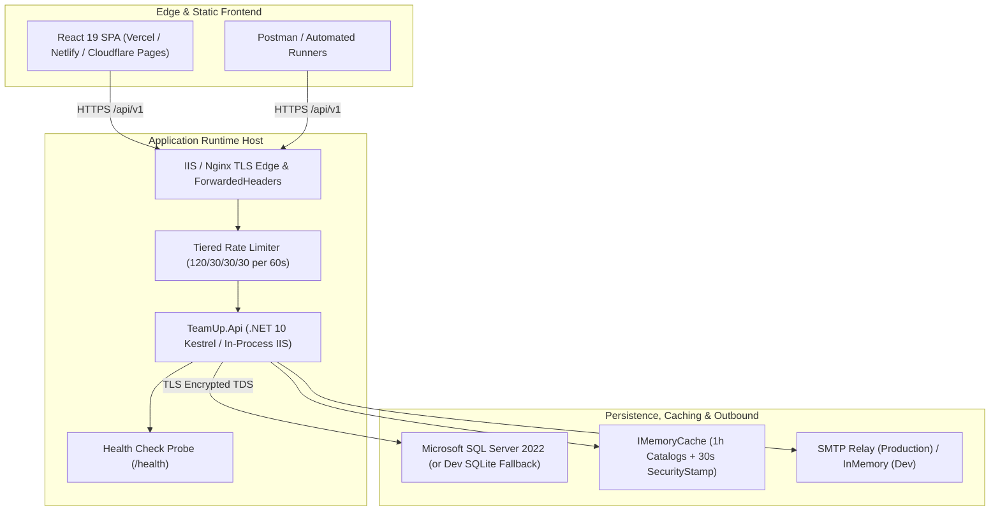
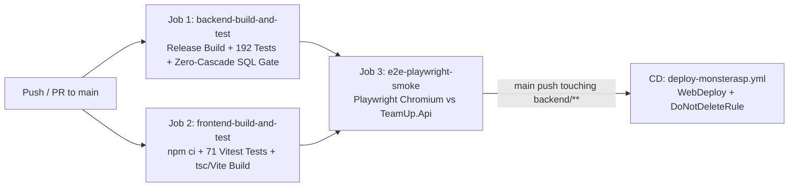

# TeamUp — Infrastructure

> **Infrastructure Architecture & Operational Topologies** · Containerization patterns, GitHub Actions CI/CD pipelines, tiered rate limiting, proxy hardening, HTTP security headers, and runtime health telemetry.

> **Sources:**
> - [backend/src/TeamUp.Api/Program.cs](../backend/src/TeamUp.Api/Program.cs)
> - [backend/Directory.Build.props](../backend/Directory.Build.props)
> - [.github/workflows/ci.yml](../.github/workflows/ci.yml)
> - [.github/workflows/deploy-monsterasp.yml](../.github/workflows/deploy-monsterasp.yml)
> - [scripts/test_live_api.ps1](../scripts/test_live_api.ps1)

---

## Table of Contents

1. [Infrastructure Topology](#infrastructure-topology)
2. [Database Containerization (Docker SQL Server)](#database-containerization-docker-sql-server)
3. [Continuous Integration & Deployment (GitHub Actions)](#continuous-integration--deployment-github-actions)
4. [Rate Limiting, Proxy Trust & HTTP Security Headers](#rate-limiting-proxy-trust--http-security-headers)
5. [Health Probes & Operational Monitoring](#health-probes--operational-monitoring)

---

## Infrastructure Topology

TeamUp runs as a decoupled static SPA + .NET 10 Web API architecture (deployed free-tier via Vercel/Netlify/Cloudflare Pages + MonsterASP.NET IIS, or self-hosted behind Nginx + Docker SQL Server):



---

## Database Containerization (Docker SQL Server)

For local development with Docker, run SQL Server 2022 directly (`docker run`) or use a local `docker-compose.yml` template (note: no `docker-compose.yml` is committed in the repository root):

```yaml
# Reference local docker-compose.yml template (optional)
services:
  teamup-sql:
    image: mcr.microsoft.com/mssql/server:2022-latest
    container_name: teamup-sql
    environment:
      - ACCEPT_EULA=Y
      - MSSQL_SA_PASSWORD=YourStrong@Passw0rd!
      - MSSQL_PID=Developer
    ports:
      - "14333:1433"
    volumes:
      - sqldata:/var/opt/mssql
    restart: unless-stopped

volumes:
  sqldata:
```

### Starting SQL Server Container Directly:
```bash
docker run -e "ACCEPT_EULA=Y" -e "MSSQL_SA_PASSWORD=YourStrong@Passw0rd!" \
   -p 14333:1433 --name teamup-sql --hostname teamup-sql \
   -d mcr.microsoft.com/mssql/server:2022-latest
```

---

## Continuous Integration & Deployment (GitHub Actions)

TeamUp runs a 3-job CI workflow ([`.github/workflows/ci.yml`](../.github/workflows/ci.yml)) on every push and pull request targeting `main`, plus an automated production CD workflow ([`.github/workflows/deploy-monsterasp.yml`](../.github/workflows/deploy-monsterasp.yml)):



### CI Quality Gate Checks:
1. **Compilation Hygiene (`backend-build-and-test`):** `TreatWarningsAsErrors=true` ensures nullability or compiler warnings fail the Release build immediately.
2. **Automated Backend Suite:** Executes all **117 unit tests** and **75 integration tests** (**192 / 192 passing**).
3. **Migration Idempotency & Zero-Cascade Gate:** Restores `dotnet-ef`, generates `idempotency-check.sql` (`dotnet ef migrations script -i`), and fails the build if `ON DELETE CASCADE` or `ON DELETE SET NULL` appears anywhere in generated DDL.
4. **Frontend Suite (`frontend-build-and-test`):** Runs `npm ci`, **71 Vitest tests**, and `npm run build` (`tsc --noEmit && vite build`) on Node 22.
5. **E2E Smoke Gate (`e2e-playwright-smoke`):** Builds `TeamUp.Api`, installs Chromium, and executes `npm run test:e2e`.

---

## Rate Limiting, Proxy Trust & HTTP Security Headers

### Tiered Partitioned Rate Limiter ([`Program.cs`](../backend/src/TeamUp.Api/Program.cs))
TeamUp uses four fixed-window limiters governed by `RateLimitingOptions` (default `WindowSeconds = 60`), partitioning strictly on `StudentId` or sanitized `RemoteIpAddress` (never raw `X-Forwarded-For` headers):

| Limiter / Policy | Scope | Default Limit (`60s`) | Partition Key |
|---|---|---|---|
| **Global Authenticated** | All authenticated requests (`/health` exempt) | `120 req/min` | `user:{studentId}` |
| **Global Anonymous** | Unauthenticated requests (`/health` exempt) | `30 req/min` | `anon:{RemoteIpAddress}` |
| **`auth-policy`** | `/api/v1/auth/*` (`AuthController`) | `30 req/min` | `auth:{RemoteIpAddress}` |
| **`directory-policy`** | `GET /api/v1/students` (`StudentsController`) | `30 req/min` | `dir:user:{studentId}` |

- **Proxy Trust Hardening (`ForwardedHeadersOptions`):** Clears default loopback `KnownProxies` and `KnownIPNetworks`; `X-Forwarded-For` / `X-Forwarded-Proto` are honored **only** when trusted proxies/CIDRs are explicitly configured.
- **Rejection Payload (`429 Too Many Requests`):** Sets `Retry-After` header and returns:
  ```json
  {
    "success": false,
    "message": "Rate limit exceeded. Please slow down and try again shortly.",
    "statusCode": 429,
    "errors": null,
    "timestamp": "2026-11-24T12:00:00Z"
  }
  ```

### Baseline HTTP Security Headers
Every API response sets:
- `X-Content-Type-Options: nosniff`
- `X-Frame-Options: DENY`
- `Referrer-Policy: no-referrer`
- `X-Permitted-Cross-Domain-Policies: none`
- `Content-Security-Policy`: `default-src 'none'; frame-ancestors 'none'` (relaxed only for `/report` HTML and `/images`/`/logos` static assets)
- `HSTS` & HTTPS redirection enabled outside `Development`.

---

## Health Probes & Operational Monitoring

- **Endpoint:** `GET /health`
- **Access:** Public (unauthenticated, exempt from rate limiting)
- **Response Format:**
  - `200 OK` when SQL database connection succeeds:
    ```json
    {
      "status": "Healthy",
      "database": "Connected"
    }
    ```
  - `200 OK` when no database context is registered: `{"status": "Healthy", "database": "NotConfigured"}`
  - `503 Service Unavailable` when database connectivity fails: `{"status": "Unhealthy", "database": "Disconnected"}`
