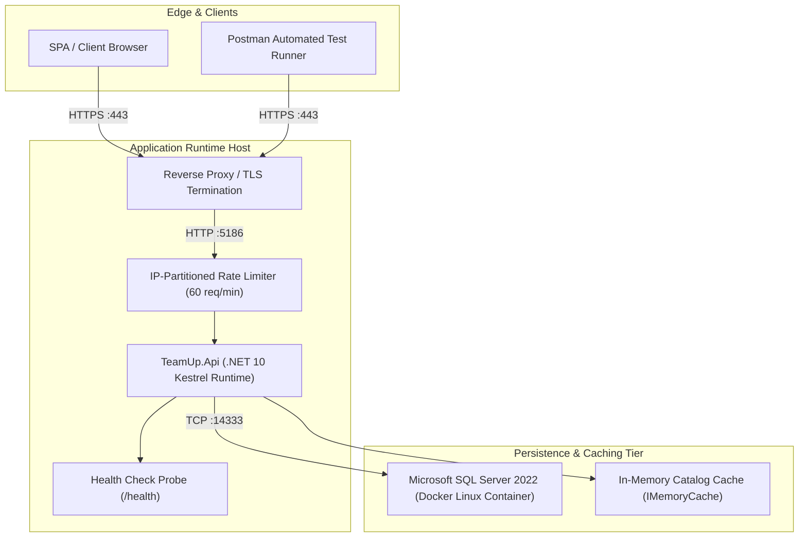
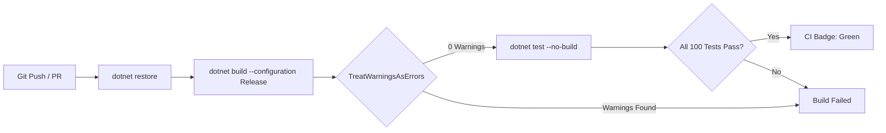

# TeamUp — Infrastructure

> **Infrastructure Architecture & Operational Topologies** · Containerization specifications, Docker Compose, GitHub Actions continuous integration, partitioned rate limiting, and runtime health telemetry.

> **Sources:**
> - [src/TeamUp.Api/Program.cs](../src/TeamUp.Api/Program.cs)
> - [Directory.Build.props](../Directory.Build.props)
> - [.github/workflows](../.github/workflows)
> - [scripts/test_live_api.ps1](../scripts/test_live_api.ps1)

---

## Table of Contents

1. [Infrastructure Topology](#infrastructure-topology)
2. [Database Containerization (Docker SQL Server)](#database-containerization-docker-sql-server)
3. [Continuous Integration (GitHub Actions)](#continuous-integration-github-actions)
4. [Rate Limiting & Threat Mitigation](#rate-limiting--threat-mitigation)
5. [Health Probes & Operational Monitoring](#health-probes--operational-monitoring)

---

## Infrastructure Topology



---

## Database Containerization (Docker SQL Server)

The persistent database layer runs as an isolated SQL Server 2022 container:

```yaml
# docker-compose.yml specification
version: '3.8'
services:
  teamup-sql:
    image: mcr.microsoft.com/mssql/server:2022-latest
    container_name: teamup-sql
    environment:
      - ACCEPT_EULA=Y
      - MSSQL_SA_PASSWORD=YourStrong@Passw0rd!
      - MSSQL_PID=Developer
    ports:
      - "14333:1433"
    volumes:
      - sqldata:/var/opt/mssql
    restart: unless-stopped

volumes:
  sqldata:
```

### Starting the Container:
```bash
docker compose up -d teamup-sql
```

---

## Continuous Integration (GitHub Actions)

TeamUp enforces automated CI quality gates on all pushes and pull requests to `main` and `develop`:



### Quality Gate Checks:
1. **Compilation Hygiene:** `TreatWarningsAsErrors=true` ensures missing nullability annotations, unused variables, or deprecated API calls fail the build immediately.
2. **Schema Verification:** Automated test suite spins up EF Core schema and executes assertions against foreign key delete rules to guarantee **zero physical cascades**.
3. **Automated Testing:** All 57 unit tests and 43 integration tests execute in clean ephemeral isolation.

---

## Rate Limiting & Threat Mitigation

Authentication endpoints (`/api/v1/auth/*`) are protected against brute-force attacks and credential stuffing using ASP.NET Core 10's native partitioned rate limiter:

```csharp
builder.Services.AddRateLimiter(options =>
{
    options.RejectionStatusCode = StatusCodes.Status429TooManyRequests;
    options.AddPolicy("auth-policy", httpContext =>
    {
        var clientIp = httpContext.Connection.RemoteIpAddress?.ToString()
            ?? httpContext.Request.Headers["X-Forwarded-For"].FirstOrDefault()
            ?? "anonymous";

        return RateLimitPartition.GetFixedWindowLimiter(clientIp, _ => new FixedWindowRateLimiterOptions
        {
            PermitLimit = 60,
            Window = TimeSpan.FromMinutes(1),
            QueueLimit = 0
        });
    });
});
```

When rate limits are exceeded, the API returns a structured RFC 7807 problem detail envelope:
```json
{
  "success": false,
  "message": "Rate limit exceeded. Please slow down and try again shortly.",
  "statusCode": 429,
  "errors": null,
  "timestamp": "2026-11-06T00:30:00Z"
}
```

---

## Health Probes & Operational Monitoring

- **Endpoint:** `GET /health`
- **Access:** Public (unauthenticated)
- **Response Format:**
  ```json
  {
    "status": "Healthy"
  }
  ```
- **Probe Usage:** Utilized by Docker Swarm, Kubernetes, or container uptime monitors to assess container readiness before routing client traffic.
