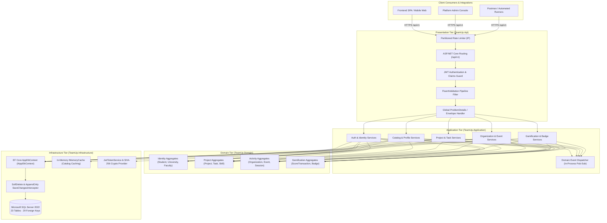

# TeamUp — System Overview

> **Platform Overview & Core Capability Map** · Clean Architecture .NET 10 Web API for Academic Collaboration, Project Matchmaking, Campus Event Management & Gamification.

> **Sources:**
> - [README.md](../README.md)
> - [TeamUp.sln](../TeamUp.sln)
> - [src/TeamUp.Api/Program.cs](../src/TeamUp.Api/Program.cs)
> - [docs/architecture/N-TIER-SOLID-ARCHITECTURE-PLAN.md](../docs/architecture/N-TIER-SOLID-ARCHITECTURE-PLAN.md)
> - [docs/api/API-PROPOSAL.md](../docs/api/API-PROPOSAL.md)

---

## Table of Contents

1. [What Is TeamUp](#what-is-teamup)
2. [Solution & Repository Layout](#solution--repository-layout)
3. [Core Capability Map (4 Modules / 16 Sub-Modules)](#core-capability-map-4-modules--16-sub-modules)
4. [System Context Diagram](#system-context-diagram)
5. [Key Platform Numbers](#key-platform-numbers)
6. [Where To Go Next](#where-to-go-next)

---

## What Is TeamUp

**TeamUp** is an enterprise-grade, student-centric academic collaboration and skill-building platform engineered for higher-education ecosystems. It bridges the gap between academic theory and real-world project delivery by uniting students, faculty clubs, and campus organizations into an integrated social-gamified network.

### Core Value Pillars:
- **Academic Identity & Cross-Faculty Networking:** Verified student profiles linked to university faculties, interest tags, portfolios, and master skills.
- **Cross-Functional Team Formation:** Student-led project creation with required skill matrices, vacancy recruitment, application vetting, and Kanban sprint boards.
- **Student Organizations & Campus Activities:** Registered student organizations with committee rosters, recruitment seasons, and structured multi-session event calendars.
- **Verifiable Attendance & Gamification:** QR/PIN session check-ins, automated attendance records, append-only score ledger transactions, progressive levels, and badge awards.
- **Zero-Trust Platform Governance:** Role-based access control (`Student`, `OrgAdmin`, `PlatformAdmin`), immutable audit logging, and single-column soft-delete recovery.

---

## Solution & Repository Layout

The codebase is structured as a Clean Architecture modular solution following Domain-Driven Design (DDD) principles:

```text
TeamUp/
├── src/
│   ├── TeamUp.Domain/             # Enterprise Entities, Invariants, Enums, Base Contracts (0 dependencies)
│   ├── TeamUp.Application/        # Use Cases, DTOs, FluentValidators, Services, Domain Event Handlers
│   ├── TeamUp.Infrastructure/     # EF Core AppDbContext, SQL Server Migrations, Interceptors, Seeders
│   └── TeamUp.Api/                # ASP.NET Core 10 Web API Controllers, Filters, Middleware, OpenAPI
├── tests/
│   ├── TeamUp.UnitTests/          # Pure unit tests (Domain math, validators, interceptors, soft-delete)
│   └── TeamUp.IntegrationTests/   # End-to-end integration tests via WebApplicationFactory & in-memory/SQL
├── docs/                          # Architectural audits, API proposals, OpenAPI JSON & Postman assets
├── wiki/                          # 📚 Comprehensive project documentation & operational guides
├── ERD/                           # Chen ERD specifications, SVG/PNG diagrams, generator scripts
├── Mapping/                       # Relational schema mapping (23 tables, row-of-cells style), 3NF checks
├── tasks/                         # 20-Phase implementation roadmap and modular task checklists
├── scripts/                       # PowerShell live HTTP API verification scripts (test_live_api.ps1)
└── TeamUp.sln                     # Visual Studio / Rider .NET 10 solution descriptor
```

---

## Core Capability Map (4 Modules / 16 Sub-Modules)

The platform is partitioned across 4 functional modules owned by designated team members:

| Module | Sub-Modules | Owner | Key Capabilities |
|---|---|---|---|
| **Module 01: Core Identity, Academic Catalog & Governance** | 1. Auth & Token Rotation<br/>2. Academic Catalog<br/>3. Student Discovery<br/>4. Platform Admin | **M1** (Tyson) | PBKDF2 password hashing, JWT Bearer tokens with SHA-256 refresh token rotation; university & faculty lookups with in-memory caching; public portfolio cards; admin dashboard & account soft-delete restore. |
| **Module 02: Skills, Projects & Sprint Task Management** | 5. Skills Master Catalog<br/>6. Student Claims<br/>7. Projects & Rosters<br/>8. Applications & Tasks | **M2** (Ossama) | Master skills hierarchy; student skill endorsements & ratings; project creation with required skills; applicant vetting workflow; project task assignments with status transitions (`Todo`, `InProgress`, `Completed`). |
| **Module 03: Student Activities, Events & Attendance** | 9. Organizations & Boards<br/>10. Recruitment Seasons<br/>11. Multi-Session Events<br/>12. Check-In & Attendance | **M3** (Ibrahim) | Student club management, committee assignments; membership application reviews; campus events with timetable sessions; waitlist management; QR/PIN code check-in with duplicate attendance prevention. |
| **Module 04: Gamification, Badges & Alert Infrastructure** | 13. Append-Only Ledger<br/>14. Level Progression<br/>15. Badge Engine<br/>16. Notifications Inbox | **M4** (Youssef) | Immutable `ScoreTransaction` financial-style ledger; algorithmic level formula; automated badge evaluation hooks; centralized in-app notifications inbox with unread tracking. |

---

## System Context Diagram



---

## Key Platform Numbers

| Metric | Measured Value | Verification Source |
|---|---|---|
| **Total REST Endpoints** | **99 Endpoints** | [`docs/api/API-PROPOSAL.md`](../docs/api/API-PROPOSAL.md) · [`wiki/ROUTES-APPENDIX.md`](./ROUTES-APPENDIX.md) |
| **Relational Tables** | **23 Tables** | [`Mapping/description.md`](../Mapping/description.md) · `AppDbContext` |
| **Foreign Key Constraints** | **29 FKs** (100% `NO ACTION`) | `sys.foreign_keys` verification script |
| **Filtered Unique Indexes** | **10 Indexes** (`WHERE DeletedAt IS NULL`) | `AppDbContext` entity configurations |
| **Automated Test Count** | **100 Passing Tests** (57 Unit + 43 Integration) | `dotnet test` test runner |
| **Implementation Phases** | **20 Phases** (100% Completed) | [`tasks/plan.md`](../tasks/plan.md) · [`tasks/todo.md`](../tasks/todo.md) |
| **Code Quality Grade** | **Grade A (96% Architecture Compliance)** | [`docs/architecture/CLEAN-CODE-AUDIT.md`](../docs/architecture/CLEAN-CODE-AUDIT.md) |

---

## Where To Go Next

- **Ready to run locally?** Follow the [Getting Started Guide](./Getting%20Started%20Guide.md).
- **Understanding architecture & layers?** Read the [Architecture Overview](./Architecture.md).
- **Inspecting technologies & design decisions?** See [Technology Stack & Architecture](./Technology%20Stack%20%26%20Architecture.md).
- **Exploring service implementations?** Check [Backend Services](./Backend%20Services.md).
- **Reviewing database design & 3NF checks?** See [Database Design & Relational Mapping](./Database%20Design%20%26%20Relational%20Mapping.md).
- **Querying API endpoints?** Consult the [API Endpoints Reference](./API%20Endpoints%20Reference.md).
