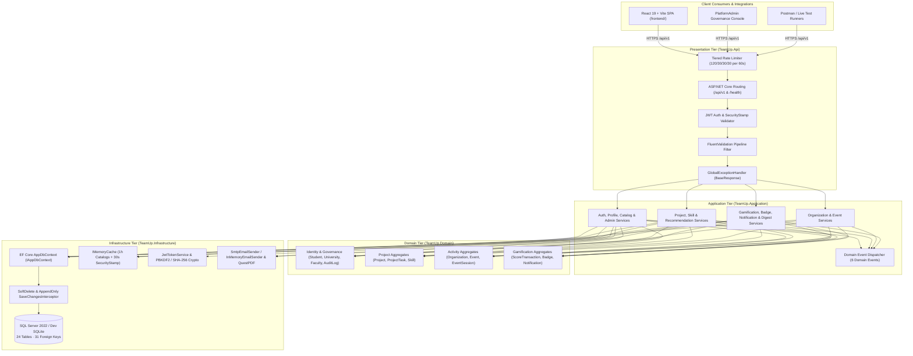

# TeamUp — System Overview

> **Platform Overview & Core Capability Map** · Clean Architecture .NET 10 Web API & React 19 SPA for Academic Collaboration, Project Matchmaking, Campus Event Management & Gamification.

> **Sources:**
> - [README.md](../README.md)
> - [backend/TeamUp.sln](../backend/TeamUp.sln)
> - [backend/src/TeamUp.Api/Program.cs](../backend/src/TeamUp.Api/Program.cs)
> - [frontend/src/app/router.tsx](../frontend/src/app/router.tsx)
> - [docs/architecture/N-TIER-SOLID-ARCHITECTURE-PLAN.md](../docs/architecture/N-TIER-SOLID-ARCHITECTURE-PLAN.md)
> - [docs/security/STRIDE-THREAT-MODEL.md](../docs/security/STRIDE-THREAT-MODEL.md)

---

## Table of Contents

1. [What Is TeamUp](#what-is-teamup)
2. [Solution & Repository Layout](#solution--repository-layout)
3. [Core Capability Map (4 Modules / 16 Sub-Modules)](#core-capability-map-4-modules--16-sub-modules)
4. [System Context Diagram](#system-context-diagram)
5. [Key Platform Numbers](#key-platform-numbers)
6. [Where To Go Next](#where-to-go-next)

---

## What Is TeamUp

**TeamUp** is an enterprise-grade, student-centric academic collaboration and skill-building platform engineered for higher-education ecosystems. It bridges the gap between academic theory and real-world project delivery by uniting students, faculty clubs, and campus organizations into an integrated social-gamified network.

### Core Value Pillars:
- **Academic Identity & Cross-Faculty Networking:** Verified student profiles linked to university faculties, interest tags, uploaded portraits, portfolios, and master skills.
- **Cross-Functional Team Formation:** Student-led project creation with required skill matrices, skill-based project recommendations, vacancy recruitment, application vetting, and Kanban sprint boards (`Todo`, `InProgress`, `InReview`, `Done`).
- **Student Organizations & Campus Activities:** Registered student organizations with scoped `OrgAdmin` committee rosters, recruitment seasons, and structured multi-session event calendars with capacity waitlists.
- **Verifiable Attendance & Gamification:** Rotating 60-second HMAC-SHA256 QR/PIN session check-ins, printable HTML attendance reports, idempotent `ScoreLedger` transactions, progressive levels, badge awards, campus leaderboard, and opt-in email digests.
- **Zero-Trust Platform Governance:** Role-based and tenant-scoped access control (`Student`, `OrgAdmin`, `PlatformAdmin`), `SecurityStamp` session validation, immutable `AuditLog` tracking, QuestPDF governance reports, and single-column soft-delete recovery.

---

## Solution & Repository Layout

The codebase is structured as a Clean Architecture backend solution paired with a modular React 19 SPA:

```text
TeamUp/
├── backend/
│   ├── TeamUp.sln                     # Visual Studio / Rider .NET 10 solution descriptor
│   ├── Directory.Build.props          # Shared build settings (Nullable, TreatWarningsAsErrors)
│   ├── src/
│   │   ├── TeamUp.Domain/             # Enterprise Entities, Invariants, Enums, Domain Events (0 dependencies)
│   │   ├── TeamUp.Application/        # Services, DTOs, FluentValidators, Security Guards, Event Handlers
│   │   ├── TeamUp.Infrastructure/     # EF Core AppDbContext, 9 Migrations, Interceptors, Seeders, QuestPDF, Email/HTML Templates
│   │   └── TeamUp.Api/                # ASP.NET Core 10 REST Controllers (19), Filters, Middleware, OpenAPI
│   └── tests/
│       ├── TeamUp.UnitTests/          # 117 Unit tests (Gamification, validators, interceptors, security)
│       └── TeamUp.IntegrationTests/   # 75 End-to-end integration tests via WebApplicationFactory & SQLite
├── frontend/                          # 🎨 React 19 + Vite 8 + TypeScript + Tailwind CSS v4 SPA
│   ├── src/                           # API client, modular router, UI kit, feature slices, 71 Vitest tests
│   └── e2e/                           # Playwright Chromium E2E smoke suite
├── assets/                            # 🖼️ Vector brand assets & official logo marks (SVG/PNG)
├── docs/                              # Architecture audits, STRIDE threat model, OpenAPI JSON, Postman, SQL script, AI research
├── wiki/                              # 📚 Comprehensive project documentation & operational guides
├── ERD/                               # Chen ERD specifications, SVG/PNG/Draw.io diagrams, generator scripts
├── Mapping/                           # Relational schema mapping (23 core tables, row-of-cells style), 3NF checks
├── tasks/                             # 20-Phase implementation roadmap and modular task checklists
├── scripts/                           # PowerShell live verification (test_live_api.ps1) & publish-monsterasp.ps1
├── CONTRIBUTING.md                    # Team ownership, branching conventions & EF Core rules
├── LICENSE                            # MIT License
├── netlify.toml                       # Netlify SPA build, fallback routing & CSP headers
└── dotnet-tools.json                  # Local dotnet-ef 10.0.14 tool manifest
```

### Frontend Route Surface (`frontend/src/app/routes/`)
- **Public & Community (`communityRoutes.tsx`):** `/` (Home + `MotionPreferenceControl`), `/privacy` & `/policy` (`PrivacyPolicyPage`), `/demo/hero` (`ProposedHeroDemo`), plus protected `/students`, `/students/:id`, `/profile/me`, `/leaderboard`, `/gamification`, and `/notifications`.
- **Auth & PlatformAdmin (`authRoutes.tsx`):** `/auth/login`, `/auth/register`, `/auth/forgot-password`, `/auth/reset-password`, and `/admin/*` (`dashboard`, `catalog`, `roles`, `restore`, `audit-logs`, `communications`).
- **Projects & Skills (`projectRoutes.tsx`):** `/skills`, `/projects`, `/projects/new`, `/projects/:id`.
- **Organizations & Events (`orgEventRoutes.tsx`):** `/organizations`, `/organizations/:id`, `/events`, `/events/:id`, `/events/:id/sessions/:sessionId/attendance`, `/check-in`.

---

## Core Capability Map (4 Modules / 16 Sub-Modules)

The platform is partitioned across 4 functional modules owned by designated team members:

| Module | Sub-Modules | Owner | Key Capabilities |
|---|---|---|---|
| **Module 01: Core Identity, Academic Catalog & Governance** | 1. Auth & Token Rotation<br/>2. Academic Catalog<br/>3. Student Discovery & Photos<br/>4. Platform Admin & Reports | **M1** (Tyson) | PBKDF2 password hashing, JWT Bearer tokens with `SecurityStamp` validation, SHA-256 refresh token rotation (10s reuse grace), escalating login lockout; 1-hr cached university & faculty lookups; privacy-aware student directory, showcase & photo upload; admin dashboard, `AuditLog`, QuestPDF reports, email template previews & soft-delete restore. |
| **Module 02: Skills, Projects & Sprint Task Management** | 5. Skills Master Catalog<br/>6. Student Claims<br/>7. Projects, Rosters & Matching<br/>8. Applications & Sprint Tasks | **M2** (Ossama) | Master skills hierarchy (1-hr cache); student skill claims (`Beginner`, `Intermediate`, `Advanced` + years); project creation with required skills & recommendations; applicant vetting workflow; project sprint tasks (`Todo`, `InProgress`, `InReview`, `Done`) with `+50 XP` completion & `+100 XP` delivery rewards. |
| **Module 03: Student Activities, Events & Attendance** | 9. Organizations & Boards<br/>10. Recruitment Seasons<br/>11. Multi-Session Events<br/>12. Rotating Check-In & Reports | **M3** (Ibrahim) | Student club management, scoped `OrgAdmin` authorization; membership application reviews; campus events with `RowVersion` capacity limits, multi-session timetables & waitlist auto-promotion; rotating 60s HMAC-SHA256 QR/PIN check-in (`+25 XP`) & printable HTML attendance reports. |
| **Module 04: Gamification, Badges & Alert Infrastructure** | 13. Append-Only Ledger<br/>14. Level Progression & Leaderboard<br/>15. Badge Engine<br/>16. Notifications & Digests | **M4** (Youssef) | Idempotent `ScoreLedger` on immutable `ScoreTransaction`; deterministic level formula; ranked campus leaderboard; automated badge evaluator (1-hr cached catalog); in-app notifications inbox; opt-in leaderboard & project-match email digests. |

---

## System Context Diagram



---

## Key Platform Numbers

| Metric | Measured Value | Verification Source |
|---|---|---|
| **Total REST Endpoints** | **116 Endpoints** (115 Controller Actions + `/health`) | [`docs/api/openapi.json`](../docs/api/openapi.json) · [`wiki/ROUTES-APPENDIX.md`](./ROUTES-APPENDIX.md) |
| **Runtime Relational Tables** | **24 Tables** (23 Core Domain Tables + `AuditLog`) | `AppDbContext` · `AppDbContextModelSnapshot.cs` |
| **Foreign Key Constraints** | **31 FKs** (100% `DeleteBehavior.Restrict` / `NO ACTION`) | `AppDbContextModelSnapshot.cs` · CI cascade gate |
| **Filtered Unique Indexes** | **11 Indexes** (10 soft-delete + 1 `ScoreTransaction` idempotency) | EF Core configurations · `AppDbContextModelSnapshot.cs` |
| **Database Check Constraints** | **20 CHECK Constraints** | `AppDbContextModelSnapshot.cs` |
| **EF Core Migrations** | **9 Migrations** | `backend/src/TeamUp.Infrastructure/Persistence/Migrations/` |
| **Automated Test Count** | **263 Passing Tests** (117 Unit + 75 Integration + 71 Frontend) + Playwright E2E | `dotnet test backend/TeamUp.sln` · `npm run test` |
| **Code Quality & Security** | **Grade A · 16/16 STRIDE Findings Remediated** | [`docs/architecture/CLEAN-CODE-AUDIT.md`](../docs/architecture/CLEAN-CODE-AUDIT.md) · [`docs/security/STRIDE-THREAT-MODEL.md`](../docs/security/STRIDE-THREAT-MODEL.md) |

---

## Where To Go Next

- **Ready to run locally?** Follow the [Getting Started Guide](./Getting%20Started%20Guide.md).
- **Understanding architecture & layers?** Read the [Architecture Overview](./Architecture.md).
- **Inspecting technologies & design decisions?** See [Technology Stack & Architecture](./Technology%20Stack%20%26%20Architecture.md).
- **Exploring service implementations?** Check [Backend Services](./Backend%20Services.md).
- **Reviewing database design & 3NF checks?** See [Database Design & Relational Mapping](./Database%20Design%20%26%20Relational%20Mapping.md).
- **Querying API endpoints?** Consult the [API Endpoints Reference](./API%20Endpoints%20Reference.md) and [Routes Appendix](./ROUTES-APPENDIX.md).
