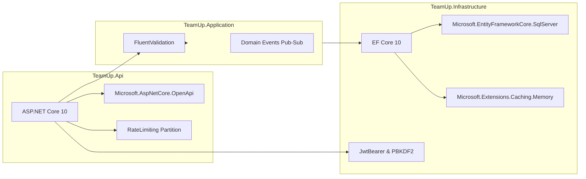

# TeamUp — Technology Stack & Architecture

> **Technology Stack Reference & Architecture Decision Records** · Framework specifications, package selections, data persistence topology, caching architecture, and performance optimizations.

> **Sources:**
> - [Directory.Build.props](../Directory.Build.props)
> - [src/TeamUp.Api/TeamUp.Api.csproj](../src/TeamUp.Api/TeamUp.Api.csproj)
> - [src/TeamUp.Application/TeamUp.Application.csproj](../src/TeamUp.Application/TeamUp.Application.csproj)
> - [src/TeamUp.Infrastructure/TeamUp.Infrastructure.csproj](../src/TeamUp.Infrastructure/TeamUp.Infrastructure.csproj)
> - [docs/architecture/CLEAN-CODE-AUDIT.md](../docs/architecture/CLEAN-CODE-AUDIT.md)

---

## Table of Contents

1. [Stack at a Glance](#stack-at-a-glance)
2. [Libraries & Design Rationales](#libraries--design-rationales)
3. [Data Persistence & Caching Topology](#data-persistence--caching-topology)
4. [Concurrency & Performance Tuning](#concurrency--performance-tuning)
5. [Version Notes & Operational Gotchas](#version-notes--operational-gotchas)

---

## Stack at a Glance

| Layer / Concern | Technology | Version / Target | Rationale |
|---|---|---|---|
| **Runtime & Language** | .NET 10 / C# 13 | `net10.0` | High-throughput web platform, modern pattern matching, native nullable reference types. |
| **Compiler Enforcements** | Roslyn Analyzers | `TreatWarningsAsErrors=true` | Zero-warning policy ensures enterprise grade code hygiene across all projects. |
| **Web API Framework** | ASP.NET Core Web API | `10.0.x` | Industry-standard RESTful HTTP framework with native pipeline middleware. |
| **Relational Database** | Microsoft SQL Server | 2022 (Linux Docker) | ACID compliance, filtered unique index support, robust check constraints. |
| **Object-Relational Mapper** | Entity Framework Core | `10.0.0` | Expressive LINQ queries, interceptors for soft-delete, code-first migrations. |
| **Authentication & Crypto** | JWT Bearer + PBKDF2 | HMAC-SHA256 / SHA-256 | Stateless claim verification with ASP.NET Core Identity PBKDF2 hashing. |
| **Input Validation** | FluentValidation.AspNetCore | `^11.3` | Clean decoupling of validation rules from DTOs, automated pipeline short-circuiting. |
| **Rate Limiting** | ASP.NET Core RateLimiter | Native .NET 10 | Fixed-window partitioned rate limiting defending auth endpoints against brute-force attacks. |
| **API Documentation** | Microsoft.AspNetCore.OpenApi | Native .NET 10 | OpenAPI v3 specification generation; pre-synced Postman test collections. |
| **Test Frameworks** | xUnit / FluentAssertions | Latest | Fluent assertions syntax and WebApplicationFactory integration testing. |

---

## Libraries & Design Rationales



### Key Architectural Choices:
1. **EF Core 10 `SaveChangesInterceptor` over Database Triggers:**
   Soft-deleting via application interceptors ensures database independence, uniform UTC timestamps, and testability within in-memory SQLite fixtures.
2. **Native OpenAPI over Swashbuckle:**
   .NET 10 features native, high-performance OpenAPI document extraction that eliminates reflection overhead and third-party version mismatch issues.
3. **Partitioned Fixed-Window Limiter:**
   Defines an IP-partitioned limiter (60 permits per minute) on the `/api/v1/auth/*` group, preventing brute-force password guessing without punishing legitimate cross-network student users.

---

## Data Persistence & Caching Topology

```mermaid
flowchart TD
    REQ[Client HTTP Request] --> API[ASP.NET Core Web API]
    API --> SVC[Application Service]

    subgraph CachingLayer["In-Memory Caching (IMemoryCache)"]
        SVC -->|1. Check Cache| CACHE{Cached in Memory?}
        CACHE -->|Yes: Hit| RET[Return Cached Catalog DTO]
    end

    subgraph PersistenceLayer["Relational Storage (SQL Server 2022)"]
        CACHE -->|No: Miss| DBCTX[AppDbContext (IAppDbContext)]
        DBCTX -->|2. AsNoTracking Query| SQL[(SQL Server 2022 DB)]
        SQL -->|3. Query Result| DBCTX
        DBCTX -->|4. Populate Cache| CACHE
    end

    RET --> RES[HTTP Response 200 OK]
    DBCTX --> RES
```

- **In-Memory Caching:** Public academic catalogs (Universities & Faculties list at `/api/v1/universities/catalog`) are cached in memory using `IMemoryCache` with a 30-minute sliding expiration. Cache entries are invalidated on administrative CRUD mutations.
- **Read Optimization:** All read-only queries enforce `.AsNoTracking()`, avoiding EF Core change tracker allocation overhead.

---

## Concurrency & Performance Tuning

1. **Optimistic Concurrency:**
   High-traffic operations (e.g., student workshop session registrations) verify capacity using optimistic concurrency tokens (`RowVersion`) to eliminate race conditions without database table locks.
2. **Database Connection Resilience:**
   The SQL Server provider is configured with transient fault retry policies:
   ```csharp
   options.UseSqlServer(connectionString, sql =>
   {
       sql.EnableRetryOnFailure(maxRetryCount: 5, maxRetryDelay: TimeSpan.FromSeconds(30), errorNumbersToAdd: null);
   });
   ```
3. **Filtered Unique Indexes:**
   All ten unique constraints enforce `WHERE [DeletedAt] IS NULL`, permitting students to re-use soft-deleted usernames, emails, or project titles without violating primary key integrity.

---

## Version Notes & Operational Gotchas

| Issue | Root Cause | Solution |
|---|---|---|
| **SQL Server Port Collision** | Default port `1433` occupied by local service. | Docker mapping configured to port `14333` (`-p 14333:1433`). |
| **EF Core Filter Warnings** | Querying soft-deleted navigation properties. | Use `.IgnoreQueryFilters()` exclusively inside administrative restore endpoints. |
| **Strict Nullable Warnings** | `Nullable=enable` flag active in solution. | All DTOs and entity models must declare explicit nullable types (`string?`) or default initializers. |
