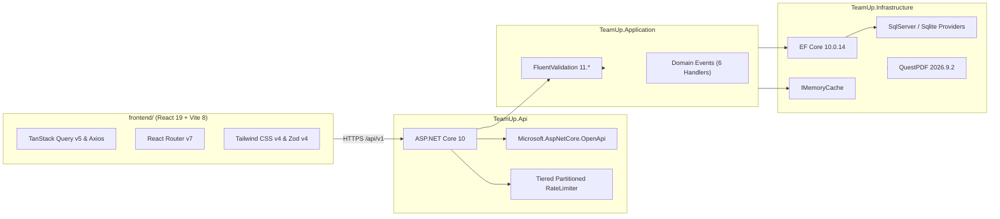
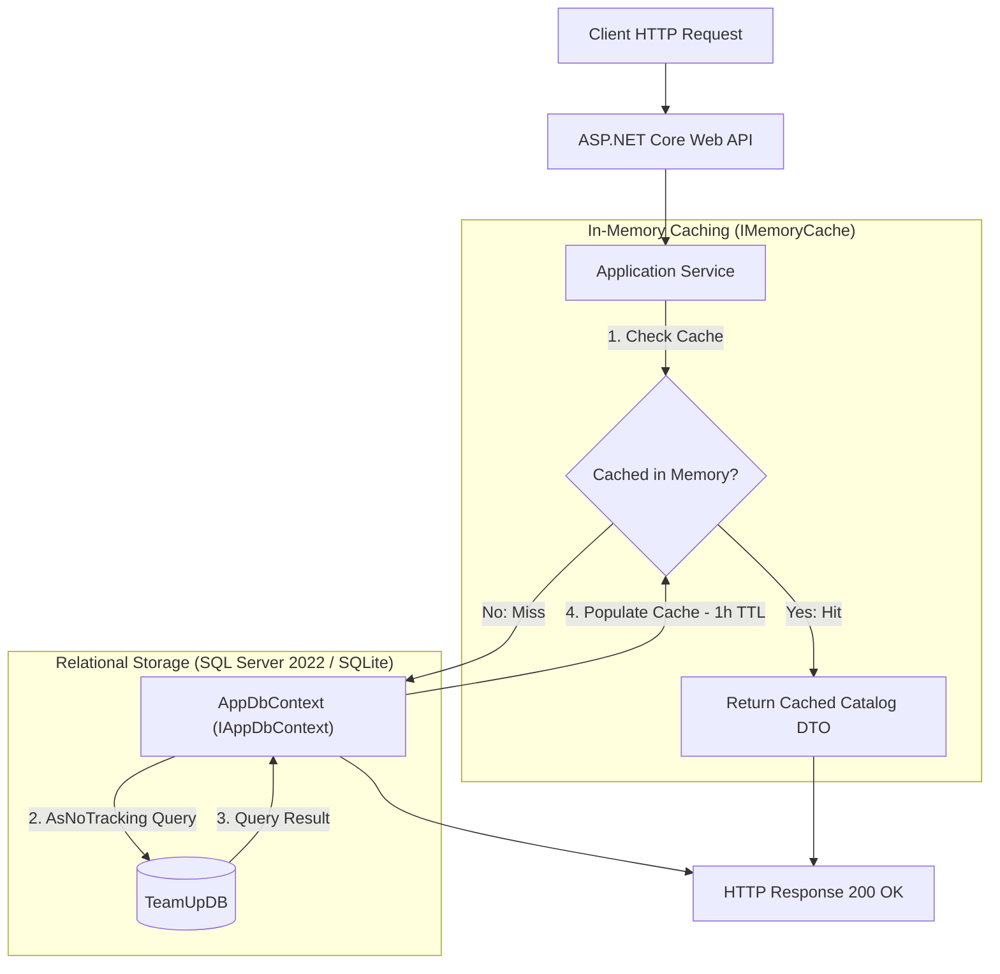

# TeamUp — Technology Stack & Architecture

> **Technology Stack Reference & Architecture Decision Records** · Backend and frontend framework specifications, NuGet/npm dependencies, caching topology, rate limiting, and concurrency optimizations.

> **Sources:**
> - [backend/Directory.Build.props](../backend/Directory.Build.props)
> - [backend/src/TeamUp.Api/TeamUp.Api.csproj](../backend/src/TeamUp.Api/TeamUp.Api.csproj)
> - [backend/src/TeamUp.Application/TeamUp.Application.csproj](../backend/src/TeamUp.Application/TeamUp.Application.csproj)
> - [backend/src/TeamUp.Infrastructure/TeamUp.Infrastructure.csproj](../backend/src/TeamUp.Infrastructure/TeamUp.Infrastructure.csproj)
> - [frontend/package.json](../frontend/package.json)
> - [frontend/vite.config.ts](../frontend/vite.config.ts)

---

## Table of Contents

1. [Backend Stack at a Glance](#backend-stack-at-a-glance)
2. [Frontend Stack at a Glance](#frontend-stack-at-a-glance)
3. [Libraries & Design Rationales](#libraries--design-rationales)
4. [Data Persistence & Caching Topology](#data-persistence--caching-topology)
5. [Concurrency & Performance Tuning](#concurrency--performance-tuning)
6. [Version Notes & Operational Gotchas](#version-notes--operational-gotchas)

---

## Backend Stack at a Glance

| Layer / Concern | Technology | Version / Target | Rationale |
|---|---|---|---|
| **Runtime & Language** | .NET 10 / C# 14 | `net10.0` (`LangVersion: latest`) | High-throughput web platform, modern pattern matching, primary constructors, native nullable reference types. |
| **Compiler Enforcements** | Roslyn Analyzers | `TreatWarningsAsErrors=true` | Zero-warning policy enforces strict code hygiene across all projects (`NU1901–NU1904` excluded). |
| **Web API Framework** | ASP.NET Core Web API | `10.0.14` | Pure JSON REST API (`/api/v1/*` + `/health`) with native filters, middleware, and exception handling. |
| **Relational Database** | Microsoft SQL Server / SQLite | SQL Server 2022 (Prod/Dev) · SQLite (Dev fallback & Tests) | ACID compliance, filtered unique indexes, and CHECK constraints in SQL Server; zero-config fallback in Dev/CI. |
| **Object-Relational Mapper** | Entity Framework Core | `10.0.14` | Expressive LINQ queries, `SaveChangesInterceptor` soft-delete/append-only guards, 9 code-first migrations. |
| **Authentication & Crypto** | JWT Bearer + PBKDF2 | `10.0.14` / HMAC-SHA256 / SHA-256 | Stateless JWT claims validated against `SecurityStamp`, PBKDF2 password hashing, SHA-256 refresh/reset tokens. |
| **Input Validation** | FluentValidation (`DependencyInjectionExtensions`) | `11.*` | Clean decoupling of validation rules from DTOs, automatic pipeline short-circuiting via `ValidationFilter`. |
| **Rate Limiting** | ASP.NET Core RateLimiter | Native .NET 10 | Tiered fixed-window partitioned rate limiters (`120/30/30/30` per 60s window). |
| **PDF & Templates** | QuestPDF + Embedded HTML Templates | `QuestPDF 2026.9.2` | Generates governance summary PDFs and renders embedded email/attendance report HTML templates. |
| **API Documentation** | Microsoft.AspNetCore.OpenApi | `10.0.14` | Native OpenAPI v3 specification generation exported to [`docs/api/openapi.json`](../docs/api/openapi.json). |
| **Test Frameworks** | xUnit + `Mvc.Testing` + `coverlet` | `xunit 2.9.3` / `Mvc.Testing 10.0.14` | 117 unit tests and 75 isolated SQLite `WebApplicationFactory` integration tests. |

---

## Frontend Stack at a Glance

| Layer / Concern | Technology | Version | Role in TeamUp SPA (`frontend/`) |
|---|---|---|---|
| **UI Framework** | React & React DOM | `19.3.1` | Component-driven functional SPA with lazy-loaded route splitting. |
| **Build Tooling & Language** | Vite + TypeScript | `Vite 8.3.6` · `TypeScript ~7.0.2` | Fast HMR dev server (`:5173`), `/api` proxy to `:5186`, strict `tsc --noEmit` build check. |
| **Styling System** | Tailwind CSS v4 (`@tailwindcss/vite`) | `4.3.5` | Utility-first styling, dark editorial palette, electric lime tokens (`#d3fb52`), reduced-motion support. |
| **Routing & Server State** | React Router v7 + TanStack Query v5 | `7.18.6` / `5.108.2` | Modular 4-developer route fragments (`authRoutes`, `communityRoutes`, `projectRoutes`, `orgEventRoutes`) and cached query invalidation. |
| **HTTP, Forms & Validation** | Axios + React Hook Form + Zod v4 | `1.21.1` / `7.92.0` / `4.6.7` | Typed `/api/v1/*` client with automatic single-flight refresh token retry and client-side schema validation. |
| **UI Utilities** | Lucide Icons + Sonner + `qrcode.react` | `1.77.0` / `2.0.8` / `4.2.0` | Iconography, toast notifications, and live rotating QR attendance check-in rendering. |
| **Frontend & E2E Testing** | Vitest 5 + Testing Library + Playwright | `vitest 5.1.1` / `@playwright/test 1.65.1` | 71 Vitest unit/component tests (`happy-dom`) + Chromium E2E smoke suite against live API. |

---

## Libraries & Design Rationales



### Key Architectural Choices:
1. **EF Core 10 `SaveChangesInterceptor` over Database Triggers:**
   Soft-deleting via [`SoftDeleteInterceptor`](../backend/src/TeamUp.Infrastructure/Persistence/SoftDeleteInterceptor.cs) ensures database independence, uniform UTC timestamps, `IAppendOnly` enforcement, and identical behavior across SQL Server and SQLite test fixtures.
2. **Native OpenAPI over Swashbuckle:**
   .NET 10 provides native, high-performance OpenAPI v3 document extraction (`app.MapOpenApi()` in Development), avoiding third-party schema reflection mismatches.
3. **Tiered Partitioned Rate Limiting (`Program.cs`):**
   Configures global fixed-window limits (`120 req/min` per authenticated `StudentId`, `30 req/min` per anonymous `RemoteIpAddress`, `/health` exempt), plus stricter `auth-policy` (`30 req/min` per IP on `/api/v1/auth/*`) and `directory-policy` (`30 req/min` on `GET /api/v1/students`) limits.

---

## Data Persistence & Caching Topology



- **Catalog Caching (`CatalogCacheKeys`):** Three high-read reference catalogs are cached in `IMemoryCache` with a **1-hour TTL** (`TimeSpan.FromHours(1)`):
  - `catalog:universities:academic` (`/api/v1/universities/catalog`) — invalidated by `UniversityService`, `FacultyService`, and `AdminService.RestoreEntityAsync`.
  - `catalog:skills:all` (unfiltered `GET /api/v1/skills`) — invalidated by `SkillService` and `AdminService.RestoreEntityAsync`.
  - `catalog:badges:all` (`GET /api/v1/badges`) — invalidated by `BadgeService` and `AdminService.RestoreEntityAsync`.
- **SecurityStamp Caching (`SecurityStampValidator`):** Caches active student `(SecurityStamp, Role)` for **30 seconds** (`auth:security-stamp:{studentId}`) and invalidates immediately on logout, password reset, role change, or account soft-delete.
- **Read Optimization:** Read-only queries use `.AsNoTracking()` to avoid EF Core change-tracker allocation overhead.

---

## Concurrency & Performance Tuning

1. **Optimistic Concurrency (`RowVersion`):**
   `Project` and `Event` include `RowVersion` (`IsRowVersion()` in SQL Server; generated GUID bytes in SQLite via `SoftDeleteInterceptor`) to protect seat capacity and project mutations against lost updates without coarse table locks (`DbUpdateConcurrencyException` maps to `409 Conflict`).
2. **Database Connection Resilience:**
   The SQL Server provider configures transient fault retry policies in [`DependencyInjection.cs`](../backend/src/TeamUp.Infrastructure/DependencyInjection.cs):
   ```csharp
   options.UseSqlServer(cs, sql => sql.EnableRetryOnFailure())
       .AddInterceptors(sp.GetRequiredService<SoftDeleteInterceptor>());
   ```
3. **Filtered Unique Indexes:**
   The schema defines **11 filtered unique indexes**: 10 soft-delete/pending-application indexes (`WHERE [DeletedAt] IS NULL` or `[DeletedAt] IS NULL AND [Status] = 'Pending'`) plus 1 idempotent XP award index on `ScoreTransaction(StudentId, SourceType, SourceReferenceId) WHERE [SourceReferenceId] IS NOT NULL`.

---

## Version Notes & Operational Gotchas

| Issue | Root Cause | Solution |
|---|---|---|
| **SQL Server Port Collision** | Default port `1433` occupied by local SQL Server. | Docker container maps host port `14333` (`-p 14333:1433`). |
| **Offline Dev Startup** | SQL Server container stopped during local frontend/API work. | `UseSqliteFallbackIfOffline: true` in `appsettings.Development.json` falls back to `TeamUp.dev.db`. |
| **EF Core Query Filters** | Normal queries hide soft-deleted rows (`DeletedAt != null`). | Use `.IgnoreQueryFilters()` strictly inside `AdminService` restore/listing and `DbSeeder` uniqueness checks. |
| **Strict Nullable & Warnings** | `Nullable=enable` and `TreatWarningsAsErrors=true` in `Directory.Build.props`. | Declare explicit nullability (`string?`) or required initializers (`= null!`) on all models and DTOs. |
